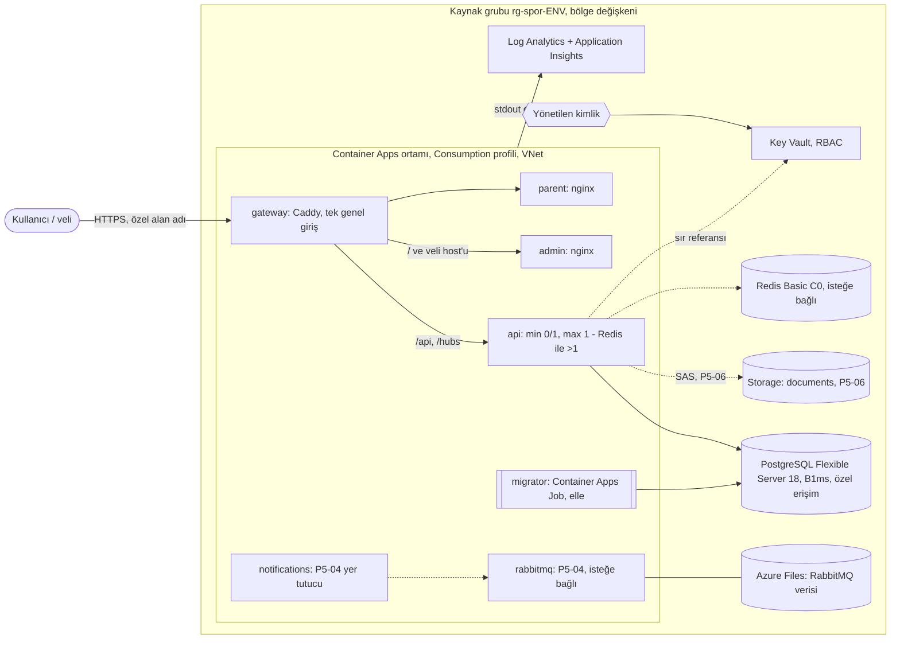

# Bulut altyapısı (Azure, OpenTofu)

P5-05. Kod `infra/` altında, karar [ADR-0015](adr/0015-altyapi-kodu-araci.md) (OpenTofu, Proposed), kayıtlar DEC-640 – DEC-649.
**Bu madde yalnız kodu ve belgeyi getirir.** Bulut hesabı yoktur; hiçbir kaynak oluşturulmadı, `plan`/`apply` hiç çalışmadı.
CI'da `tofu fmt`, `validate` ve Trivy `config` taraması çalışır; gerçek davranış ilk `plan`'da görülecektir.

## 1. Özet ve sahibe üç uyarı

1. **Bütçe tutmuyor.** NFR-CST-01 (Faz 5'e kadar staging + production en çok 20 USD/ay) bu mimariyle yaklaşık 4 – 5 kat aşılır
   (bölüm 5: staging ~27, production ~62, birlikte ~89 USD/ay, 2026-11-17 perakende fiyatlarıyla). Faz 5 bütçeyi gözden
   geçirmek içindir; karar sahibe aittir.
2. **Azure'da Türkiye bölgesi yok.** Azure'a gitmek ADR-0014'te "B" (yurt dışı barındırma) seçeneğini seçmek demektir, agent'in
   önerdiği "A" (Türkiye) değil. KVKK sonucu bölüm 6'dadır.
3. **Gerçek veriden önce kapatılması gereken iki açık var:** istemci IP'si (bölüm 7, ağ geçidi zinciri) ve yönetilen
   PostgreSQL'de yedek/RLS rollerinin doğrulanması (bölüm 8).

## 2. Mimari



- **Tek genel giriş `gateway`** (Caddy, compose'taki imajla aynı). SPA'lar API'yi kendi host'larında `/api` ve `/hubs` ile
  çağırır (ADR-0006, CORS kapalı) ve nginx imajları bu yollara bilerek `404` döner; bu yüzden bu yolları API'ye yönlendiren bir
  katman şarttır. `api`, `admin`, `parent` yalnız ortam içinden erişilir (internal ingress). Azure Front Door (~35 USD/ay taban)
  aynı işi görür ama bütçeyi daha da büyütür.
- **Ağ:** bir VNet, iki alt ağ: Container Apps (`/24`, `Microsoft.Storage` service endpoint) ve PostgreSQL (`/24`, delegasyonlu).
  PostgreSQL'in genel uç noktası ve güvenlik duvarı kuralı yoktur; özel DNS bölgesi ve VNet bağlantısıyla erişilir.
  Staging `10.41.0.0/16`, production `10.40.0.0/16` (ileride eşleşebilsin).

## 3. Kaynak listesi

| Kaynak | Modül | Not |
| --- | --- | --- |
| Resource group, etiketler | foundation / stack | Her kaynak `application`, `environment`, `managed-by`, `repository`, `data` etiketini taşır. |
| Log Analytics çalışma alanı | foundation | `PerGB2018`, 30 gün saklama, günlük kota (staging 0,2 GB, production 0,5 GB) maliyet sigortasıdır. |
| Application Insights | foundation | Çalışma alanı tabanlı. API yalnız OTLP gönderir (docs/gozlemlenebilirlik.md); App Insights'a veri, OTLP→Azure Monitor dönüştüren bir collector kurulunca akar (bölüm 9). Bağlantı dizisi çıktıdır (hassas). |
| Kullanıcı atamalı yönetilen kimlik | foundation | Bütün uygulamalar ve iş bunu kullanır: Key Vault'tan sır okur (`Key Vault Secrets User`), Blob'a erişir (`Storage Blob Data Contributor`). |
| Key Vault (RBAC) | foundation | Erişim ilkesi yok, yalnız rol. Production'da `purge protection` ve 90 gün; staging'de kapalı (yeniden kurulabilsin). |
| VNet, alt ağlar, özel DNS bölgesi | foundation | Yukarıda. |
| PostgreSQL Flexible Server | data | Sürüm 18 (bölüm 8), `B_Standard_B1ms`, 32 GB, otomatik büyüme kapalı, özel erişim, yedek saklama staging 7 / production 30 gün (NFR-REL-03), coğrafi yedek kapalı. `azure.extensions=PG_STAT_STATEMENTS`, `shared_preload_libraries=pg_stat_statements`, `pg_stat_statements.track=top`, `track_utility=off` (rol betiği parola içeren SQL çalıştırır). `spor_akademi` veritabanı. |
| Storage hesabı `documents` + `documents` konteyneri | data | Belge deposu (P5-06). Anonim erişim yok, **hesap anahtarları kapalı**, TLS 1.2, sürümleme ve 7 gün yumuşak silme. Erişim yalnız Entra ID ile (kullanıcı delegasyonlu SAS). |
| Storage hesabı + Azure Files paylaşımı (RabbitMQ) | data | Yalnız `enable_rabbitmq` ile. Container Apps bağlamayı hesap anahtarıyla yapar (yönetilen kimlik desteklenmiyor), bu yüzden ayrı hesap; güvenlik duvarı yalnız uygulamalar alt ağına açık. |
| Redis Cache Basic C0 | data | Yalnız `enable_redis` ile (varsayılan kapalı, bölüm 5). |
| Container Apps ortamı | apps | Yalnız Consumption profili: çalışan kopya yokken kaynak faturası yok. |
| `api` | apps | İç giriş, hedef port 8080, `/health/live` başlangıç + canlılık, `/health/ready` hazırlık sondası, HTTP ölçek kuralı (100 eşzamanlı istek), SignalR için çerez afinitesi (`session_affinity_enabled`). Sırlar Key Vault'tan: `ConnectionStrings__App`, `Jwt__SigningKey` (+ `ConnectionStrings__Cache`). `ForwardedHeaders__KnownNetworks__0` = uygulamalar alt ağı (DEC-507). `AllowedHosts` değişkenden. |
| `admin`, `parent` | apps | nginx imajları, iç giriş, `/index.html` sondası. `admin` için `STORAGE_PUBLIC_ORIGIN` = Blob uç noktası. |
| `gateway` | apps | Tek dış giriş. `/healthz` yanıtlar, `/health/*` yolunu dışarıya `404` verir. |
| `migrator` işi | apps | Container Apps Job, elle tetiklenir (`az containerapp job start`). `ConnectionStrings__Migrator` Key Vault'tan. Bir API sürümünden önce çalıştırılır (migrator imajı, ADR-0011). |
| `rabbitmq` | apps | Yalnız `enable_rabbitmq`. Tek kopya, Azure Files, iç TCP giriş (5672). |
| `notifications` | apps | P5-04 işçisi için yer tutucu; `enable_notifications_worker` kapalı. |

İmajlar CI'ın GHCR'ye bastığı `ghcr.io/<sahip>/spor-akademi-v2-{api,migrator,admin,parent}:<commit SHA>` adreslerinden gelir;
`latest` kullanılmaz (`image_tag` zorunlu). Paketler özelse `registry_username` verilir ve `ghcr-pull-token` sırrı gerekir.

### Sırlar (Key Vault'ta; kodda yok, state'te yalnız bir istisna)

İstisna: RabbitMQ'nun Azure Files anahtarı (`azurerm_container_app_environment_storage.access_key`) Container Apps bağlaması için gerekir ve **state'e yazılır**; state özel ve şifreli olmalıdır (bölüm 8). Öteki sırlar state'e girmez.

| Sır | Kim yazar | İçerik |
| --- | --- | --- |
| `postgres-admin-password` | `tofu` (geçici kaynak + write-only; state'e girmez) | `sa_admin` parolası; yalnız rol kurulumu ve acil durum |
| `conn-app` | sahip | `Host=<postgres_fqdn>;Database=spor_akademi;Username=spor_akademi_app;Password=...;SSL Mode=Require` |
| `conn-migrator` | sahip | Aynı, `spor_akademi_migrator` rolüyle |
| `jwt-signing-key` | sahip | **64 karakter onaltılık (hex)**, 32 bayt rastgele: `openssl rand -hex 32` (JWT anahtarı döndürme runbook'u: DEC-518) |
| `conn-cache` | sahip | Yalnız Redis açıksa: `<host>:6380,password=...,ssl=True` |
| `rabbitmq-password` | sahip | Yalnız RabbitMQ açıksa |
| `conn-rabbitmq` | sahip | Yalnız RabbitMQ açıksa: `amqp://spor_akademi:<rabbitmq-password>@rabbitmq:5672/` (API ve bildirim worker'ı bunu `ConnectionStrings__RabbitMq` olarak okur) |
| `ghcr-pull-token` | sahip | Yalnız özel paketlerde; `read:packages` |
| e-posta, ödeme, Sentry | sahip | `extra_secret_env` değişkeniyle bağlanır (ortam değişkeni adı → sır adı) |
| SMTP parolası | sahip | `email_secret_env` ile bağlanır (ör. `Email__Smtp__Password` → `smtp-password`); API ve bildirim worker'ı ikisi de okur. Gönderen adresi ve SMTP ana bilgisayarı `email_env` ile (sır değil) |

## 4. Ortamlar ve çalıştırma

`envs/staging` ve `envs/production` iki ayrı kök modüldür; ikisi de `modules/stack`'i çağırır, fark yalnız değerlerdedir
(boyut, saklama süresi, silme koruması, alan adları). Workspace kullanılmadı: ayrı state, ayrı yetki, bir ortamdaki yanlış
`apply`'ın ötekine dokunamaması (DEC-643).

```
cd infra/envs/staging
export TF_VAR_subscription_id=<abonelik kimliği>
tofu init                      # uzak state yapılandırıldıysa (backend.tf)
tofu plan  -var image_tag=<commit SHA>
tofu apply -var image_tag=<commit SHA>      # ilk uygulama: deploy_apps=false (varsayılan)
```

`backend.tf` yorum satırı hâlindeki bir `azurerm` backend örneğidir (state için ayrı, elle kurulan, özel bir Storage hesabı;
Entra kimliğiyle erişim). Doldurmak sahibe aittir. Sağlayıcı kilit dosyaları (`.terraform.lock.hcl`) commit'lidir.

## 5. Aylık maliyet tahmini

> **Tahmin, kesin değil.** Fiyatlar 2026-11-17'de Azure Retail Prices API'sinden (`prices.azure.com/api/retail/prices`,
> bölge `westeurope`, USD, tüketim fiyatı, vergisiz) alındı; kullanım varsayımları aşağıda. Özel anlaşma, rezervasyon ve
> ücretsiz kotalar (Container Apps'te abonelik başına ayda 180 000 vCPU-sn, 360 000 GiB-sn, 2 milyon istek) hesaba **katılmadı**
> (toplam en çok ~3 USD düşürür). Karar öncesi Azure fiyat hesaplayıcısıyla doğrulanmalı.

Birim fiyatlar: PostgreSQL B1ms 0,0199 USD/saat; PostgreSQL depolama 0,1369 USD/GB-ay; Container Apps boşta (idle) vCPU
0,000004 USD/sn ve bellek 0,000004 USD/GiB-sn, aktif vCPU 0,000034 USD/sn; Redis Basic C0 0,022 USD/saat; Blob Hot LRS
0,0196 USD/GB-ay; Log Analytics alım 2,99 USD/GB (ilk 5 GB ücretsiz); Key Vault 0,03 USD/10 000 işlem.
Bir ay = 730 saat = 2 628 000 sn. Özel DNS bölgesi 0,50 USD/ay (yayınlanmış liste fiyatı, API'den doğrulanmadı).

| Kalem | Varsayım | Staging | Production |
| --- | --- | ---: | ---: |
| PostgreSQL B1ms | 730 saat | 14,5 | 14,5 |
| PostgreSQL depolama | 32 GB | 4,4 | 4,4 |
| `api` | 0,5 vCPU + 1 GiB. Production: hep açık, %5 aktif. Staging: 0'a iner, ayda ~40 saat aktif | 3,0 | 17,7 |
| `admin`, `parent`, `gateway` | 0,25 vCPU + 0,5 GiB; production hep açık (3 × 7,9), staging 0'a iner (3 × 1,5) | 4,5 | 23,7 |
| Log Analytics | Tipik 1 – 3 GB/ay, ücretsiz 5 GB içinde | 0 | 0 |
| Key Vault, Blob (~20 GB), özel DNS, VNet | Küçük işlemler | 0,7 | 2,0 |
| **Toplam (RabbitMQ ve Redis kapalı)** | | **~27** | **~62** |
| İsteğe bağlı: RabbitMQ (`enable_rabbitmq`) | 0,25 vCPU + 0,5 GiB hep açık (7,9) + Azure Files (~1) | +9 | +9 |
| İsteğe bağlı: Redis Basic C0 (`enable_redis`) | 0,022 × 730 | +16 | +16 |
| Üst sınır riski: Container Apps ortam ücreti | Fiyat listesinde 2026-11-01'den beri "Environment Management Hour" 0,1 USD/saat kalemi var. Hangi ortam türüne uygulandığı doğrulanamadı; her ortama uygulanırsa ortam başına +73 | +73? | +73? |

**Bütçeyle karşılaştırma (NFR-CST-01, 20 USD/ay, ikisi birlikte):**

| Senaryo | Aylık toplam | Bütçe katı |
| --- | ---: | ---: |
| Bugünkü kod, RabbitMQ ve Redis kapalı | ~89 | 4,5 × |
| + RabbitMQ (P5-04) ve Redis (çoklu kopya), yalnız production | ~114 | 5,7 × |
| Ortam ücreti her ortama uygulanırsa (en kötü), ilk satıra ek | +146 (toplam ~235) | 12 × |
| Staging yalnız gerektiğinde kurulur (`tofu destroy`, kullanılmayan günlerde 0) ve production'da `admin`/`parent`/`gateway` 0'a iner | ~45 – 50 | 2,3 × |

En büyük iki kalem değiştirilemez: yönetilen PostgreSQL (~19 USD) ve `api`'nin hep açık bir kopyası (~18 USD) tek başına
bütçeyi neredeyse bitirir. 20 USD/ay yalnız tek VPS ile tutar (DEC-087, ADR-0014 seçenek A/B). Sahibin seçenekleri:
(a) bütçeyi Faz 5 için yükseltmek (öneri: staging ~27, production ~62 USD yi kabul etmek), (b) Azure'u yalnız production için
kullanıp staging'i VPS'te tutmak, (c) Azure'dan vazgeçip aynı kodu başka bir sağlayıcıya uyarlamak (araç aynı kalır).

### Neden bu maliyet kararları

- **Container Apps (Consumption) seçildi, AKS, App Service ve VM değil:** AKS'in kontrol düzlemi ve düğüm havuzu tek başına
  bütçenin üstünde; App Service B1 (~13 USD) çok kapsayıcılı yapıya, iş (job) ve iç TCP girişe uymuyor; VM, bugünkü VPS'in
  Azure'daki aynısı ve yönetilen hizmet kazancı yok. Container Apps compose'taki yapıya en yakınıdır ve 0'a iner.
- **PostgreSQL B1ms Burstable:** yük testi (docs/performans.md) tek kopya için yeterli bir tabana işaret etti; B1ms ve 32 GB
  başlangıçtır, `postgres_sku_name` ile büyür. CPU kredisi biterse yavaşlar; production'da bu izlenmeli (bölüm 9).
- **Redis varsayılan kapalı** (aşağıda). **RabbitMQ varsayılan kapalı:** tüketicisi (P5-04) henüz yok.

## 6. Veri konumu ve KVKK (ADR-0014)

**Azure'un Türkiye'de bölgesi yok** (bu belgenin yazıldığı tarihte bilinen durum; sahip teyit etmeli). En yakın seçenekler
Batı Avrupa (`westeurope`, Hollanda) ve Almanya Batı-Orta (`germanywestcentral`, Frankfurt); bölge `location` değişkenidir
(`envs/*/main.tf`, varsayılan `westeurope`, bir yer tutucudur, karar değildir). Sonuçları:

- ADR-0014'ün agent önerisi **A (Türkiye'de barındırma)** Azure ile mümkün değildir. Azure seçimi **B (AB'de barındırma,
  standart sözleşmeyle)** demektir: KVKK md. 9 gereği yurt dışına aktarım için Kurul'un standart sözleşmesi imzalanır ve **5 iş
  günü içinde Kurul'a bildirilir**; aydınlatma metninin "Aktarım" bölümü ülke ve sağlayıcı adıyla güncellenir; sorumluluk
  okulda (veri sorumlusu) kalır, sözleşme yükü platform sahibinde toplanabilir. Çocuk verisi ve **özel nitelikli sağlık
  raporları** işlendiği için Kurul ve velilerin hassasiyeti yüksektir. Hukuki teyit sahibindedir.
- Kod bunu zorlayacak şekilde kurulur: **coğrafi yedek kapalı** (`postgres_geo_redundant_backup = false`): yedek eşlenmiş
  ikinci bölgeye kopyalanmaz, çünkü ikinci bir yurt dışı konum daha demektir. Blob `LRS`, Log Analytics ve App Insights aynı bölgede.
  Dayanıklılık maliyeti: bölge çökerse yedekten başka bölgeye geri yükleme elle ve saatler sürer (tatbikat: docs/geri-yukleme-tatbikati.md).
- Azure'a geçmek **Faz 5'te Deploy bloğunu** gerektirir; ADR-0014 "gerçek veri öncesi karar" olarak açık kalır. Karar A'ya dönerse
  `infra/`'nın modülleri Azure'a özgüdür; araç (OpenTofu) ve imajlar taşınabilir.
- Loglar ve izler kişisel veri taşımaz (NFR-PRV-03); yine de Log Analytics'e giden stdout'un bu kuralı sağladığı ilk
  staging'de örneklenerek doğrulanmalıdır.

## 7. Çalışma zamanı gereksinimleri ve nasıl karşılandı

| Gereksinim (belge) | Çözüm | Açık |
| --- | --- | --- |
| **SignalR afinitesi** (performans.md, DEC-565) | `api` girişinde `session_affinity_enabled`; çoklu kopya için Redis geri düzlemi zorunlu. `api_max_replicas > 1` iken `enable_redis` kapalıysa `plan` hata verir (`precondition`). | Afinite çerezi gateway'den geçer; ilk staging'de negotiate + WebSocket'in aynı kopyaya gittiği doğrulanmalı. |
| **KnownProxies / KnownNetworks** (DEC-507) | API'ye `ForwardedHeaders__KnownNetworks__0` = uygulamalar alt ağı verilir; başka kimseye güvenilmez. | **Açık (DEC-644):** `ForwardLimit` kodda `1` sabit. İstek iki vekilden geçer (gateway girişi → Caddy → `api` girişi); API istemci IP'si olarak Caddy'nin adresini görür, oran sınırı ve kilitlenme IP'ye göre bozulur. Çözüm bir kod değişikliğidir (`ForwardedHeaders:ForwardLimit` ayarı, Azure'da `2`) ve ayrı bir iş olarak açılmalıdır; gerçek veriden önce şart. |
| **Sağlık sondaları** | Canlılık/başlangıç `/health/live`, hazırlık `/health/ready` | `/health/ready` veritabanını sorar: veritabanı kopunca bütün kopyalar trafikten çıkar (beklenen). |
| **`pg_stat_statements`** | Sunucu parametreleri yukarıdaki gibi; `CREATE EXTENSION` sahibe (liste) | Önyükleme parametresi sunucuyu bir kez yeniden başlatır. |
| **Yedek rolü, WAL/PITR** (geri-yukleme-tatbikati.md) | Platform yedeği ve zamana geri dönüş (PITR) staging 7 / production 30 gün; `archive_command` ve WAL betikleri **kullanılmaz** (yönetilen sunucuda yazılamaz). | `spor_akademi_backup_dump` rolü `BYPASSRLS` ister; yönetilen sunucuda yönetici rolün bunu verip veremediği doğrulanmadı (bölüm 8). Mantıksal yedek (`pg_dump`) için ayrı bir taşınabilir kopya hâlâ tavsiye edilir. |
| **Migration'lar** (ADR-0011) | `migrator` işi, ayrı bağlantı dizisi (migrator rolü) | Uygulama rolü ile aynı sunucu; roller sahibin betiğiyle kurulur. |
| **Tek örnekli işler** | Hangfire ve outbox işleri API içinde çalışır; 2 kopyada çift çalışma riski için `api_max_replicas = 1` varsayılan | Çoklu kopyaya geçişte Hangfire/outbox kilidi (P4-08 bulguları) yeniden gözden geçirilmeli. |

## 8. Bilinen riskler ve varsayımlar

- **PostgreSQL 18:** `version = "18"` yazıldı (compose ve testler 18 çalıştırır). `azurerm` 5.14 şemada sürümü serbest metin kabul
  eder; Azure'un seçilen bölgede 18'i sunup sunmadığı ilk `plan`/`apply`'da anlaşılır. Sunmuyorsa en yüksek desteklenen sürüme
  inilir (`postgres_version`), nedeni bu belgeye yazılır ve uygulamanın 18'e özgü bir şey kullanmadığı testlerle teyit edilir.
- **Yönetilen PostgreSQL'de roller:** `BYPASSRLS` ve `pg_read_all_data` üyeliği yönetilen sunucuda kısıtlı olabilir; yedek rolü ve
  `docker/postgres/initdb/10-create-roles.sh` mantığı yönetici rolle denenmeli. Başarısızsa mantıksal yedek yönetici rolle alınır
  ve ADR-0011 güncellenir.
- **RabbitMQ + SMB:** RabbitMQ'nun Mnesia verisi SMB üzerinde (kilit semantiği) kırılgan olabilir. Üretimde NFS paylaşımı
  (Premium FileStorage, daha pahalı) ya da kalıcılık gerektirmeyen kuyruklar (outbox kaynak gerçek olduğundan yeniden gönderilebilir)
  düşünülmeli. **Azure Service Bus** neden seçilmedi: AMQP 1.0 konuşur, RabbitMQ istemcisi (AMQP 0-9-1) ve P5-04'ün varsayımı
  uyuşmaz; istemci ve soyutlama değişir. Maliyeti düşük olurdu (Basic katman: milyon işlem başına cent), yönetilen ve yedekli
  olurdu; P5-04 aracı Service Bus'a çevirirse bu karar yeniden açılır (DEC-645).
- **Redis (Valkey yerine):** uygulama Redis protokolüyle konuşur ve compose'ta Valkey kullanılır; Azure'da Valkey yönetilen hizmet
  olarak yok. Azure Cache for Redis'in yeni örnekleri için kullanımdan kaldırma takvimi açıklandı; kalıcı çözüm Azure Managed
  Redis'tir (daha pahalı). Bu yüzden varsayılan **kapalı** ve tek kopya (bellek içi önbellek); çoklu kopya gerektiğinde açılır.
- **Key Vault ve Blob güvenlik duvarları:** ikisi de genel uç noktada, yalnız Entra ID/RBAC ile korunur; Trivy'nin `AZU-0013`
  (Key Vault) ve `AZU-0012` (Blob) bulguları gerekçesiyle koddaki `#trivy:ignore` satırlarında kabul edildi (DEC-641). Özel uç nokta
  (Key Vault için ~7 USD/ay) sonraki sıkılaştırma adımıdır.
- **Terraform state:** RabbitMQ'nun Azure Files anahtarı state'e girer (Container Apps ortam depolaması anahtar ister). State
  özel ve şifreli bir konteynerde, yalnız `apply` yetkililerine açık olmalı.
- **Doğrulanmadı:** hiçbir şey gerçek abonelikte denenmedi. Özellikle: `azurerm` 5'te alan adları (bazıları doğrulamada düzeltildi),
  Container Apps'in Key Vault sırlarını ilk başlatmada okuma zamanlaması (rol atamasının yayılması birkaç dakika sürebilir; ilk
  `apply` hata verirse yeniden denenir), `time_sleep` eklenmedi.

## 9. Gözlemlenebilirlik

- **Günlükler:** Container Apps her kapsayıcının stdout'unu (API'nin JSON günlükleri, `@tr` ile trace kimliği) Log Analytics'e
  yazar. Seq yerine KQL kullanılır. Günlük kotası maliyet sigortasıdır; kota dolarsa o gün günlük kaybolur.
- **İzler ve metrikler:** API'nin `OpenTelemetry:Otlp:Endpoint` ayarı yok ise telemetri kapalıdır (varsayılan). Seçenekler:
  (1) bir OTLP collector kapsayıcısı (`otel-collector-contrib`, Apache-2.0, Azure Monitor exporter ile) eklemek ve
  `otlp_endpoint` değişkenini ona vermek (Application Insights bu yolla dolar), (2) Jaeger/Prometheus'u compose'taki gibi
  çalıştırmak (daha çok kapsayıcı, daha çok maliyet). Karar ilk staging'den sonra; bu PR kaynağı (App Insights) hazırlar,
  collector'ı eklemez.
- **Alarmlar:** `docker/observability/alerts.yml` Prometheus kurallarıdır; Azure Monitor karşılıkları (sağlık, 5xx, gecikme,
  PostgreSQL CPU kredisi, depolama) yazılmadı; sahip bildirim kanalıyla birlikte karar verir.

## 10. İlk `apply` için sahip kontrol listesi

1. **Kararlar:** bölge (bölüm 6, ADR-0014), bütçe (bölüm 5), OpenTofu (ADR-0015), RabbitMQ barındırma (bölüm 8), Redis.
2. Azure aboneliği (gerçek veri için ayrı abonelik/yönetim grubu düşünülebilir) ve `apply` yapacak kullanıcı için `Owner` ya da
   `Contributor` + `User Access Administrator` (rol atamaları için). Hiçbir anahtar/parola depoya girmez.
3. `Microsoft.App`, `Microsoft.DBforPostgreSQL`, `Microsoft.OperationalInsights`, `Microsoft.KeyVault`, `Microsoft.Storage`,
   `Microsoft.Network` kaynak sağlayıcılarının kayıtlı olduğunu doğrula; bölgede PostgreSQL 18 ve B1ms kotası.
4. Uzak state: özel Storage hesabı + `tfstate` konteyneri (elle), `backend.tf` yorumunu aç, `tofu init`.
5. `GHCR` paketlerinin görünürlüğü: public ya da `registry_username` + `ghcr-pull-token`. RabbitMQ açılacaksa `rabbitmq_image`'ı `deploy_apps=true`'dan önce digest ile sabitle (varsayılan `rabbitmq:4-alpine` etikettir).
6. **Aşama 1:** `deploy_apps=false` ile `tofu plan` → incele → `tofu apply` (kimlik, Key Vault, ağ, PostgreSQL, depolama, Container Apps
   ortamı). Sunucu bir kez yeniden başlar (`pg_stat_statements`).
7. PostgreSQL'e VNet içinden bağlan (örn. geçici bir kapsayıcı ya da Azure Cloud Shell VNet entegrasyonu), `postgres-admin-password`
   ile rolleri kur (`10-create-roles.sh` mantığı), `CREATE EXTENSION pg_stat_statements`, yedek rollerini dene (bölüm 8).
8. Key Vault sırlarını yaz: `conn-app`, `conn-migrator`, `jwt-signing-key` (ve gerekene göre `conn-cache`, `rabbitmq-password`,
   `ghcr-pull-token`). Yazan kullanıcıya `Key Vault Secrets Officer` gerekir (apply eden kullanıcıya otomatik verilir).
9. **Aşama 2:** `deploy_apps=true` ile `plan` / `apply`. Ardından `az containerapp job start -n migrator -g rg-spor-<ortam>` ile
   migration'ları çalıştır; `api` hazır olunca `gateway_fqdn` çıktısına bak.
10. Alan adı: `parent_host` için (admin, öteki bütün host'ların varsayılan rotasıdır) DNS DNS `CNAME` → `gateway_fqdn`, `asuid` TXT → `custom_domain_verification_id`, Container
    Apps'te yönetilen sertifikalı özel alan adı (bu PR'da kodda yok; yalnız `gateway`'e eklenir). `allowed_hosts`'u gerçek host adlarına
    ayarla (DEC-516). `Email:AppBaseUrl` ve ödeme `CallbackUrl` ayarlarını bu adreslerle ver.
11. Production'da koruma: kaynak grubu kilidi (`CanNotDelete`), `purge protection` (açık), PITR geri yükleme tatbikatı bu
    sunucuda (docs/geri-yukleme-tatbikati.md), maliyet bütçesi ve uyarısı (Azure Cost Management, aylık eşik).
12. **Gerçek veri öncesi:** bölüm 7'deki `ForwardLimit` işi kapanmış, KVKK adımları (bölüm 6) tamamlanmış olmalı.

## 11. P5-06 için kalanlar

- **Azure Blob adaptörü** (`IDocumentStorage` karşılığı): `Azure.Storage.Blobs` (MIT) ile `DefaultAzureCredential`, kullanıcı delegasyonlu SAS
  (`Storage:DownloadLinkLifetime` ≤ 15 dk). Altyapı hazır: hesap, `documents` konteyneri, `Storage Blob Data Contributor` rolü. Yeni ayarlar
  (örn. `Storage__Provider=AzureBlob`, `Storage__AccountName`, `Storage__Container`) `extra_env` ile verilir; anahtar sırrı gerekmez.
- **Key Vault yapılandırması:** uygulama sırları şimdi Container Apps sır referansıdır (ortam değişkeni). Doğrudan `Azure.Extensions.AspNetCore.Configuration.Secrets`
  ile okumak gerekirse yönetilen kimliğin istemci kimliği `AZURE_CLIENT_ID` olarak verilmeli (modül çıktısı eklenir).
- Admin uygulamasının CSP `img-src` kuralı Blob uç noktasını (`STORAGE_PUBLIC_ORIGIN`) zaten alır.
- CORS: tarayıcı doğrudan Blob'dan indirecekse hesaba CORS kuralı gerekir (bugün indirme bağlantısı gezinti ya da `` olduğundan şart değil).
