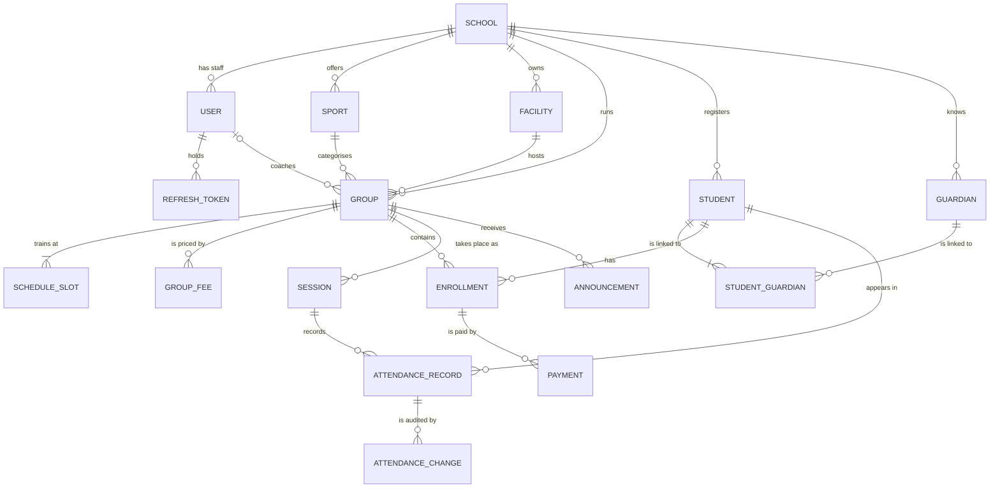

# Spor Akademi — Proje Dokümanı (Tek ve Kendine Yeten)

> **Anlık görüntü:** 2026-11-06 · Faz 1 (MVP) devam ediyor · Son sürüm etiketi `v0.0.1`
>
> Bu doküman, projeye ait tüm bilgileri tek başına içerir: ürün tanımı ve kullanıcı hikayeleri, domain modeli, gereksinimler, mimari ve mimari kararların gerekçeleri, API sözleşmesi ve hata kodları, karar günlüğünün tamamı, çalışma ve agent kuralları, altyapı, yol haritası ve açık konular. Okumak için başka hiçbir dosyaya ihtiyaç yoktur.

## İçindekiler

1. Proje ve amaç
2. Ürün: problem, roller, kapsam
3. Domain modeli
4. Fonksiyonel olmayan gereksinimler (özet)
5. Mimari
6. API kuralları
7. ADR dizini
8. Karar günlüğü (DEC-001 – DEC-096)
9. Çalışma kuralları
10. Agent kuralları
11. Altyapı, araçlar ve sürümler
12. Yol haritası ve durum
13. Açık konular
14. Faz 0'dan çıkan dersler

**Ekler**

- Ek A — Kullanıcı hikayeleri ve kabul kriterleri
- Ek B — Domain modeli ayrıntıları
- Ek C — Fonksiyonel olmayan gereksinimlerin tamamı
- Ek D — API endpoint listesi
- Ek E — Hata ve uyarı kodları
- Ek F — Mimari karar kayıtları (ADR) özetleri
- Ek G — Yol haritasının maddeleri

---

## 1. Proje ve amaç

Spor okulları için **çok kiracılı (multi-tenant)** bir yönetim platformu: okullar, branşlar, tesisler, gruplar, öğrenciler (çocuk ve yetişkin), kayıtlar, yoklama ve aidat.

**İki amaç, önem sırasıyla:**
1. **Öğrenme:** Mimari, temiz kod, test, güvenlik, deployment ve yapay zeka destekli geliştirmeyi uçtan uca uygulamak ve mülakatlarda anlatabilmek.
2. **Ürün:** Gerçek bir ürün gibi davranmak; kararlar production'a çıkacakmış gibi alınır.

İkisi çatıştığında aktarılabilir bir kavram öğreten seçenek tercih edilir; ama hiçbir teknoloji sadece popüler olduğu için seçilmez.

**Sahip:** Batuhan Tümer · **Repo:** `github.com/batuhantumerr/spor-akademi` (public, lisanssız, "Tüm hakları saklıdır")

---

## 2. Ürün: problem, roller, kapsam

**Problem:** Spor okulları kayıt, program, yoklama ve aidatı Excel, kağıt ve mesajlaşma gruplarıyla yönetiyor; kontenjan aşılıyor, ödenmemiş aidatlar fark edilmiyor, geçmiş tutulmuyor.

### Roller

| Rol | Kapsam | MVP'de yaptığı |
| --- | --- | --- |
| Platform Admin | Tüm platform, hiçbir okula bağlı değil | Okul ve ilk Okul Adminini oluşturur |
| Okul Admini | Tek okul | Her şeyi yönetir |
| Antrenör | Tek okul, kendi grupları | Gruplarını görür, yoklama alır, sadece acil durum telefonunu görür |
| Veli | Tek okul | MVP'de giriş yok; faz 3'te gelir |

- **Öğrenci kullanıcı değil, profildir.** Çocuk veya yetişkin olabilir.
- **Reşit olmayan** (kontrol tarihinde, okulun saat dilimine göre 18 yaş altı): en az bir veli zorunlu.
- **Yetişkin:** veli gerekmez, kendi telefonu zorunlu.
- **Acil durum kişisi:** her öğrenci için zorunlu, velilerden bağımsız (ad, telefon, yakınlık).

### MVP kapsamı (v0.1.0)

- **Must:** okul oluşturma, giriş (JWT + refresh), rol bazlı yetki, tenant izolasyonu, branş, tesis, antrenör, grup (doğum yılı aralığı, kontenjan, program), öğrenci ve veli kaydı, kayıt (kontenjan, yaş, çakışma kontrolü), yoklama ve geçmişi.
- **Should:** aylık aidat tanımı, elle ödeme kaydı, ödenmemiş borç listesi.
- **Could:** gruba duyuru.
- **Won't (MVP):** online ödeme, bildirim, belge yükleme, veli uygulaması, gerçek zamanlı özellikler, şube, çok okullu kullanıcı, native mobil.

### MVP başarı kriterleri

- İki okul aynı anda kullanılabilir; testler birbirlerinin verisine erişemediklerini kanıtlar.
- Okul Admini eksiksiz bir grup kurup kontenjanı aşmadan öğrenci kaydedebilir.
- Antrenör giriş yapar, sadece kendi gruplarını görür, yoklama alır.
- **Uygulama yerelde uçtan uca çalışır** (sunucu belirsiz olduğu için production şartı Deploy bloğuna taşındı, DEC-094).
- Her Must hikayesinin geçen kabul testleri vardır.

### Kullanıcı hikayeleri (US-01 – US-25)

| Epic | Hikayeler |
| --- | --- |
| Platform ve tenancy | US-01 okul oluşturma, US-02 tenant izolasyonu |
| Kimlik doğrulama | US-03 giriş ve kilitleme, US-04 refresh ve çıkış, US-05 ilk giriş ve şifre değiştirme |
| Okul kurulumu | US-06 branş, US-07 tesis, US-08 antrenör |
| Gruplar | US-09 grup, US-10 haftalık program, US-11 düzenleme/arşiv, US-12 antrenör ekranı |
| Öğrenciler | US-13 kayıt (çocuk/yetişkin), US-14 antrenörün acil durum görünümü, US-15 ayrıldı, US-16 arama |
| Kayıt | US-17 gruba kayıt, US-18 kaydı sonlandırma |
| Yoklama | US-19 yoklama alma, US-20 düzeltme (48 saat), US-21 geçmiş |
| Aidat (Should) | US-22 aidat tanımı, US-23 ödeme kaydı/iptali, US-24 ödenmemiş borçlar |
| Duyuru (Could) | US-25 grup duyurusu |

Her kabul kriteri en az bir otomatik teste dönüşür; testler `[Trait("Story", "US-xx")]` ile etiketlenir. Kabul kriterlerinin tamamı Ek A'dadır.

---

## 3. Domain modeli

### Ortak dil (kod / arayüz)

School–Tenant / Okul · Sport / Branş · Facility / Tesis · Group / Grup · Schedule slot / Program saati · Session / Antrenman · Student / Öğrenci · Guardian / Veli · Emergency contact / Acil durum kişisi · Enrollment / Kayıt · Attendance / Yoklama · Fee / Aidat · Period / Dönem · Payment / Ödeme · Due / Borç

Yasak kelimeler: "class", "lesson", "member", gruplar için "registration".

### Aggregate'lar ve modüller

| Modül | Aggregate'lar | Öne çıkan kurallar |
| --- | --- | --- |
| Tenancy | School | Slug platform genelinde benzersiz; saklama politikası okul bazında |
| Identity | User (+RefreshToken) | E-posta platform genelinde benzersiz; refresh token'ın sadece hash'i saklanır; token aileleri |
| Organization | Sport, Facility | İsim okul bazında benzersiz; kullanılıyorsa silinmez, arşivlenir |
| Groups | Group (program saatleri, aidat tanımları) | Slotlar çakışmaz; geçmiş dönemlerin aidatı değişmez |
| Students | Student, Guardian | Veli/yetişkin kuralları; tam olarak bir acil durum kişisi; veli telefonu okul bazında benzersiz |
| Enrollments | Enrollment | Kontenjan, doğum yılı, mükerrer kayıt ve program çakışması (domain servisi + kilitler) |
| Attendance | Session (kayıtlar, değişiklik geçmişi) | Tembel oluşturulur, saat snapshot'ı; gelecek antrenmana yoklama yok; antrenör için 48 saat |
| Billing | Payment | Asla düzenlenmez/silinmez, sadece gerekçeyle iptal; borç hesaplanır, saklanmaz |
| Announcements | Announcement | — |

**Domain servisleri:** `EnrollmentPolicy`, `ScheduleConflictChecker`, `SessionCalendar`, `DueCalculator`.

**Domain event'leri:** `StudentLeft`, `GroupArchived`, `UserDeactivated`, `PasswordChanged`. Aynı transaction içinde, commit'ten önce işlenir (ADR-0009).

### Yapı taşları (P1-01, tamamlandı)

`SporAkademi.Domain` projesinin `SharedKernel` klasöründe, sadece .NET'in temel kütüphanesiyle:
- `Entity<TId>`: eşitlik tip + `Id`.
- `AggregateRoot<TId>`: event listesi; `Raise` sadece aggregate içinden.
- Güçlü tipli ID'ler: `readonly record struct` + `IEntityId<TSelf>` (`static abstract From`), `EntityId.New<TId>()` UUID v7 üretir.
- `Error(Code, Description, Type)`, `ErrorType` (6 tür), `Result` / `Result<T>`: açık fabrika metotları, örtük dönüşüm yok; başarısız sonucun `Value`'su exception fırlatır.

### Value object'ler (P1-02, devam ediyor)

Her biri `sealed record`, private constructor, `Create(...)` → `Result<T>`. Null programcı hatasıdır (`ArgumentNullException`); boş metin `Field.Required`.

| Value object | Kurallar |
| --- | --- |
| `Email` | Kırpılır, küçük harf; tek `@`, yerel kısım ≤64, alan adında nokta, toplam ≤254 |
| `PhoneNumber` | Sadece Türkiye; yazım biçimleri temizlenir, `+90` + 10 hane (E.164); ilk hane 2–5 |
| `Slug` | `^[a-z0-9]+(-[a-z0-9]+)*\z`, 3–50 karakter (`$` değil `\z`) |
| `Money` | Sadece TRY; en fazla 2 kuruş hanesi, yuvarlama yok; negatif yok, sıfır geçerli; üst sınır `decimal(12,2)`; sadece `Add`, farklı para birimi programcı hatası |
| `TimeRange` | `End > Start`; yarı açık `[Start, End)` (10–11 ile 11–12 çakışmaz) |
| `YearMonth` | Yıl 2000–2100, ay 1–12; karşılaştırılabilir; `YearMonth.Invalid` |

Sonra gelecekler: `BirthYearRange`, `Address`, `EmergencyContact`, `ScheduleSlot`, `RetentionPolicy`.

### Genel kurallar

- ID'ler UUID v7 (`Guid.CreateVersion7()` parametresiz; zaman sadece sıralama için, `TimeProvider` kuralının istisnası).
- Her tabloda `CreatedAt/By`, `UpdatedAt/By` (interceptor).
- Genel soft delete yok; iş durumları var (`Archived`, `Left`, `Ended`, `Cancelled`).
- Anlar UTC `timestamptz`; tarih ve saatler okulun saat diliminde.
- Her aggregate root'ta `xmin` eşzamanlılık token'ı.
- İş kurallarında zaman `TimeProvider`'dan; `DateTime.Now/UtcNow` yasak.

---

## 4. Fonksiyonel olmayan gereksinimler (özet)

| Alan | Hedef |
| --- | --- |
| Güvenlik | OWASP ASVS L1 (MVP), L2 (faz 4); sadece HTTPS + HSTS; PBKDF2; şifre ≥10 karakter; token: access 15 dk, refresh 7 gün rotation, mutlak 30 gün; refresh JS'e kapalı; deny-by-default yetki; repoda gizli bilgi yok; uygulama DB kullanıcısı şema değiştiremez; high/critical açık yok |
| Gizlilik / KVKK | Veri minimizasyonu; antrenör sadece acil durum telefonu; loglarda kişisel veri yok; ayrılan öğrencinin verisi süre sonunda anonimleştirilir; **faz 4'e kadar sadece sentetik veri** |
| Performans | p95 okuma <300 ms, yazma <500 ms; 20 kişilik yoklama telefonda <30 sn; listeler sayfalı (max 100); N+1 yok |
| Güvenilirlik | %99,5 (tek sunucu); günlük şifreli yedek, sunucu dışında, 30 gün; RPO 24 sa (faz 4: 15 dk), RTO 4 sa; migration öncesi yedek; `/health/live` ve `/health/ready`; önemli kurallar DB kısıtlarıyla da |
| Bakım | Uyarılar hata; mimari testleri; Domain/Application ≥%80 kapsam; CI <10 dk; PR <400 satır; README ile <15 dk kurulum |
| Gözlemlenebilirlik | JSON log, correlation ID, uptime izleme; faz 4'te OpenTelemetry ve Sentry |
| Kullanılabilirlik | 360 px'ten itibaren; antrenör ekranları mobil öncelikli; temel erişilebilirlik; Türkçe ve yol gösterici hata mesajları |
| Uyumluluk | Son iki tarayıcı sürümü; arayüz Türkçe, metinler koddan ayrı; `gg.AA.yyyy`, `₺1.250,00`, `Europe/Istanbul` |
| Maliyet | Faz 5'e kadar aylık ≤20 USD |

---

## 5. Mimari

### 5.1 Genel şekil (ADR-0001)

**Clean Architecture katmanlarıyla modüler monolit.** Tek deploy, tek veritabanı.

```
src/
  SporAkademi.Domain/          iş kuralları, hiçbir şeye bağımlı değil
  SporAkademi.Application/     kullanım senaryoları, arayüzler, <Modül>/Contracts
  SporAkademi.Infrastructure/  EF Core, PostgreSQL, kimlik doğrulama
  SporAkademi.Api/             endpoint'ler, DI (composition root)
tests/
  Domain.UnitTests, Application.UnitTests, IntegrationTests, ArchitectureTests
web/admin/                     Angular
```

- Bağımlılık: `Api → Application, Infrastructure`; `Infrastructure → Application`; `Application → Domain`.
- Dokuz modül katman projeleri içinde **klasördür**; sınırları mimari testleri korur.
- Tek `DbContext`, modül başına PostgreSQL şeması (`students.students` vb.).
- Modüller birbirine sadece `Contracts` (okuma arayüzleri, istisnai senkron komutlar) ve domain event'leriyle erişir; döngüsel bağımlılık yok.

### 5.2 Command/query (ADR-0004)

- MediatR ve AutoMapper yok; **dispatcher sınıfı da yok**.
- Endpoint handler'ı doğrudan alır: `ICommandHandler<TCommand, TResponse>`, `IQueryHandler<TQuery, TResponse>`, `Task<Result<T>>` döner.
- Decorator sırası: **Logging → Validation (FluentValidation) → Transaction** (sadece command). Kayıt Scrutor ile, `ValidateOnBuild` açık.
- Command'lar aggregate üzerinden; query'ler `AsNoTracking` + `Select` ile doğrudan DTO.
- Mapping elle; domain entity'leri API yanıtı olmaz.

### 5.3 Hata yönetimi (ADR-0007)

- Beklenen hatalar `Result`/`Error`; beklenmeyenler exception → global handler → `500`, iç ayrıntı yok, `traceId` var.
- `Validation` 400, `Unauthorized` 401, `Forbidden` 403, `NotFound` 404, `Conflict` 409, `BusinessRule` 422.
- API sabit kod döner (`Enrollment.GroupFull`); Türkçe metni Angular dil dosyası üretir. Kodların tamamı Ek E'dedir.

### 5.4 Multi-tenancy (ADR-0003)

Paylaşımlı DB + `TenantId`; tenant JWT'deki `tenant_id` claim'inden. Beş savunma katmanı:
1. Global query filter (otomatik).
2. Yazmada `TenantId` interceptor ile atanır, farklı tenant'a yazma engellenir.
3. **Bileşik foreign key'ler** `(tenant_id, x_id)`: okullar arası referans DB'de imkansız.
4. Okul bazında benzersiz index'ler.
5. Tenant izolasyon test paketi ve mimari testleri.

Ek: başka okulun kaydı → `404`; `IgnoreQueryFilters()` sadece `Tenancy`'de; ham SQL tenant koşulunu açıkça içerir; arka plan işleri ve cache tenant'ı açıkça taşır; faz 4'te Row Level Security.

### 5.5 Eşzamanlılık (ADR-0005)

- Kayıt ve kontenjan düşürmede `SELECT ... FOR UPDATE`; **her zaman önce öğrenci, sonra grup** (deadlock'u önler); `lock_timeout` 5 sn → `409`.
- Kilitler sadece `IEnrollmentLocks` üzerinden.
- Kısmi benzersiz index: `(tenant_id, student_id, group_id) WHERE status = 'Active'`.
- Düzenlemelerde lost update'e karşı `version` alanı → `409 Concurrency.Conflict`.

### 5.6 Domain event'leri ve modül iletişimi (ADR-0009)

- Event'ler aynı transaction içinde, commit'ten önce; hata olursa her şey geri alınır.
- Event işleyicileri sadece DB değişikliği yapar; dış sistemler faz 2'de outbox ile.
- Senkron komut listesi: `Tenancy → IIdentityModule.CreateSchoolAdminAsync` (US-01 atomik).

### 5.7 Kimlik doğrulama (ADR-0006)

- Kendi `Identity` modülümüz; kriptografi kendimiz yazılmaz (`PasswordHasher`, .NET JWT).
- Access token: HS256 JWT, 15 dk, bellekte; claim'ler `sub`, `role`, `tenant_id`, `pwd_change_required`, `jti`; kişisel veri yok.
- Refresh token: 256 bit opak, DB'de SHA-256 hash'i; `HttpOnly; Secure; SameSite=Strict; Path=/api/v1/auth`; rotation, aile, reuse detection, mutlak 30 gün.
- Angular ve API aynı origin (`/api`), CORS yok; refresh/çıkış sadece `POST` + `X-Requested-With`.
- Kabul edilen sınır: pasif kullanıcının access token'ı en fazla 15 dk geçerli.

### 5.8 Test stratejisi (ADR-0008)

- Domain birim testleri + **Testcontainers ile gerçek PostgreSQL üzerinde API entegrasyon testleri** temel.
- Kendi DB'miz mock'lanmaz; mock sadece dış sistemler ve zaman için.
- Testler önce yazılır, kırmızı gösterilir; var olan test sahibin onayı olmadan zayıflatılmaz.
- Araçlar: xUnit (v3, MTP), Shouldly, NSubstitute, Testcontainers, Respawn, FakeTimeProvider, NetArchTest, Coverlet, Playwright, k6. FluentAssertions yasak.
- Uçtan uca testler, staging yokken CI'da başlatılan uygulamaya karşı (DEC-095).
- Testcontainers, yerel ortamla aynı PostgreSQL imajını `compose.yaml`'dan okur; roller migration'lardan önce oluşturulur.

### 5.9 Veritabanı ve migration'lar (ADR-0011)

- İsimlendirme **snake_case** (`EFCore.NamingConventions`); geçmiş tablosu `public.__ef_migrations_history`.
- Üç rol: `postgres` (sadece kurulum), `spor_akademi_migrator` (DB sahibi, migration'lar), `spor_akademi_app` (şema değiştiremez; varsayılan yetkilerle tablolara CRUD; geçmiş tablosuna erişimi yok).
- Migration'lar **her zaman migrator ile** (`scripts/ef.sh`); `postgres` ile çalıştırılırsa uygulama tablolara erişemez.
- Production: uygulama asla `Migrate()` çağırmaz. SQL script PR'da incelenir; **migration bundle** CI'da aynı build'den üretilip migrator imajında çalıştırılır. Sıra: yedek → bundle → yeni API → sağlık kontrolü. `Down` çalıştırılmaz; geri alma yedek + ileri yönlü düzeltme. Her migration bir önceki API sürümüyle çalışmalı (expand–contract zorunlu).
- Uygulanmış/merge edilmiş migration asla düzenlenmez; düzeltme yeni migration'la.

### 5.10 Çalışma ortamları

| Ortam | Durum |
| --- | --- |
| Yerel | Docker Compose: PostgreSQL 18.6 alpine, Seq; API `scripts/run-api.sh`, Angular `npm start` |
| CI | GitHub Actions, Linux; Testcontainers ile geçici PostgreSQL |
| Staging / Production | **Deploy bloğunda, zamanlanmamış** (DEC-094) |

Planlanan production yapısı (sunucu alındığında): tek VPS, Caddy (TLS, yönlendirme, HSTS) → nginx (statik admin) ve API; ortam başına ayrı PostgreSQL; Seq sadece SSH tüneliyle; `app.` ve `staging.` alt alan adları.

---

## 6. API kuralları

- `/api/v1`, çoğul kebab-case kaynaklar; sağlık kontrolleri `/health/live`, `/health/ready`.
- camelCase JSON; UUID v7 metin; `YYYY-MM-DD`, `HH:mm`, UTC an `…Z`, dönem `YYYY-MM`.
- **Para metin olarak:** `{ "amount": "1250.00", "currency": "TRY" }`.
- `POST` 201 + `Location`; `PUT` idempotent; `DELETE` 204.
- **Durum geçişleri aksiyon endpoint'i:** `POST /students/{id}/leave`, `/groups/{id}/archive`, `/enrollments/{id}/end`, `/payments/{id}/cancel`, `/coaches/{id}/deactivate`.
- Offset sayfalama (`page`, `pageSize` varsayılan 20, max 100); yanıt `items, page, pageSize, totalCount, totalPages`; sıralama `sort=-createdAt`.
- `version` alanıyla eşzamanlı düzenleme kontrolü.
- Engelleyici olmayan durumlar `warnings` dizisinde (ör. `Schedule.FacilityOverlap`).
- **Her endpoint tek yanıt şekli:** antrenör görünümü ayrı endpoint (`GET /groups/{id}/roster`).
- Yoklama: `PUT /groups/{id}/sessions/{YYYY-MM-DDTHH:mm}/attendance` (idempotent, antrenmanı tembel oluşturur).

---

## 7. ADR dizini

Her ADR'ın bağlamı, seçenekleri, kararı ve sonuçları Ek F'de özetlenmiştir.

| ADR | Konu | Durum |
| --- | --- | --- |
| 0001 | Clean Architecture katmanlarıyla modüler monolit | Accepted |
| 0002 | Öğrenciler profildir; veli sadece reşit olmayanlar için zorunlu | Accepted |
| 0003 | Paylaşımlı DB ve `TenantId` ile multi-tenancy | Accepted |
| 0004 | Handler'lar, decorator'lar ve elle mapping | Accepted |
| 0005 | Kayıtta pessimistic locking | Accepted |
| 0006 | Bellekte access token, HttpOnly cookie'de refresh token | Accepted |
| 0007 | Result pattern ve ProblemDetails | Accepted |
| 0008 | Test stratejisi | Accepted |
| 0009 | Modüller arası iletişim, transaction içi domain event'leri | Accepted |
| 0010 | UI kütüphanesi seçimi | Yazılacak (P1-13) |
| 0011 | Production migration stratejisi (bundle + SQL incelemesi) | Accepted |

---

## 8. Karar günlüğü

Kurallar: kabul edilmiş karar düzenlenmez; değişiklik yeni kararla (`Superseded by`). Agent karar önerir, kabul eden sahiptir.

### Ürün ve domain

| ID | Karar |
| --- | --- |
| DEC-001 | İlk günden multi-tenant |
| DEC-002 | Roller: Platform Admin, Okul Admini, Antrenör; veli girişi faz 3 |
| DEC-003 | Öğrenciler profildir, kullanıcı değildir (DEC-043 ile genişletildi) |
| DEC-004 | Kullanıcı tek okula bağlı; e-posta platform genelinde benzersiz |
| DEC-005 | MVP'de şube yok |
| DEC-006 | Aidat MVP'de Should, sadece elle ödeme |
| DEC-007 | Veli bilgisini sadece Okul Admini görür; antrenör tek acil durum telefonu |
| DEC-008 | Ayrılan öğrencinin kişisel verisi ayarlanabilir süre sonunda anonimleştirilir; ödemeler yasal süre saklanır |
| DEC-009 | Birden fazla gruba kayıt; çakışma ve mükerrer kayıt yok |
| DEC-010 | 15 dk'da 5 başarısız girişte 15 dk kilit |
| DEC-011 | Gruplar doğum yılı aralığı kullanır |
| DEC-012 | Tesis çakışması uyarı, hata değil |
| DEC-013 | İsim araması büyük-küçük harf ve Türkçe karakter duyarsız |
| DEC-014 | Antrenör yoklamayı 48 saat düzenleyebilir; admin her zaman |
| DEC-015 | Antrenör = `Coach` rollü User |
| DEC-016 | Antrenmanlar tembel, saat snapshot'ıyla |
| DEC-017 | Bir gün aktif olan her ay için tam aidat; kıst yok |
| DEC-018 | Enrollment ayrı aggregate |
| DEC-019 | Genel soft delete yok |
| DEC-020 | Cinsiyet `Female` / `Male` |
| DEC-021 | Borçlar hesaplanır, saklanmaz |
| DEC-022 | ID'ler UUID v7 |
| DEC-043 | Yetişkin öğrenci desteği; veli sadece reşit olmayanlara zorunlu; yetişkine kendi telefonu zorunlu |
| DEC-044 | Acil durum kişisi her öğrenci için zorunlu, velilerden bağımsız value object |
| DEC-045 | Reşit olmayanlar asla kullanıcı olmaz; yetişkin girişi faz 3'te değerlendirilir |

### Teknoloji, mimari ve API

| ID | Karar |
| --- | --- |
| DEC-023 | .NET 10 (LTS), ASP.NET Core, EF Core, PostgreSQL |
| DEC-024 | Admin Angular, veli uygulaması React (faz 3) |
| DEC-025 | Modüler monolit + Clean Architecture |
| DEC-026 | Paylaşımlı DB + `TenantId` + global filter; tenant JWT'den |
| DEC-027 | MediatR/AutoMapper yok — **Superseded by DEC-046** |
| DEC-036 | Dokuz modül |
| DEC-037 | Modüller klasör; sınırları mimari testleri korur |
| DEC-038 | Tek `DbContext`, modül başına şema; modüller arası FK serbest |
| DEC-039 | Modül başka modülün aggregate'ını değiştiremez (DEC-065 ile genişletildi) |
| DEC-040 | Bileşik (tenant'lı) foreign key'ler |
| DEC-041 | `IgnoreQueryFilters()` sadece Tenancy'de; ham SQL tenant koşulu içerir |
| DEC-042 | Başka okulun kaydı `404` |
| DEC-046 | Dispatcher yok; handler doğrudan enjekte; Logging → Validation → Transaction decorator'ları; Scrutor |
| DEC-047 | Command'lar aggregate üzerinden; query'ler doğrudan DTO projeksiyonu |
| DEC-048 | Elle mapping; entity API yanıtı olmaz; MediatR/AutoMapper CI'da yasaklı |
| DEC-049 | `FOR UPDATE`, önce öğrenci sonra grup, 5 sn kilit bekleme |
| DEC-050 | Aktif kayıt için kısmi benzersiz index |
| DEC-051 | Kendi Identity modülümüz; `PasswordHasher` ve .NET JWT; harici IdP yok |
| DEC-052 | HS256 JWT, belirli claim'ler, kişisel veri yok |
| DEC-053 | Opak refresh token, SHA-256 hash, HttpOnly cookie; access token bellekte |
| DEC-054 | Angular ve API aynı origin; CORS yok |
| DEC-055 | Refresh/çıkış sadece `POST` + `X-Requested-With` |
| DEC-056 | Pasif kullanıcının access token'ı ≤15 dk geçerli (kabul edilen sınır) |
| DEC-057 | Beklenen hata `Result`/`Error`, beklenmeyen exception |
| DEC-058 | Hata türü → HTTP eşlemesi; 500'de iç ayrıntı yok |
| DEC-059 | Sabit hata kodu + ProblemDetails; Türkçe metni istemci üretir |
| DEC-060 | DB'ye dokunan kod Testcontainers ile gerçek PostgreSQL'de |
| DEC-061 | Test araçları listesi; FluentAssertions yasak |
| DEC-062 | Testler hikaye ID'siyle etiketlenir ve koddan önce yazılır |
| DEC-063 | Uçtan uca testler staging sonrası — **Superseded by DEC-095** |
| DEC-064 | Domain event'leri transaction içinde, commit'ten önce |
| DEC-065 | Modüller `Contracts` üzerinden; döngüsel bağımlılık yok |
| DEC-066 | Para JSON'da metin |
| DEC-067 | Durum geçişleri aksiyon endpoint'i |
| DEC-068 | Offset sayfalama ve yanıt biçimi |
| DEC-069 | `version` alanı ve `409 Concurrency.Conflict` |
| DEC-070 | Engelleyici olmayan durumlar `warnings` dizisinde |
| DEC-071 | Her endpoint tek yanıt şekli; rol görünümleri ayrı endpoint |
| DEC-078 | Production migration stratejisi (ADR-0011) |
| DEC-079 | snake_case isimlendirme (`EFCore.NamingConventions`) |
| DEC-096 | CA1716 sadece `Error` tipinde `[SuppressMessage]` ile kapalı (`src/` altındaki tek istisna) |

### Fonksiyonel olmayan gereksinimler ve çalışma şekli

| ID | Karar |
| --- | --- |
| DEC-028 | Dil kuralı (ilk hali) — **Superseded by DEC-030** |
| DEC-029 | Rolling-wave planlama, sahibin onayladığı faz geçişleri |
| DEC-030 | Dokümanlar Türkçe; kod, isimler, enum'lar, commit'ler, teknik terimler İngilizce |
| DEC-031 | Faz 4'e kadar sadece sentetik veri |
| DEC-032 | Token süreleri: 15 dk / 7 gün / mutlak 30 gün |
| DEC-033 | %99,5 erişilebilirlik; faz 4'ten önce kesintisiz deploy yok |
| DEC-034 | Aylık ≤20 USD bütçe |
| DEC-035 | Sadece sahibin adı; Claude Code attribution kapalı; `commit-msg` hook'u |
| DEC-072 | Repo geliştirme boyunca public; ticari yayında private |
| DEC-073 | Lisans yok; "Tüm hakları saklıdır" |
| DEC-094 | Sunucu belirsiz: deploy zamanlanmamış bir bloğa taşındı; faz geçişleri ona bağlı değil |
| DEC-095 | Staging yokken uçtan uca testler CI'da başlatılan uygulamaya karşı |

### Araç zinciri, tedarik zinciri ve imajlar

| ID | Karar |
| --- | --- |
| DEC-074 | Test projelerinde CA1707 ve CA1515 kapalı (sadece `tests/`) |
| DEC-075 | Node.js 26 LTS; `.nvmrc` + `engines` + `engine-strict=true` |
| DEC-076 | Testler Microsoft Testing Platform (MTP) ile; exit code 8 istisnası sadece henüz testi olmayan projelerde, #12 ile takip |
| DEC-077 | Satır sonları LF: `.gitattributes` `eol=lf`, `.editorconfig`, Prettier |
| DEC-080 | Açık politikası: high/critical CI'ı kırar, low/moderate uyarı kalır; NU1900/NU1905 fail-closed; istisnalar açık bazında, sahibin onayı + gerekçe + inceleme tarihiyle; "kod değişmeden build kırılabilir"; action'lar commit hash'iyle; Dependabot cooldown 7 gün (major 14); Trivy binary sürümü ve checksum'ı sabit |
| DEC-081 | API imajı: chiseled-extra (ICU + tzdata), root olmayan, digest sabit, izin listesi `.dockerignore`; saat dilimi ve Türkçe kültür için fail-fast |
| DEC-082 | Barındırma: Hetzner CX33, olmazsa OVH VPS-2 (Deploy bloğunda) |
| DEC-083 | Alan adı Cloudflare Registrar, DNS "DNS only" |
| DEC-084 | Reverse proxy Caddy |
| DEC-085 | Yedekler Cloudflare R2'de, sunucudan çıkmadan şifreli |
| DEC-086 | Seq Individual lisansla, sadece SSH tüneliyle |
| DEC-087 | Alt alan adları `app.` ve `staging.`; kök alan adı `app.`'e yönlenir |
| DEC-088 | nginx admin statik dosyaları için kalıyor, Caddy önde |
| DEC-089 | GHCR'de public paketler; tag sadece tam commit SHA; migrator imajı da test ve taramadan geçer |
| DEC-090 | Her ortam için ayrı PostgreSQL |
| DEC-091 | Yedekler age ile açık anahtara şifrelenir; gizli anahtar repoya, sunucuya, sohbete girmez |
| DEC-092 | Admin imajı `nginx-unprivileged` alpine-slim: kullanılmayan paketleri güncellemek yerine hiç barındırmamak |
| DEC-093 | `src` projelerinde `RuntimeIdentifiers=linux-x64`; runtime paketleri lock dosyasında yok, NuGet imza doğrulamasıyla korunur; bundle yerelde üretilmez |

> NuGet lock dosyaları (P0-38) ve Dependabot yapılandırması ayrıca kural olarak geçerlidir (bölüm 11). Her ADR'ın bağlamı, değerlendirilen seçenekleri ve sonuçları Ek F'dedir.

---

## 9. Çalışma kuralları

**Bir değişikliğin yolu:** roadmap maddesi + issue → branch → testler (kırmızı) → kod (yeşil) → kendi incelemen + AI incelemesi → PR, CI → squash merge → kontrol.

- **Trunk-based:** sadece `main`; branch'ler ≤2–3 gün; ad `<tür>/<issue-no>-<kısa-açıklama>`.
- **Conventional Commits, İngilizce:** `feat(enrollments): enforce group capacity`; gövde "neden"; altbilgi `Refs: P1-26, US-17`; AI attribution yok.
- **PR:** squash merge, başlık Conventional Commits; ≤~400 satır (üretilmiş kod hariç); tek konu; şablon doldurulur.
- **İnceleme:** tüm diff'i kendin oku (anlatamadığın kod merge edilmez) + kodu yazmamış yeni bir agent oturumuyla inceleme.
- **Kod stili:** `.editorconfig`, `dotnet format`, uyarılar hata; `sealed` varsayılan, handler'lar `internal sealed`; `CancellationToken`; `TimeProvider`; ESLint + Prettier, `any` yok.
- **Migration'lar:** adı ne yaptığını söyler; SQL incelenir; uygulanmış migration düzenlenmez; veri kaybettiren değişiklikler expand–contract.
- **Bağımlılıklar:** yeni paket sahibin onayıyla, gerekçe + lisans + alternatifler; ticari lisanslılar yasak; sürümler `Directory.Packages.props`'ta.
- **Dokümanlar:** davranışı değiştiren PR dokümanı da günceller; yeni mimari karar önce ADR.
- **Sürümler:** SemVer; her faz bir minor; `CHANGELOG.md` (Keep a Changelog); etiketler (`v0.0.1`).
- **Dependabot PR'ları** istisna: açıklamaları İngilizce, bot kendi branch'ini rebase eder.

### Definition of Done

Kabul kriterlerinin hepsi testli · kendi + AI incelemesi · CI yeşil · yeni uyarı ve issue'suz `TODO` yok · OpenAPI ve Angular client güncel · dokümanlar güncel · **yerelde uçtan uca çalıştırıldı ve elle kontrol edildi** (Deploy bloğu açılınca staging'e döner) · roadmap maddesi aynı PR'da işaretli.

### Faz geçişleri

Kapsam incelemesi, çıkış kriterleri, değişmesi gereken kararlar, retrospektif, öğrenme özeti, sonraki faz planı, **sahibin imzası**. Faz 0'dan sonra hafif biçimde: bütün kararlar değil, sadece değişmesi gerekenler.

### Öğrenme günlüğü

Projede bir öğrenme günlüğü tutulur: her maddeden sonra kendi cümlelerinle bir not (kavram, projede nerede, alternatif, bedel, 30 saniyelik mülakat cevabı, hâlâ emin olmadığın). Agent sadece taslak önerir.

---

## 10. Agent kuralları

**Dil:** sahiple Türkçe; kod, isimler ve commit'ler İngilizce; dokümanlar Türkçe; teknik terimler çevrilmez.

**Önce oku:** işe başlarken yol haritası; özellik geliştirirken kullanıcı hikayeleri ve domain modeli; endpoint yazarken API sözleşmesi ve hata kodları; mimari sorularda ADR'lar; bir kararın geçerliliği için karar günlüğü.

**Mimari:** bölüm 5'teki kurallar (katmanlar, `Contracts`, aggregate'ta iş kuralı, handler + decorator, `Result`, tenant, transaction içi event'ler, `IEnrollmentLocks`, `TimeProvider` + UUID v7 istisnası, migration'lar sadece migrator ile).

**Test:** önce test ve kırmızı; `Story` trait'i; gerçek PostgreSQL; Shouldly; var olan test onaysız zayıflatılmaz; "bitti" demeden önce testleri çalıştır ve göster.

**Güvenlik ve gizlilik:** loglarda kişisel veri yok; gizli bilgi kodda ve logda yok; antrenör yanıtlarında veli verisi yok; kriptografi yazılmaz; sentetik veri. **`.env` hiçbir yoldan okunmaz;** sadece onaylı araçlar (`docker compose`, `scripts/ef.sh`, `scripts/run-api.sh`) kullanır; gizli bilgi yazdıran komutlar (`printenv`, `docker inspect`, `docker compose config`, `dotnet user-secrets list`) çalıştırılmaz; listeye araç eklemek sahibin onayıyla.

**Çalışma şekli:**
1. Planla, sonra yaz; onay bekle.
2. Küçük adımlar (≤~400 satır).
3. Belirsizlikte sor, varsayım yapma.
4. Bitince açıkla; öğrenme notu taslağı öner.
5. Roadmap'i aynı PR'da işaretle.
6. Conventional Commits, attribution yok.
7. **Doğrula:** sürüm, uyumluluk, varsayılan değer, tarih gibi iddiaları komutla veya resmi dokümanla doğrula, kaynağını belirt; doğrulanamayanı "doğrulanmadı" diye işaretle.

**Kapsam disiplini:** roadmap maddesinde olmayan iyileştirme yapılmaz; `type:idea` issue'su açılır ve tek cümleyle bildirilir. İstisnalar: güvenlik açığı, veri kaybı riski, kabul kriterini engelleyen sorun (dur ve sor). Kabul kriterleri karşılandıysa iş biter. Faz 1 boyunca altyapı ve güvenlik araçları fikirleri, bir şeyi kırmadıkça `type:idea`.

**GitHub iş akışı:**
- GitHub durumuna bağlı her işlemden önce durumu `gh pr view --json state` gibi bir komutla doğrula; sahip bildirse bile.
- Issue (roadmap formu, milestone, etiketler) → branch (güncel `main`'den) → küçük commit'ler → push'tan önce `git pull` → PR (`Closes #n`) → dur ve bildir.
- **Merge'i sadece sahip yapar.** "Merge'e hazır" sadece dört zorunlu check (`backend`, `frontend`, `repo-checks`, `images`) yeşilken.
- PR güncel değilse `main` branch'e merge edilir; rebase ve force push yok.
- Merge sonrası durum doğrulanır, `main` güncellenir, yerel branch silinir.
- Push, PR açma ve CI bekleme ayrı komutlarla; push çıktısı `grep`'e aktarılmaz (pipe çıkış kodunu gizler).

**Asla yapma:** roadmap dışı iş, karar kabul/değiştirme, faz geçişi onaylama, kabul edilmiş ADR'ı düzenleme, onaysız paket (paket yükleyen komutlardan önce ne ekleyeceğini kontrol et), uygulanmış migration'ı düzenleme, uyarı bastırma veya analyzer kapatma, CI'ı testleri geçirmek için değiştirme, `main`'e push / force push, refactoring'i işin içine gizleme, PR merge etmek veya issue'yu elle kapatmak, migration bundle'ını yerelde üretmek.

**`.claude/settings.json` deny kuralları:** `Read(/.env)`; `git push --force*`, `git push -f*`, `git push * --force*`, `git push * -f*`, `git reset --hard*`, `git reset * --hard*`. Bunlar bir güvenlik sınırı değil, emniyet kemeri; kör desenler masum komutları da engelleyebilir (`tail -f`).

**Yazarlık:** Claude Code'da `attribution.commit/pr` boş, `sessionUrl: false`; `.githooks/commit-msg` AI satırlarını siler (`git config core.hooksPath .githooks`).

---

## 11. Altyapı, araçlar ve sürümler

### Sürümler

| Bileşen | Sürüm / not |
| --- | --- |
| .NET SDK | `global.json` 10.0.401 + `latestPatch` (yerelde 401, CI ve imajlarda 10.0.403) |
| EF Core, dotnet-ef | 10.0.14 (transitive pinning açık; araç sürümü CI'da kontrol edilir) |
| Npgsql provider | 10.0.3 |
| Node.js | 26 LTS (`.nvmrc`, `engines`, `engine-strict`) |
| Angular | 22; TypeScript major ve minor güncellemeleri `ng update` ile |
| PostgreSQL | 18.6 alpine, tag + digest, her yerde aynı (tek kaynak `compose.yaml`) |
| Test platformu | xUnit v3 + MTP |

### Yerel ortam

- `docker compose up -d --wait`: PostgreSQL ve Seq; portlar sadece `127.0.0.1`; ayarlanabilir host portu (`POSTGRES_HOST_PORT`).
- `.env` repoda değil; `.env.example` var; şifreler sadece harf ve rakam (`openssl rand -hex 24`).
- Roller init script'iyle (`docker/postgres/initdb/10-create-roles.sh`, çalıştırılabilir, LF).
- Betikler: `scripts/lib/env.sh` (`.env`'i veri olarak okur, çalıştırmaz, değer yazdırmaz), `scripts/ef.sh` (sadece izin verilen alt komutlar; `--verbose` ve `--connection` reddedilir; `--check-env`), `scripts/run-api.sh`.
- README ile temiz klondan çalışır hale gelme: ~88 saniye.

### CI (`.github/workflows/ci.yml`)

| Job | İçerik |
| --- | --- |
| `backend` | `dotnet restore --locked-mode` (NuGet önbelleği), build, format, test, `has-pending-model-changes` |
| `frontend` | `npm ci`, lint, format, test, build, `npm audit --audit-level=high` |
| `repo-checks` | Satır sonu (`packages.lock.json` hariç), yasaklı paketler, dotnet-ef sürüm eşleşmesi |
| `images` | API, admin ve migrator imajlarının build'i, duman testleri, Trivy (v0.76.1, checksum doğrulamalı) |
| `publish` | Sadece `main` push'unda; test edilen imajı `docker save`/artifact ile alır, GHCR'ye tam SHA ile gönderir ve digest'i doğrular |

- Workflow yetkisi varsayılan `contents: read`; `packages: write` sadece `publish`'te.
- `concurrency`: iptal sadece PR'larda; `main`'deki her commit yayımlanır.
- Action'lar commit hash'iyle; runner sabit imaj.

### GitHub ayarları

- Public repo; ruleset: silme ve force push engelli, PR zorunlu (onay sayısı 0), dört zorunlu check (kaynak GitHub Actions), "up to date" zorunlu.
- Sadece squash merge, başlık = PR başlığı, merge sonrası branch silme.
- Secret scanning ve push protection açık; Dependabot alerts ve security updates açık.
- Etiketler: `type:*`, `priority:*`, `module:*`, `area:*`, `type:idea`. Milestone'lar: Phase 0, Phase 1, Deploy (unscheduled).

### Dependabot

- nuget, npm, github-actions, docker (`/docker/*`), docker-compose (`/`); haftalık pazartesi 06:00 İstanbul.
- Minor ve patch gruplanır, major ayrı PR; cooldown 7 gün (major 14; github-actions için sadece `default-days`).
- Yoksayılan major'lar: `@angular/*`, `@angular-devkit/*`, `angular-eslint`, `rxjs`, `tslib`, `vitest`; `typescript` için major ve minor.
- Başlıklar `chore(deps)` / `chore(deps-dev)`; güvenlik güncellemeleri cooldown'a tabi değil.

### İmajlar (GHCR, public)

| İmaj | Base | Not |
| --- | --- | --- |
| `spor-akademi-api` | `aspnet:10.0.14-noble-chiseled-extra` | Root olmayan, port 8080, ~75 MB, fail-fast tz/kültür |
| `spor-akademi-admin` | `nginx-unprivileged` alpine-slim | SPA yönlendirmesi, `index.html` no-cache, hash'li dosyalar immutable, `server_tokens off` |
| `spor-akademi-migrator` | `runtime-deps` chiseled | Self-contained `efbundle` + aynı build'den `migrations.sql`; bağlantı `ConnectionStrings__Migrator` ortam değişkeniyle |

### NuGet lock dosyaları (P0-38)

`RestorePackagesWithLockFile`; CI ve Dockerfile'da `--locked-mode`; paket değişince `dotnet restore --force-evaluate` (CI'da asla). Yerel `obj/` doluyken kilit kontrolü atlanabilir; asıl güvence CI'daki temiz kopya.

---

## 12. Yol haritası ve durum

| Faz | Sürüm | Durum |
| --- | --- | --- |
| 0 — Temel | `v0.0.1` | **Tamamlandı** (2026-11-05) |
| 1 — MVP | `v0.1.0` | **Devam ediyor** |
| 2 — İş mantığı derinliği | `v0.2.0` | Online ödeme, Hangfire, outbox, e-posta, anonimleştirme, MinIO, Redis |
| 3 — Veli deneyimi | `v0.3.0` | React PWA, SignalR, dashboard, i18n, WCAG |
| 4 — Production sağlamlaştırma | `v0.4.0` | OWASP, RLS, audit log, KVKK başvuruları, OpenTelemetry, k6, feature flag |
| 5 — Ölçek ve mimari | `v1.0.0` | RabbitMQ, servis ayırma, Azure, Terraform |
| Deploy bloğu | — | Zamanlanmamış: sunucu, deploy workflow'u, geri alma provası, production compose + Caddy, şifreli yedek betiği, üçüncü taraf imaj taraması |

### Faz 1 iterasyonları

1.1 Yapı taşları ve kimlik doğrulama (P1-01 – P1-14) · 1.2 Okul kurulumu ve gruplar (P1-15 – P1-21) · 1.3 Öğrenciler ve kayıt (P1-22 – P1-27) · 1.4 Yoklama (P1-28 – P1-30) · 1.5 Aidat ve duyuru (P1-31 – P1-34) · Sürüm (P1-35 – P1-40).

- **P1-01** Domain yapı taşları: tamamlandı (#68).
- **P1-02** Value object'ler: ilk PR (#70, `Email`, `PhoneNumber`, `Slug`) açık; `main` bir base imaj açığı (zlib) yüzünden kırmızı, düzeltme bekleniyor. İkinci PR: `Money`, `TimeRange`, `YearMonth`.

### Roadmap'e düşülmüş önemli notlar

- P1-03: loglama eklenince Seq production compose'a (Deploy bloğu).
- P1-04: migrator duman testindeki tablo erişim kontrolünün ilk modül tablosuyla gerçekten çalıştığı kırmızı demoyla gösterilir.
- P1-07: `/health/live` ve `/health/ready` anonim endpoint listesinde.
- P1-08: Testcontainers aynı PostgreSQL imajını `compose.yaml`'dan okur; roller migration'lardan önce; ilk test `/health/ready` (DB varken 200, yokken 503).
- P1-13: `/api` dev server proxy'si; UI kütüphanesi seçimi (ADR-0010).
- P4-F1: Trivy checksum'ının workflow'a sabitlenmesi yeniden değerlendirilir.

---

## 13. Açık konular

| Konu | Durum |
| --- | --- |
| `main` kırmızı: admin base imajında `zlib` HIGH açığı | Önce stable `1.30.x-alpine-slim` kontrol edilecek; değilse geçici `apk upgrade zlib` + DEC |
| nginx imajı stable (1.30) yerine mainline (1.31.7) | Dependabot güncellemesiyle kaymış; düzeltme yukarıdaki işle; stable dal koruması `type:idea` |
| #12 | Exit code 8 istisnası; Application.UnitTests ve IntegrationTests ilk testlerini alınca kapanır |
| #39 | Dependabot doğrulamaları (cooldown, action yorumları, `ignore`'un güvenlik güncellemelerine etkisi, docker-compose digest güncellemesi) |
| #53, #56 | Sunucu ve CD; Deploy bloğunda |
| #57, #59 ve diğer `type:idea` issue'ları | GHCR temizliği, nginx etiketleri, compose imaj digest'leri vb. |
| #65 | Faz 0 geçiş issue'su; elle kapatılması gerekiyor |
| Öğrenme günlüğü | Faz 0'dan kalan kavramların kendi cümlelerinle yazılması |

---

## 14. Faz 0'dan çıkan dersler

- **Bilgi sohbette değil, repoda yaşar.** Sohbette veya PR açıklamasında kalan her not kaybolur; roadmap maddesine, issue'ya veya `CLAUDE.md`'ye yazılmalı.
- **Bir kural ancak ihlal edildiğinde bir şeyi kırıyorsa uygulanıyordur.** `.editorconfig`'teki ayar dosyaları korumadı; CI kontrolü korudu.
- **Hata olmaması, çalıştığı anlamına gelmez.** Boşu boşuna geçen testler, önbellekten gelen restore, `--no-build`, eşleşmeyen `sed`, "No PRs affected".
- **Kanıt bağımsız olmalı.** Bir sistemin kendi raporuna değil, ayrı bir kontrole dayan.
- **Belirsizlikle ilerlerken hatanın sesine bak.** Gürültülü hatalar (CI kırılır) kabul edilebilir; sessiz hatalar önceden doğrulanmalı.
- **Fail-closed:** "kontrol edemedim" ile "kontrol ettim, temiz" aynı sonucu vermemeli.
- **Test ettiğini yayımla.** Aynı build'den bundle ve SQL; test edilen imajın kendisi GHCR'ye.
- **Saldırı yüzeyini küçült.** Kullanılmayan paketi güncellemek yerine hiç barındırma (70 → 21 paket).
- **Her aracı, saldırıya uğrayabileceğini varsayarak kullan.** Trivy action'ının Mart 2026'daki etiket ele geçirme olayında hash'le sabitlenmiş workflow'lar etkilenmedi.
- **İptal iş birliğine dayalıdır.** `CancellationToken` işlemi durdurmaz; beklemeyi bırakmak, işi durdurmak değildir.
- **Scope creep.** Faz 0, sunucu yokken deploy hazırlığı ve tedarik zinciri derinliği yüzünden uzadı; kapsam disiplini kuralı bunun cevabı.

---

## Ek A — Kullanıcı hikayeleri ve kabul kriterleri

#### Bu doküman nasıl okunur

- Her hikaye şu kalıbı izler: **Bir** *rol* **olarak**, *bir yetenek* **istiyorum**, **böylece** *bir fayda* elde ederim.
- Kabul kriterleri Given / When / Then (Diyelim ki / Ne zaman / O zaman) yapısını kullanır. **Her kabul kriteri en az bir otomatik teste dönüşür.**
- Öncelikler, vizyon dokümanındaki MoSCoW kapsamını izler.
- Hikaye kimlikleri (ID) değişmez. GitHub issue'ları bunlara referans verir (ör. `US-17`).

#### Yetki matrisi

| Yetenek | Platform Admin | Okul Admini | Antrenör |
| --- | --- | --- | --- |
| Okul oluşturma | ✅ | — | — |
| Branş ve tesis yönetimi | — | ✅ | — |
| Antrenör hesaplarını yönetme | — | ✅ | — |
| Grup ve program yönetimi | — | ✅ | Sadece kendi gruplarını görür |
| Öğrenci ve veli yönetimi | — | ✅ | — |
| Öğrencileri görüntüleme | — | ✅ | Sadece kendi grupları |
| Veli bilgilerini görüntüleme | — | ✅ | Sadece acil durum telefonu, kendi grupları |
| Öğrenci kaydı yapma / kaydı sonlandırma | — | ✅ | — |
| Yoklama alma | — | ✅ | Sadece kendi grupları |
| Yoklama geçmişini görüntüleme | — | ✅ | Sadece kendi grupları |
| Aidat ve ödemeler | — | ✅ | — |

Platform Admin, hiçbir okulun iş verisini (öğrenciler, yoklama, ödemeler) asla göremez.

---

#### Epic 1 — Platform ve tenant yapısı

##### US-01 · Okul oluşturma · Must

**Bir** Platform Admin **olarak**, bir okul ve o okulun ilk Okul Adminini oluşturmak **istiyorum**, **böylece** yeni bir okul platformu kullanmaya başlayabilir.

- **Diyelim ki** Platform Admin'im, **ne zaman** okul adını, benzersiz bir slug'ı, saat dilimini ve ilk adminin adı ile e-postasını gönderirsem, **o zaman** okul `Active` durumunda oluşturulur ve okul için bir Okul Admini hesabı açılır.
- **Diyelim ki** aynı slug'a sahip bir okul var, **ne zaman** gönderirsem, **o zaman** doğrulama hatası alırım ve hiçbir şey oluşturulmaz.
- **Diyelim ki** admin e-postası platformdaki herhangi bir kullanıcı tarafından zaten kullanılıyor, **ne zaman** gönderirsem, **o zaman** doğrulama hatası alırım ve hiçbir şey oluşturulmaz (işlem atomiktir: ya hepsi olur ya hiçbiri).
- **Diyelim ki** okul oluşturuldu, **o zaman** ilk Okul Admini, ilk girişte değiştirmesi zorunlu olan geçici bir şifre alır (bkz. US-05).
- **Diyelim ki** Platform Admin değilim, **ne zaman** bu işlemi çağırırsam, **o zaman** `403 Forbidden` alırım.

##### US-02 · Tenant izolasyonu · Must

**Bir** Okul Admini **olarak**, okulumun verilerinin diğer tüm okullar için görünmez olmasını **istiyorum**, **böylece** çocukların ve ailelerin verileri gizli kalır.

- **Diyelim ki** A Okulu ve B Okulu kullanıcıları var, **ne zaman** A Okulu'ndan bir kullanıcı herhangi bir kaynağı listeler veya ararsa, **o zaman** sadece A Okulu kayıtları döner.
- **Diyelim ki** A Okulu kullanıcısı B Okulu'na ait bir kaydı ID'si ile isterse, **o zaman** yanıt `404 Not Found` olur (`403` değil; böylece kaydın var olduğu bile açığa çıkmaz).
- **Diyelim ki** A Okulu kullanıcısı B Okulu'na ait bir varlığa referans veren bir kayıt oluşturmaya veya güncellemeye çalışırsa (ör. B Okulu'nun öğrencisini kaydetmek), **o zaman** istek başarısız olur.
- **Diyelim ki** koda yeni bir varlık (entity) eklendi, **o zaman** bu varlık tenant'a bağlı olduğu halde `TenantId` içermiyorsa otomatik bir mimari testi başarısız olur.

---

#### Epic 2 — Kimlik doğrulama ve hesaplar

##### US-03 · Giriş yapma · Must

**Bir** kullanıcı **olarak**, e-postam ve şifremle giriş yapmak **istiyorum**, **böylece** rolüme ait özelliklere erişebilirim.

- **Diyelim ki** bilgiler doğru, **ne zaman** giriş yaparsam, **o zaman** kısa ömürlü bir access token ve bir refresh token alırım. Access token; kullanıcı ID'mi, rolümü ve `tenant_id`'mi içerir (Platform Admin için `tenant_id` yoktur).
- **Diyelim ki** bilgiler yanlış, **o zaman** e-postanın sistemde olup olmadığını belli etmeyen genel bir "e-posta veya şifre hatalı" mesajı alırım.
- **Diyelim ki** aynı hesap için 15 dakika içinde 5 başarısız deneme yapıldı, **o zaman** hesap 15 dakika boyunca geçici olarak kilitlenir.
- **Diyelim ki** hesabım veya okulum pasif hale getirildi, **o zaman** giriş yapamam.

##### US-04 · Oturumun açık kalması ve çıkış yapma · Must

**Bir** kullanıcı **olarak**, oturumumun güvenli şekilde yenilenmesini ve çıkış yapabilmeyi **istiyorum**, **böylece** sürekli giriş yapmak zorunda kalmam ve ayrıldıktan sonra oturumum başkası tarafından kullanılamaz.

- **Diyelim ki** geçerli bir refresh token'ım var, **ne zaman** access token'ımın süresi dolarsa, **o zaman** yeni bir access token ve yeni bir refresh token alabilirim; eski refresh token geçersiz olur (rotation).
- **Diyelim ki** daha önce kullanılmış bir refresh token tekrar gönderildi, **o zaman** o kullanıcının tüm refresh token'ları iptal edilir (reuse detection: çalınmış token tespiti).
- **Diyelim ki** çıkış yaptım, **o zaman** mevcut refresh token'ım iptal edilir.

##### US-05 · İlk giriş ve şifre değiştirme · Must

**Geçici şifresi olan bir** kullanıcı **olarak**, kendi şifremi belirlemeye zorlanmak **istiyorum**, **böylece** şifremi benden başka kimse bilmez.

- **Diyelim ki** hesabımda geçici şifre var, **ne zaman** giriş yaparsam, **o zaman** şifremi değiştirene kadar sadece şifre değiştirme işlemine erişebilirim.
- **Diyelim ki** şifremi değiştirdim, **o zaman** yeni şifre şifre politikasına uymalıdır (en az 10 karakter) ve diğer tüm oturumlarım iptal edilir.
- **Diyelim ki** şifremi unuttum, **o zaman** MVP'de bir Okul Admini şifremi sıfırlar ve yeni bir geçici şifre verilir. (E-posta ile kendi kendine şifre sıfırlama faz 2'dedir.)

---

#### Epic 3 — Okul kurulumu

##### US-06 · Branş yönetimi · Must

**Bir** Okul Admini **olarak**, okulumun sunduğu branşları tanımlamak **istiyorum**, **böylece** gruplar branşa göre düzenlenebilir.

- **Diyelim ki** bir adla branş oluşturdum, **o zaman** okulumun branşları arasında listelenir.
- **Diyelim ki** okulumda aynı ada sahip bir branş var, **o zaman** oluşturma başarısız olur (isimler global değil, okul bazında benzersizdir).
- **Diyelim ki** bir branşın grupları var, **ne zaman** onu silmeye çalışırsam, **o zaman** silme başarısız olur; bunun yerine arşivleyebilirim ve arşivlenen branş yeni grup oluştururken listede görünmez.

##### US-07 · Tesis yönetimi · Must

**Bir** Okul Admini **olarak**, saha ve havuz gibi tesisleri tanımlamak **istiyorum**, **böylece** grupların nerede antrenman yaptığını bilirim.

- **Diyelim ki** ad, tür (`Field` / saha, `Pool` / havuz, `Court` / kort-salon, `Other` / diğer), adres ve isteğe bağlı kapasite ile bir tesis oluşturdum, **o zaman** listelenir.
- **Diyelim ki** bir tesis aktif bir grup tarafından kullanılıyor, **ne zaman** onu silmeye çalışırsam, **o zaman** silme başarısız olur; arşivleme yapılabilir.

##### US-08 · Antrenör yönetimi · Must

**Bir** Okul Admini **olarak**, antrenör hesapları oluşturmak ve pasif hale getirmek **istiyorum**, **böylece** antrenörler yoklama alabilir ve ayrılan antrenörlerin erişimi kapanır.

- **Diyelim ki** ad, e-posta ve telefonla bir antrenör oluşturdum, **o zaman** okulumda geçici şifreli bir Antrenör hesabı açılır.
- **Diyelim ki** bir antrenörü pasif hale getirdim, **o zaman** artık giriş yapamaz ve tüm refresh token'ları iptal edilir.
- **Diyelim ki** bir antrenör pasif, **o zaman** grupları silinmez ama yeniden atama yapılana kadar "aktif antrenör yok" olarak gösterilir.

---

#### Epic 4 — Gruplar ve antrenman programları

##### US-09 · Grup oluşturma · Must

**Bir** Okul Admini **olarak**, bir antrenman grubu oluşturmak **istiyorum**, **böylece** öğrenciler branşa, yaşa ve saate göre düzenlenebilir.

- **Diyelim ki** branş, ad, doğum yılı aralığı (ör. 2015–2016), kontenjan, tesis ve antrenör girdim, **o zaman** grup oluşturulur.
- **Diyelim ki** doğum yılı aralığı geçersiz (başlangıç bitişten sonra) veya kontenjan 1'den küçük, **o zaman** oluşturma başarısız olur.
- Yaş uygunluğu, yaş aralığı yerine **doğum yılı aralığı** ile belirlenir. Türkiye'deki spor okulları grupları genellikle böyle oluşturur ("2015–2016 doğumlular") ve bu yöntem, bir öğrencinin sezonun ortasında yaş sınırını aşıp gruptan çıkmak zorunda kalmasını önler.

##### US-10 · Haftalık program tanımlama · Must

**Bir** Okul Admini **olarak**, bir grubun haftalık antrenman saatlerini tanımlamak **istiyorum**, **böylece** antrenörler ve ofis grubun ne zaman antrenman yaptığını bilir.

- **Diyelim ki** gün, başlangıç saati ve bitiş saati ile bir zaman dilimi (slot) ekledim, **o zaman** grubun programına eklenir.
- **Diyelim ki** bitiş saati başlangıç saatinden sonra değil, **o zaman** slot reddedilir.
- **Diyelim ki** slot aynı grubun başka bir slotuyla çakışıyor, **o zaman** slot reddedilir.
- **Diyelim ki** slot, aynı tesisteki başka bir grubun slotuyla çakışıyor, **o zaman** bir uyarı görürüm ama yine de kaydedebilirim (büyük bir sahada iki grup aynı anda çalışabilir).
- **Diyelim ki** antrenörün aynı saatte başka bir grubu var, **o zaman** slot reddedilir.
- Tüm saatler okulun saat dilimine göredir.

##### US-11 · Grubu düzenleme ve arşivleme · Must

**Bir** Okul Admini **olarak**, bir grubu düzenlemek veya arşivlemek **istiyorum**, **böylece** sezonlar arasında yapıyı güncel tutabilirim.

- **Diyelim ki** kontenjanı aktif kayıt sayısının altına düşürmeye çalıştım, **o zaman** değişiklik reddedilir.
- **Diyelim ki** bir grubu arşivledim, **o zaman** gruptaki tüm aktif kayıtlar bugünün tarihiyle sonlanır ve grup antrenör ekranlarında artık görünmez.

##### US-12 · Antrenörün kendi gruplarını görmesi · Must

**Bir** Antrenör **olarak**, gruplarımı ve bugünkü antrenmanlarımı görmek **istiyorum**, **böylece** nerede olmam gerektiğini bilirim ve hızlıca yoklama alabilirim.

- **Diyelim ki** antrenörüm, **ne zaman** ana ekranımı açarsam, **o zaman** okulumun saat dilimine göre sadece kendi aktif gruplarımı ve bugünkü antrenmanları görürüm.
- **Diyelim ki** bana ait olmayan bir grubu istedim, **o zaman** `404 Not Found` alırım.

---

#### Epic 5 — Öğrenciler ve veliler

##### US-13 · Öğrenci kaydetme (çocuk ve yetişkin) · Must

**Bir** Okul Admini **olarak**, çocuk veya yetişkin bir öğrenciyi kaydetmek **istiyorum**, **böylece** okul ihtiyaç duyduğu bilgilere sahip olur.

- **Diyelim ki** öğrencinin adını, soyadını, doğum tarihini, cinsiyetini ve bir acil durum kişisini (ad, telefon, yakınlık) girdim, **o zaman** öğrenci `Active` durumunda oluşturulur.
- **Diyelim ki** öğrenci kayıt tarihinde 18 yaşından küçük ve hiç veli girilmedi, **o zaman** oluşturma başarısız olur.
- **Diyelim ki** öğrenci 18 yaşında veya büyük, **o zaman** veli girmek zorunlu değildir ama öğrencinin kendi telefonu zorunludur.
- **Diyelim ki** acil durum kişisi girilmedi, **o zaman** oluşturma başarısız olur.
- **Diyelim ki** okulumda aynı telefona sahip bir veli zaten var, **o zaman** yeni bir kopya oluşturulmaz, mevcut veli bağlanır (kardeşler aynı veliyi paylaşır).
- **Diyelim ki** acil durum kişisini girerken velilerden birini seçtim, **o zaman** o velinin adı ve telefonu acil durum kişisi alanlarına kopyalanır (bilgiler sonradan birbirinden bağımsızdır).
- **Diyelim ki** öğrencinin yaşı tam 18'e bastığı gün kayıt yapılıyor, **o zaman** öğrenci yetişkin sayılır (doğum günü sınırı okulun saat dilimine göre hesaplanır).

##### US-14 · Antrenörün acil durum kişisini görmesi · Must

**Bir** Antrenör **olarak**, gruplarımdaki öğrencilerin acil durum telefonunu görmek **istiyorum**, **böylece** bir öğrenci sakatlanırsa hızlı hareket edebilirim.

- **Diyelim ki** öğrenci gruplarımdan birine aktif olarak kayıtlı, **ne zaman** öğrenciyi görüntülersem, **o zaman** sadece adını, doğum yılını ve acil durum kişisinin telefon numarasını görürüm.
- **Diyelim ki** öğrenci benim gruplarımda değil, **o zaman** `404 Not Found` alırım.
- **Diyelim ki** antrenöre giden herhangi bir yanıt, **o zaman** bu yanıt hiçbir zaman veli bilgisi, öğrencinin kendi telefonu veya e-postası ya da acil durum kişisinin telefonu dışındaki bilgilerini içermez (yanıtın yapısı üzerinde bir contract test ile doğrulanır).

##### US-15 · Öğrenciyi ayrıldı olarak işaretleme · Must

**Bir** Okul Admini **olarak**, bir öğrenciyi ayrıldı olarak işaretlemek **istiyorum**, **böylece** aktif listelerde görünmez ve verileri ileride anonimleştirilebilir.

- **Diyelim ki** bir öğrenciyi bir tarihle `Left` (ayrıldı) olarak işaretledim, **o zaman** tüm aktif kayıtları o tarihte sonlanır.
- **Diyelim ki** öğrenci `Left` durumunda, **o zaman** yeniden aktifleştirilene kadar hiçbir gruba kaydedilemez.
- **Diyelim ki** öğrenci `Left` durumunda, **o zaman** geçmiş yoklamaları geçmiş ekranında görünmeye devam eder.

##### US-16 · Öğrenci arama ve listeleme · Must

**Bir** Okul Admini **olarak**, öğrencileri aramak ve filtrelemek **istiyorum**, **böylece** bir öğrenciyi hızlıca bulabilirim.

- **Diyelim ki** ismin bir kısmıyla arama yaptım, **o zaman** büyük-küçük harf ve Türkçe karakter farkı gözetmeden eşleşen öğrenciler döner ("Şükrü" ile "sukru" eşleşir).
- **Diyelim ki** duruma, branşa veya gruba göre filtreledim, **o zaman** sonuçlar buna göre süzülür.
- **Diyelim ki** sonuçlar bir sayfayı aşıyor, **o zaman** sayfalanır (varsayılan 20, sayfa başına en fazla 100).

---

#### Epic 6 — Kayıt (Enrollment)

##### US-17 · Öğrenciyi bir gruba kaydetme · Must

**Bir** Okul Admini **olarak**, bir öğrenciyi bir gruba kaydetmek **istiyorum**, **böylece** antrenmanlara katılabilir.

- **Diyelim ki** öğrenci `Active`, grubun doğum yılı aralığında doğmuş, grupta boş yer var ve öğrencinin diğer aktif kayıtlarında çakışan bir saat yok, **o zaman** başlangıç tarihli aktif bir kayıt oluşturulur.
- **Diyelim ki** grup dolu, **o zaman** kayıt "grup dolu" hatasıyla başarısız olur.
- **Diyelim ki** öğrencinin doğum yılı aralığın dışında, **o zaman** kayıt başarısız olur.
- **Diyelim ki** öğrenci bu gruba zaten aktif olarak kayıtlı, **o zaman** kayıt başarısız olur.
- **Diyelim ki** öğrencinin başka bir aktif kaydında çakışan bir saat var, **o zaman** kayıt başarısız olur ve hata mesajında çakışan grubun adı belirtilir.
- **Diyelim ki** iki admin aynı anda iki farklı öğrenciyi son boş yere kaydetmeye çalışıyor, **o zaman** sadece biri başarılı olur (eşzamanlılığa karşı güvenli).

##### US-18 · Kaydı sonlandırma · Must

**Bir** Okul Admini **olarak**, bir öğrencinin bir gruptaki kaydını sonlandırmak **istiyorum**, **böylece** yer boşalır.

- **Diyelim ki** aktif bir kayıt var, **ne zaman** onu bir tarihle sonlandırırsam, **o zaman** kayıt `Ended` olur ve yer o tarihten itibaren boşalır.
- **Diyelim ki** kayıt sonlandı, **o zaman** öğrencinin geçmişinde saklanmaya devam eder.

---

#### Epic 7 — Yoklama

##### US-19 · Yoklama alma · Must

**Bir** Antrenör **olarak**, grubumun bir antrenmanı için yoklama kaydetmek **istiyorum**, **böylece** okul kimin katıldığını bilir.

- **Diyelim ki** grubumun bir antrenmanı bugün veya geçmişte, **ne zaman** onu açarsam, **o zaman** o tarihte gruba aktif olarak kayıtlı tüm öğrencileri görürüm.
- **Diyelim ki** her öğrenciyi `Present` (geldi), `Absent` (gelmedi), `Late` (geç kaldı) veya `Excused` (mazeretli) olarak işaretleyip kaydettim, **o zaman** yoklama, kimin ve ne zaman kaydettiği bilgisiyle birlikte saklanır.
- **Diyelim ki** antrenman gelecekte, **o zaman** yoklama kaydedemem.
- **Diyelim ki** o antrenman için zaten yoklama var, **o zaman** kaydetmek yeni bir kopya oluşturmaz, mevcut yoklamayı günceller (idempotent).

##### US-20 · Yoklamayı düzeltme · Must

**Bir** Antrenör **olarak**, yoklamadaki bir hatayı düzeltmek **istiyorum**, **böylece** kayıtlar doğru olur.

- **Diyelim ki** antrenmanın bitişinin üzerinden 48 saatten az geçti, **o zaman** yoklamayı düzenleyebilirim.
- **Diyelim ki** 48 saatten fazla geçti, **o zaman** sadece bir Okul Admini düzenleyebilir.
- **Diyelim ki** herhangi bir düzenleme yapıldı, **o zaman** önceki değer, kimin ve ne zaman değiştirdiği saklanır.

##### US-21 · Yoklama geçmişi · Must

**Bir** Okul Admini veya Antrenör **olarak**, yoklama geçmişini görmek **istiyorum**, **böylece** bir öğrencinin katılımını takip edebilirim.

- **Diyelim ki** bir öğrenci seçtim, **o zaman** antrenman bazında yoklamasını ve seçilen tarih aralığı için devam oranını görürüm.
- **Diyelim ki** bir grup seçtim, **o zaman** seçilen ay için antrenman × öğrenci şeklinde bir tablo görürüm.
- **Diyelim ki** Antrenör'üm, **o zaman** sadece kendi gruplarımın geçmişini görürüm.

---

#### Epic 8 — Aidatlar · Should

##### US-22 · Aylık aidat tanımlama · Should

**Bir** Okul Admini **olarak**, grup başına aylık bir aidat belirlemek **istiyorum**, **böylece** borçlar hesaplanabilir.

- **Diyelim ki** bir grup için bir tutar (TL) belirledim, **o zaman** bu tutar seçilen aydan itibaren geçerli olur; geçmiş aylar eski tutarı korur.

##### US-23 · Ödeme kaydetme · Should

**Bir** Okul Admini **olarak**, nakit veya havale ile yapılan bir ödemeyi kaydetmek **istiyorum**, **böylece** kimin ödediğini bilirim.

- **Diyelim ki** öğrenci, kayıt, ay, tutar, ödeme yöntemi ve tarih ile bir ödeme kaydettim, **o zaman** ödeme saklanır ve o kaydın o aylık borcu azalır.
- **Diyelim ki** bir ödeme hatalı girildi, **o zaman** (bir gerekçe ile) iptal edilebilir ama asla düzenlenemez veya silinemez; böylece geçmiş denetlenebilir kalır.
- Para değerleri her zaman ondalık (decimal) olarak saklanır, asla kayan noktalı sayı (float) olarak değil.

##### US-24 · Ödenmemiş aidatlar · Should

**Bir** Okul Admini **olarak**, ödenmemiş borçların listesini görmek **istiyorum**, **böylece** ailelerle iletişime geçebilirim.

- **Diyelim ki** bir kayıt bir ayda aktifti ve o ayın borcu tamamen ödenmedi, **o zaman** kalan tutarla birlikte ödenmemişler listesinde görünür.
- **Diyelim ki** listeyi açtım, **o zaman** gruba ve aya göre filtreleyebilirim.

---

#### Epic 9 — Duyurular · Could

##### US-25 · Grup duyuruları · Could

**Bir** Okul Admini **olarak**, bir gruba duyuru yayınlamak **istiyorum**, **böylece** grubun antrenörü bilgilendirilir.

- **Diyelim ki** bir gruba duyuru yayınladım, **o zaman** grubun antrenörü bunu ana ekranında görür.

---

#### Onaylanan kararlar

| Hikaye | Karar |
| --- | --- |
| US-03 | 15 dakika içinde 5 başarısız girişten sonra hesap 15 dakika kilitlenir |
| US-09 | Gruplar yaş aralığı yerine doğum yılı aralığı kullanır |
| US-10 | Tesis çakışmaları hata değil uyarı verir |
| US-16 | İsim aramasında büyük-küçük harf ve Türkçe karakter farkı gözetilmez |
| US-20 | Antrenörler yoklamayı antrenmandan sonraki 48 saate kadar düzenleyebilir |

---

## Ek B — Domain modeli ayrıntıları

#### 1. Ortak dil (ubiquitous language)

Bir kelime, her yerde tek bir anlam: konuşmalarda, dokümanlarda, kodda, veritabanında ve arayüzde. Kod İngilizce terimi, arayüz Türkçe karşılığını kullanır.

| Terim (kod) | Türkçe (arayüz) | Anlamı |
| --- | --- | --- |
| School / Tenant | Okul | Platformu kullanan bir spor okulu. "Tenant" teknik, "School" iş dünyası terimidir; ikisi aynı şeydir |
| Sport | Branş | Bir okulun sunduğu spor dalı (Futbol, Yüzme) |
| Facility | Tesis | Antrenmanın yapıldığı fiziksel yer (A Sahası, 1 Numaralı Havuz) |
| Group | Grup | Tek bir branş, doğum yılı aralığı ve antrenöre sahip, haftalık bir programla antrenman yapan öğrenci topluluğu |
| Schedule slot | Program saati | Bir grubun haftalık olarak tekrar eden zaman dilimi (Salı 17:00–18:30) |
| Session | Antrenman | Bir program saatinin belirli bir tarihteki somut gerçekleşmesi (Salı 14 Ocak 2027, 17:00–18:30) |
| Student | Öğrenci | Bir okula kayıtlı kişi; çocuk veya yetişkin olabilir. Bir profildir, kullanıcı değildir |
| Minor / Adult | Reşit olmayan / Yetişkin | Kontrol tarihinde 18 yaşından küçük olan öğrenci reşit değildir; diğerleri yetişkindir |
| Guardian | Veli | Bir veya daha fazla reşit olmayan öğrenciden sorumlu yetişkin |
| Emergency contact | Acil durum kişisi | Acil durumda aranacak kişi; veli olabilir de olmayabilir de. Antrenör sadece telefonunu görür |
| Enrollment | Kayıt | Bir öğrencinin belirli bir dönem boyunca bir gruba üyeliği |
| Attendance | Yoklama | Bir öğrencinin bir antrenmana katılıp katılmadığı |
| Fee | Aidat | Bir grup için alınan aylık tutar |
| Period | Dönem | Aidat açısından bir takvim ayı (2027-01) |
| Payment | Ödeme | Bir kayıt ve dönem için alınan para |
| Due | Borç | Bir kayıt ve dönem için ödenmesi gereken aidat, eksi geçerli ödemeler |

Belirsiz oldukları için kullanılmayacak kelimeler: "class" (programlama terimiyle çakışır), "lesson" (Session kullan), "member" (Student veya User kullan), "registration" (gruplar için Enrollment kullan; "register" sadece öğrenci oluşturmak için).

#### 2. Modele genel bakış



#### 3. Kullanılan yapı taşları

- **Entity:** Verisi değişse de aynı kalan bir kimliği vardır (soyadını değiştiren bir öğrenci hâlâ aynı öğrencidir).
- **Value object:** Sadece değerleriyle tanımlanır, değişmezdir (immutable), kimliği yoktur (iki `Money(500, TRY)` birbirine eşittir). Doğrulama constructor'ında yapılır; böylece geçersiz bir value object asla var olamaz.
- **Aggregate:** Tek bir giriş noktası (**aggregate root**) üzerinden, tek bir birim olarak birlikte değişen nesneler kümesi. Aggregate, bir transaction'ın ve kurallarının (invariant) sınırıdır. Diğer aggregate'lara asla nesne referansıyla değil, **sadece ID ile** başvurulur.
- **Invariant:** Her zaman doğru olması gereken bir kural. Her invariant'ın tek bir sahibi vardır: içinde kontrol edilebiliyorsa bir aggregate, birden fazla aggregate'ı kapsıyorsa bir domain servisi.
- **Domain event:** Domain'de gerçekleşmiş bir olay (`StudentLeft`); aggregate'ları birbirine bağımlı hale getirmeden yan etkileri tetiklemek için kullanılır.

#### 4. Aggregate'lar

Tenant'a bağlı her aggregate `ITenantScoped` arayüzünü uygular (`TenantId` alanı vardır). Tüm ID'ler UUID v7'dir.

##### 4.1 School (aggregate root) — tenant'a bağlı değil

| Alan | Tip | Notlar |
| --- | --- | --- |
| Id | `SchoolId` | Diğer her yerde `TenantId` olarak da kullanılır |
| Name | string | |
| Slug | `Slug` (VO) | Küçük harf, `a-z0-9-`, platform genelinde benzersiz |
| TimeZone | string (IANA) | ör. `Europe/Istanbul` |
| Status | `Active` / `Deactivated` | |
| RetentionPolicy | `RetentionPolicy` (VO) | Kişisel verilerin anonimleştirilmesinden önceki ay sayısı; ödemelerin saklanacağı yıl sayısı |

##### 4.2 User (aggregate root)

| Alan | Tip | Notlar |
| --- | --- | --- |
| Id | `UserId` | |
| TenantId | `SchoolId?` | Sadece Platform Admin için `null` |
| Email | `Email` (VO) | Küçük harfe normalize edilir, platform genelinde benzersiz |
| PasswordHash | string | Asla şifrenin kendisi değil |
| Role | `PlatformAdmin` / `SchoolAdmin` / `Coach` | |
| FirstName, LastName, Phone | | Phone, `PhoneNumber` (VO) tipindedir |
| Status | `Active` / `Deactivated` | |
| MustChangePassword | bool | Oluşturulduktan veya admin sıfırlamasından sonra true |
| FailedLoginCount, LockoutEndsAt | | Hesap kilitleme için (US-03) |

**RefreshToken** (entity, ayrı tablo, User'a ait): `TokenHash`, `FamilyId`, `ExpiresAt`, `RevokedAt`, `ReplacedByTokenId`. Bir refresh token'ın, şifre gibi sadece **hash'i** saklanır. `FamilyId`, birbirinin yerine geçen (rotate edilen) token zincirini gruplar; böylece eski bir token tekrar kullanılırsa tüm aile iptal edilir (US-04).

**Invariant'lar:** Platform Admin'in TenantId'si yoktur; diğer her rolün vardır. Pasif bir kullanıcının geçerli refresh token'ı yoktur.

Antrenör, `Coach` rolüne sahip bir User'dır; MVP'de ayrı bir Coach varlığı yoktur.

##### 4.3 Sport (aggregate root)

`Id`, `TenantId`, `Name`, `IsArchived`. **Invariant:** isim okul bazında benzersizdir (büyük-küçük harf duyarsız).

##### 4.4 Facility (aggregate root)

`Id`, `TenantId`, `Name`, `Type` (`Field` / `Pool` / `Court` / `Other`), `Address` (VO), `Capacity?`, `IsArchived`.

##### 4.5 Group (aggregate root)

| Alan | Tip | Notlar |
| --- | --- | --- |
| Id, TenantId | | |
| SportId, FacilityId | ID'ler | Diğer aggregate'lara referans |
| CoachId | `UserId?` | Antrenör pasif hale getirildiyse null |
| Name | string | |
| BirthYearRange | `BirthYearRange` (VO) | `From <= To` |
| Capacity | int | `>= 1` |
| Status | `Active` / `Archived` | |
| ScheduleSlots | `ScheduleSlot` (VO) listesi | `DayOfWeek` + `TimeRange` |
| Fees | `GroupFee` listesi | `EffectiveFrom` (`YearMonth`) + `Amount` (`Money`) |

**Aggregate içindeki invariant'lar:**
- Aynı grubun program saatleri asla çakışmaz.
- `TimeRange.End > TimeRange.Start`.
- Her `EffectiveFrom` dönemi için tek bir aidat vardır; geçmiş dönemler değiştirilemez.

**Dışarıdan veri gerektiren kurallar (bir domain servisi tarafından kontrol edilir, bkz. bölüm 5):** antrenörün müsaitliği, tesis çakışması uyarısı, aktif kayıtlara göre kontenjan.

##### 4.6 Student (aggregate root)

| Alan | Tip | Notlar |
| --- | --- | --- |
| Id, TenantId | | |
| FirstName, LastName | | Ayrıca normalize edilmiş bir arama sütunu (bkz. US-16) |
| BirthDate | `DateOnly` | |
| Gender | `Female` / `Male` | |
| Status | `Active` / `Left` | |
| LeftAt | `DateOnly?` | |
| AnonymizedAt | `DateTimeOffset?` | Faz 2'de doldurulur |
| Phone | `PhoneNumber?` (VO) | Öğrencinin kendi telefonu; yetişkinler için zorunlu |
| Email | `Email?` (VO) | Öğrencinin kendi e-postası; isteğe bağlı |
| EmergencyContact | `EmergencyContact` (VO) | Ad, telefon, yakınlık; her öğrenci için zorunlu |
| Guardians | `StudentGuardian` listesi | `GuardianId`, `Relationship` |

**Invariant'lar:**
- Her öğrencinin tam olarak bir acil durum kişisi vardır.
- Reşit olmayan bir öğrencinin en az bir velisi vardır.
- Yetişkin bir öğrencinin kendi telefonu vardır; velisi olması gerekmez.
- `LeftAt` sadece ve sadece `Status = Left` ise doludur.

Reşit olma durumu, kontrolün yapıldığı tarihte okulun saat dilimine göre hesaplanır ("bugün" `TimeProvider`'dan alınır). Kurallar öğrenci oluşturulurken veya velileri ve iletişim bilgileri değiştirilirken kontrol edilir; bir öğrencinin 18 yaşına basması mevcut kaydı geçersiz kılmaz. (Bkz. ADR-0002.)

`Relationship` (`Mother` / `Father` / `Other`), Guardian üzerinde değil bağlantı üzerinde durur, çünkü belirli bir öğrenciyle olan ilişkiyi anlatır.

Acil durum kişisi bir veli olabilir, ama bilgileri öğrenci üzerinde ayrı tutulur. Bu sayede antrenör görünümü veli tablosuna hiç erişmez (DEC-007).

##### 4.7 Guardian (aggregate root)

`Id`, `TenantId`, `FirstName`, `LastName`, `Phone` (VO), `Email?`, `Address?`. **Invariant:** telefon okul bazında benzersizdir (kardeşlerin aynı veliyi paylaşması bu sayede olur, US-13).

##### 4.8 Enrollment (aggregate root)

`Id`, `TenantId`, `StudentId`, `GroupId`, `StartDate`, `EndDate?`, `Status` (`Active` / `Ended`).

**İç invariant:** `EndDate >= StartDate`; `Ended` sadece ve sadece `EndDate` doluysa.

**Aggregate'lar arası invariant'lar (kayıt politikası, bkz. bölüm 5):** öğrenci Active; doğum yılı grubun aralığında; grupta boş yer var; aynı grupta aktif kaydı yok; diğer aktif kayıtlarıyla çakışan program saati yok.

Bu kurallar **kayıt anında** kontrol edilir. Bir grubun programı sonradan değiştirildiğinde öğrencilerin diğer gruplarıyla çakışma yeniden kontrol edilmez (US-10 sadece antrenör ve tesisi kontrol eder; DEC-162).

Enrollment, Group'un bir parçası değil, ayrı bir aggregate'tır. Group'un içinde olsaydı, bir grubu yüklemek yılların kayıt geçmişini de yüklemek anlamına gelirdi ve her yoklama veya ödeme işlemi tüm grubu kilitlerdi. Bu seçimin bedeli, kontenjanın aggregate'lar arası bir kural haline gelmesi ve bir eşzamanlılık stratejisi gerektirmesidir (ADR-0005, adım 5).

##### 4.9 Session (aggregate root)

| Alan | Tip | Notlar |
| --- | --- | --- |
| Id, TenantId, GroupId | | |
| Date | `DateOnly` | |
| TimeRange | `TimeRange` (VO) | Program saatinden kopyalanan **anlık görüntü (snapshot)** |
| Records | `AttendanceRecord` listesi | |

Bir antrenman, onun için ilk kez yoklama kaydedildiğinde **tembel (lazy) olarak oluşturulur**. Planlanan antrenmanlar programdan hesaplanır, saklanmaz. Saat aralığı kopyalanır; böylece grubun programı sonradan değişse bile geçmiş asla yeniden yazılmaz. Benzersiz anahtar: `(GroupId, Date, StartTime)`.

**AttendanceRecord** (entity): `StudentId`, `Status` (`Present` / `Absent` / `Late` / `Excused`), `RecordedBy`, `RecordedAt`.
**AttendanceChange** (entity): `PreviousStatus`, `NewStatus`, `ChangedBy`, `ChangedAt`.

**Invariant'lar:** gelecekteki bir antrenman için yoklama kaydedilemez; bir antrenmanda her öğrenci için tek kayıt; Antrenör kayıtları sadece antrenman bittikten sonraki 48 saat içinde değiştirebilir. Şimdiki zaman `DateTime.Now`'dan değil, .NET'in `TimeProvider`'ından alınır; böylece 48 saat kuralı test edilebilir.

##### 4.10 Payment (aggregate root)

| Alan | Tip | Notlar |
| --- | --- | --- |
| Id, TenantId | | |
| EnrollmentId, StudentId | ID'ler | StudentId, raporlama için tekrar (denormalize) tutulur |
| Period | `YearMonth` (VO) | |
| Amount | `Money` (VO) | `decimal(12,2)` + para birimi, `> 0` |
| Method | `Cash` / `BankTransfer` | |
| PaidOn | `DateOnly` | |
| Status | `Recorded` / `Cancelled` | |
| CancelReason, CancelledBy, CancelledAt | | İptal edildiğinde zorunlu |

**Invariant'lar:** asla düzenlenmez, asla silinmez; iptal için gerekçe zorunludur. **Borç hesaplanır, saklanmaz:** kaydın en az bir gün aktif olduğu her dönem için `borç = o dönemin grup aidatı − Recorded durumundaki ödemelerin toplamı`.

##### 4.11 Announcement (aggregate root, Could)

`Id`, `TenantId`, `GroupId`, `Title`, `Body`, `CreatedBy`, `CreatedAt`.

#### 5. Domain servisleri

| Servis | Sorumluluğu |
| --- | --- |
| `EnrollmentPolicy` | Aggregate'lar arası tüm kayıt kurallarını kontrol eder (US-17) |
| `ScheduleConflictChecker` | Antrenör müsaitliği ve tesis çakışması (US-10) |
| `SessionCalendar` | Bir grubun bir tarih aralığındaki planlanan antrenmanlarını program saatlerinden hesaplar |
| `DueCalculator` | Kayıt ve dönem bazında borçları hesaplar (US-24) |

Domain servisleri sadece iş kurallarını içerir. İhtiyaç duydukları veriyi (veya onu getirecek salt okunur arayüzleri) parametre olarak alırlar; veritabanını veya dış sistemleri asla doğrudan çağırmazlar.

#### 6. Domain event'leri (MVP)

Aynı transaction içinde, commit'ten önce işlenir; herhangi bir adım başarısız olursa asıl değişiklik de geri alınır. Event işleyicileri sadece veritabanı içi değişiklik yapar; dış sistemlere giden yan etkiler (e-posta vb.) faz 2'de outbox ile commit'ten sonra çalışır. Başka bir modüldeki değişiklik event işleyicisi tarafından, o modülün `Contracts` sözleşmesi üzerinden yapılır. (Bkz. ADR-0009.)

| Event | Yayınlayan | Etkisi |
| --- | --- | --- |
| `StudentLeft` | Student | Öğrencinin aktif kayıtlarını `LeftAt` tarihinde sonlandırır |
| `GroupArchived` | Group | Grubun aktif kayıtlarını bugünün tarihiyle sonlandırır |
| `UserDeactivated` | User | Tüm refresh token'ları iptal eder; antrenörse gruplarındaki `CoachId`'yi boşaltır |
| `PasswordChanged` | User | Diğer tüm refresh token'ları iptal eder |

#### 7. Value object'ler

| Value object | Kurallar |
| --- | --- |
| `Email` | Kırpılır, küçük harf; tek `@`, yerel kısım ≤64, alan adında nokta, toplam ≤254 |
| `PhoneNumber` | Sadece Türkiye numaraları; boşluk, tire, parantez atılır; E.164'e (`+905321234567`) normalize edilir; ilk hane 2–5 |
| `Money` | `decimal` tutar + para birimi (şimdilik sadece TRY); en fazla 2 kuruş hanesi, yuvarlama yok; negatif yok, sıfır geçerli; üst sınır `decimal(12,2)`; sadece `Add`; farklı para birimiyle işlem programcı hatasıdır |
| `BirthYearRange` | `From <= To`, makul yıllar |
| `TimeRange` | `End > Start`; yarı açık `[Start, End)`, bitişik aralıklar çakışmaz |
| `ScheduleSlot` | `DayOfWeek` + `TimeRange` |
| `YearMonth` | Yıl 2000–2100, ay 1–12; karşılaştırılabilir |
| `Address` | Adres satırı, ilçe, il |
| `EmergencyContact` | Ad (zorunlu), `PhoneNumber` (zorunlu), yakınlık (zorunlu, serbest metin, en fazla 50 karakter) |
| `Slug` | `^[a-z0-9]+(-[a-z0-9]+)*\z`, 3–50 karakter |
| `RetentionPolicy` | Kişisel veri 6–120 ay, ödeme kayıtları 1–50 yıl (DEC-361) |

#### 8. Genel kurallar

- **ID'ler:** UUID v7 (`Guid.CreateVersion7()`, parametresiz; içindeki zaman sadece sıralama içindir). Zamana göre sıralı oldukları için, rastgele v4 GUID'lerin aksine veritabanı index'leri kompakt kalır; ayrıca ID'ler kaydetmeden önce kodda üretilebilir.
- **Denetim (auditing):** her tabloda `CreatedAt`, `CreatedBy`, `UpdatedAt`, `UpdatedBy` bulunur ve bir EF Core interceptor'ı tarafından otomatik doldurulur.
- **Genel soft delete yok:** teknik bir `IsDeleted` alanı yerine varlıkların iş anlamı taşıyan durumları vardır (`Archived`, `Left`, `Ended`, `Cancelled`). Her biri bir şeyin *neden* pasif olduğunu söyler.
- **Zaman:** anlar UTC `timestamptz` olarak saklanır; tarihler ve yerel saatler (`DateOnly`, `TimeOnly`) okulun saat dilimine göre yorumlanır.
- **Eşzamanlılık:** her aggregate root'un optimistic concurrency için bir eşzamanlılık token'ı (PostgreSQL `xmin`) vardır.

#### 9. Onaylanan kararlar

| # | Karar |
| --- | --- |
| D1 | Antrenör, `Coach` rolüne sahip bir User'dır; ayrı bir Coach varlığı yoktur |
| D2 | Antrenmanlar ilk yoklamada tembel olarak oluşturulur ve saat aralığının anlık görüntüsünü tutar |
| D3 | Kaydın en az bir gün aktif olduğu her ay için tam aylık aidat alınır; MVP'de kıst (orantılı) hesaplama yok |
| D4 | Enrollment ayrı bir aggregate'tır; kontenjan eşzamanlılık stratejisi ADR-0005'te belirlenir |
| D5 | Genel soft delete yok; bunun yerine iş anlamı taşıyan durumlar |
| D6 | Cinsiyet değerleri: `Female` / `Male`; bazı branşlarda gruplama için gerekli |
| D7 | Yetişkin öğrenciler desteklenir: veli sadece reşit olmayanlar için zorunlu; yetişkinler için kendi telefonu zorunlu |
| D8 | Acil durum kişisi, velilerden bağımsız olarak öğrenciye ait bir value object'tir |

---

## Ek C — Fonksiyonel olmayan gereksinimlerin tamamı

#### Bu doküman nasıl okunur

- Her gereksinimin değişmeyen bir ID'si (`NFR-SEC-03`), **ölçülebilir bir hedefi** ve bir **doğrulama yöntemi** vardır. Doğrulanamayan bir gereksinim, gereksinim değil temennidir.
- **Geçerli olduğu faz**, gereksinimin hangi fazdan itibaren bağlayıcı olduğunu gösterir. Daha önceki fazlar, o hedefe ulaşmayı zorlaştıracak bir şey yapmamalıdır.
- Kategoriler ISO/IEC 25010 kalite modelini izler.

#### 1. Bağlam ve varsayımlar

Aşağıdaki hedefler, faz 3 sonundaki şu yüke göre belirlenmiştir:

| Varsayım | Değer |
| --- | --- |
| Okul (tenant) sayısı | 50 |
| Toplam aktif öğrenci | 5.000 (en büyük okul: 500) |
| Personel kullanıcı (admin ve antrenör) | 400 |
| Veli kullanıcı (faz 3 ve sonrası) | 6.000 |
| Yoğun saatler | Hafta içi 16:00–20:00 ve hafta sonu 09:00–14:00; antrenmanların çoğu bu saatlerde yapılır ve antrenörler yoklama alır |
| Yoğun saatte eşzamanlı kullanıcı | 300 |

**Faz 4'e kadar sadece sentetik veri.** Faz 4'teki KVKK gereksinimleri tamamlanana kadar staging ve production ortamlarında gerçek çocuk veya aile verisi değil, sadece üretilmiş demo verisi bulunur. Bu, öğrenme projesi aşamasında projeyi hukuki açıdan güvende tutar.

#### 2. Güvenlik (SEC)

| ID | Gereksinim | Hedef | Doğrulama | Geçerli olduğu faz |
| --- | --- | --- | --- | --- |
| NFR-SEC-01 | Güvenlik standardı | MVP'de OWASP ASVS Seviye 1, faz 4'e kadar Seviye 2 | Faz geçişinde kontrol listesi | Faz 1 |
| NFR-SEC-02 | İletişim güvenliği | Sadece HTTPS; HTTP istekleri HTTPS'e yönlendirilir; HSTS açık; TLS 1.2 ve üzeri | Deploy sonrası otomatik kontrol | Faz 0 |
| NFR-SEC-03 | Şifre saklama | ASP.NET Core `PasswordHasher` (PBKDF2) ile tuzlanmış (salted), yavaş hash; düz metin şifre asla saklanmaz ve loglanmaz | Kod incelemesi, birim testi | Faz 1 |
| NFR-SEC-04 | Şifre politikası | En az 10 karakter; zorunlu karakter türü kuralı yok; yaygın şifreler listesine karşı kontrol edilir | Birim testi | Faz 1 |
| NFR-SEC-05 | Token süreleri | Access token 15 dakika; refresh token 7 gün ve her kullanımda yenilenir (rotation); oturumun mutlak üst sınırı 30 gün | Entegrasyon testi | Faz 1 |
| NFR-SEC-06 | Tarayıcıda token saklama | Refresh token hiçbir zaman JavaScript tarafından okunamaz. Access token sadece bellekte tutulur. Kesin yöntem ADR-0006'da belirlenecek | Kod incelemesi, e2e test | Faz 1 |
| NFR-SEC-07 | Varsayılan olarak yetki | Açıkça "public" işaretlenmedikçe her endpoint kimlik doğrulama ister (deny by default) | Mimari testi | Faz 1 |
| NFR-SEC-08 | Tenant izolasyonu | Hiçbir istek başka bir okulun verisini okuyamaz veya değiştiremez | Tenant izolasyon test paketi (P1-35) | Faz 1 |
| NFR-SEC-09 | Gizli bilgiler (secrets) | Repoda, Docker imajlarında veya loglarda hiçbir gizli bilgi bulunmaz; gizli bilgiler ortam değişkenlerinden / GitHub secrets'tan gelir | CI'da secret taraması | Faz 0 |
| NFR-SEC-10 | Veritabanı yetkileri | Uygulama, şemayı değiştiremeyen bir kullanıcıyla bağlanır; migration'lar ayrı bir kullanıcıyla çalışır | Deploy betiği incelemesi | Faz 0 |
| NFR-SEC-11 | Bağımlılıklar | Sürüm çıkarken bağımlılıklarda bilinen yüksek veya kritik seviye güvenlik açığı yoktur | CI'da otomatik tarama (NuGet ve npm audit, Dependabot) | Faz 0 |
| NFR-SEC-12 | Girdi sınırları | İstek gövdesi en fazla 1 MB (dosyalar faz 2'de ayrıca ele alınır); tüm girdiler API sınırında doğrulanır | Entegrasyon testi | Faz 1 |
| NFR-SEC-13 | Güvenlik başlıkları | CSP, `X-Content-Type-Options`, `Referrer-Policy`, frame koruması | Otomatik başlık kontrolü | Faz 4 |
| NFR-SEC-14 | Rate limiting | Giriş için IP ve hesap bazında sınır; API için kullanıcı bazında sınır | Entegrasyon testi | Giriş faz 1'de, diğerleri faz 4'te |

#### 3. Gizlilik ve KVKK (PRV)

| ID | Gereksinim | Hedef | Doğrulama | Geçerli olduğu faz |
| --- | --- | --- | --- | --- |
| NFR-PRV-01 | Veri minimizasyonu | Sadece bir kullanıcı hikayesinin ihtiyaç duyduğu veri toplanır; her kişisel veri alanı kişisel veri envanterinde listelenir (faz 1'de oluşturulacak) | Her faz geçişinde inceleme | Faz 1 |
| NFR-PRV-02 | Bilmesi gereken kadar erişim | Antrenörler sadece DEC-007'nin izin verdiğini görür; yanıt yapısı üzerindeki contract testlerle zorunlu kılınır | Contract testleri | Faz 1 |
| NFR-PRV-03 | Loglarda kişisel veri yok | Loglar sadece ID içerir; isim, telefon, e-posta, doğum tarihi veya token asla loglanmaz | Log incelemesi, otomatik log temizleme testi | Faz 1 |
| NFR-PRV-04 | Saklama süresi | DEC-008'e göre anonimleştirme | İş (job) logları | Faz 2 |
| NFR-PRV-05 | İlgili kişi başvuruları | Talep üzerine bir kişinin verisini dışa aktarma ve silme | Entegrasyon testi | Faz 4 |
| NFR-PRV-06 | Aydınlatma metni | Gerçek veri kullanılmadan önce okullara ve velilere bir aydınlatma metni gösterilir | Doküman mevcut ve arayüzde bağlantısı var | Faz 4 |
| NFR-PRV-07 | Verinin konumu | Gerçek veriler için barındırma konumu KVKK dikkate alınarak belirlenir (kişisel verilerin yurt dışına aktarımı ek koşullara tabidir); bir ADR ile kayda geçer | ADR | Faz 4 |

#### 4. Performans (PRF)

Bölüm 1'deki yoğun saat yükünde, production sunucusunda ölçülür.

| ID | Gereksinim | Hedef | Doğrulama | Geçerli olduğu faz |
| --- | --- | --- | --- | --- |
| NFR-PRF-01 | API gecikmesi, okuma | p95 < 300 ms | k6 yük testi, sonrasında production metrikleri | Faz 4'te ölçülür, faz 1'den itibaren buna göre tasarlanır |
| NFR-PRF-02 | API gecikmesi, yazma | p95 < 500 ms | k6 yük testi | Faz 4 |
| NFR-PRF-03 | Yoklama akışı | Bir antrenör, telefonundan bugünkü antrenmanı açıp 20 öğrencinin yoklamasını 30 saniyenin altında kaydedebilir | Süre ölçülerek manuel test, e2e test | Faz 1 |
| NFR-PRF-04 | Ön yüz yükleme | Antrenör ekranlarında, orta seviye bir telefonda 4G üzerinden Largest Contentful Paint < 2,5 sn | CI'da Lighthouse | Faz 1 (antrenör ekranları) |
| NFR-PRF-05 | Liste endpoint'leri | Her zaman sayfalı; sayfa başına en fazla 100 kayıt; sınırsız sorgu yok | Mimari / kod incelemesi | Faz 1 |
| NFR-PRF-06 | Veritabanı sorguları | Liste endpoint'lerinde N+1 sorgu yok; tüm foreign key'ler ve filtre sütunları index'li | Entegrasyon testlerinde EF Core sorgu loglaması | Faz 1 |

#### 5. Güvenilirlik ve kurtarma (REL)

| ID | Gereksinim | Hedef | Doğrulama | Geçerli olduğu faz |
| --- | --- | --- | --- | --- |
| NFR-REL-01 | Erişilebilirlik (availability) | Tek sunucuda aylık %99,5 (yaklaşık 3,5 saat kesintiye izin verir) | Uptime monitörü | Faz 1 |
| NFR-REL-02 | Deploy zamanı ve kesinti | Production deploy'ları antrenman saatleri dışında, hafta içi 09:00–14:00 (Europe/Istanbul) arasında yapılır; deploy başına kesinti < 1 dakika | Deploy logları | Faz 1 |
| NFR-REL-03 | Yedekleme | Günlük otomatik veritabanı yedeği; şifrelenmiş, sunucu dışında saklanan, 30 gün tutulan | Yedekleme işi logları | Faz 0 |
| NFR-REL-04 | Kurtarma noktası hedefi (RPO) | MVP'de en fazla 24 saatlik veri kaybı; faz 4'e kadar 15 dakika (point-in-time recovery) | Geri yükleme tatbikatı | Faz 1 / Faz 4 |
| NFR-REL-05 | Kurtarma süresi hedefi (RTO) | Servis 4 saat içinde geri gelir | Her faz geçişinde geri yükleme tatbikatı | Faz 1 |
| NFR-REL-06 | Migration öncesi yedek | Her production migration'ından önce yedek alınır | CD pipeline adımı | Faz 0 |
| NFR-REL-07 | Sağlık kontrolleri | `/health/live` (süreç ayakta) ve `/health/ready` (veritabanına erişilebiliyor) | Deploy sonrası otomatik kontrol | Faz 0 |
| NFR-REL-08 | Veritabanında veri bütünlüğü | Önemli kurallar sadece kodda değil, veritabanı kısıtlarıyla da (unique index, foreign key, check constraint) korunur | Entegrasyon testleri | Faz 1 |

#### 6. Ölçeklenebilirlik (SCL)

| ID | Gereksinim | Hedef | Doğrulama | Geçerli olduğu faz |
| --- | --- | --- | --- | --- |
| NFR-SCL-01 | Durumsuz (stateless) API | Bellekte oturum durumu tutulmaz; her API örneği her isteğe hizmet verebilir, böylece yeni örnekler eklenebilir | Faz 4'te proxy arkasında iki örnekle test | Faz 1 |
| NFR-SCL-02 | Tenant büyümesi | Yeni bir okul eklemek deploy veya yapılandırma değişikliği gerektirmez | US-01 testi | Faz 1 |

#### 7. Bakım yapılabilirlik (MNT)

| ID | Gereksinim | Hedef | Doğrulama | Geçerli olduğu faz |
| --- | --- | --- | --- | --- |
| NFR-MNT-01 | Build kalitesi | Derleyici ve analyzer uyarıları hata sayılır; kod formatı CI'da zorunlu tutulur | CI | Faz 0 |
| NFR-MNT-02 | Mimari kurallar | Katman bağımlılıkları mimari testlerle zorunlu tutulur | CI | Faz 1 |
| NFR-MNT-03 | Test kapsamı | `Domain` ve `Application` için en az %80 satır kapsamı; kapsam bir hedef değil, bir sinyaldir | CI'da kapsam raporu | Faz 1 |
| NFR-MNT-04 | CI hızı | Tüm CI pipeline'ı < 10 dakika | CI süreleri | Faz 1 |
| NFR-MNT-05 | PR boyutu | PR başına < 400 değişen satır hedeflenir (üretilmiş kod hariç) | PR incelemesi | Faz 1 |
| NFR-MNT-06 | Projeye başlama süresi | README takip edilerek, sıfırdan klonlanan proje tek komutla 15 dakikanın altında yerelde çalışır | Her faz geçişinde test edilir | Faz 0 |

#### 8. Gözlemlenebilirlik (OBS)

| ID | Gereksinim | Hedef | Doğrulama | Geçerli olduğu faz |
| --- | --- | --- | --- | --- |
| NFR-OBS-01 | Yapılandırılmış loglama | Zaman damgası, seviye, correlation ID, tenant ID ve kullanıcı ID içeren JSON loglar | Log incelemesi | Faz 1 |
| NFR-OBS-02 | İstek takibi (correlation) | Her isteğin bir correlation ID'si olur; yanıt başlığında döner ve hata yanıtlarına eklenir | Entegrasyon testi | Faz 1 |
| NFR-OBS-03 | Uptime izleme | `/health/ready` her 5 dakikada bir dışarıdan kontrol edilir, sorun olursa e-posta ile uyarı gelir | Monitör kurulu | Faz 1 |
| NFR-OBS-04 | Trace, metrik, hata takibi | OpenTelemetry, dashboard'lar, alarmlar, Sentry | Dashboard'lar mevcut | Faz 4 |

#### 9. Kullanılabilirlik ve erişilebilirlik (USA)

| ID | Gereksinim | Hedef | Doğrulama | Geçerli olduğu faz |
| --- | --- | --- | --- | --- |
| NFR-USA-01 | Responsive tasarım | Tüm ekranlar 360 px genişlikten itibaren kullanılabilir; antrenörler sahada telefon kullandığı için antrenör ekranları mobil öncelikli tasarlanır | Telefonda manuel kontrol, mobil ekran boyutunda e2e testler | Faz 1 |
| NFR-USA-02 | Temel erişilebilirlik | Semantik HTML, klavye ile gezinme, görünür odak (focus), tüm girdilerde etiket, WCAG AA kontrast | E2e testlerde otomatik axe kontrolü | Faz 1 |
| NFR-USA-03 | Tam erişilebilirlik denetimi | WCAG 2.2 AA | Denetim raporu | Faz 3 |
| NFR-USA-04 | Hata mesajları | Kullanıcıya gösterilen mesajlar Türkçe ve yol gösterici; asla stack trace veya iç hata kodu göstermez | İnceleme | Faz 1 |

#### 10. Uyumluluk ve yerelleştirme (CMP)

| ID | Gereksinim | Hedef | Doğrulama | Geçerli olduğu faz |
| --- | --- | --- | --- | --- |
| NFR-CMP-01 | Tarayıcılar | Chrome, Edge, Firefox ve Safari'nin (masaüstü ve mobil) son iki ana sürümü | Playwright testleri Chromium, Firefox ve WebKit üzerinde çalışır | Faz 1 |
| NFR-CMP-02 | Arayüz dili | MVP'de Türkçe; tüm arayüz metinleri koddan ayrı tutulur, böylece faz 3'te kod değişmeden İngilizce eklenebilir | Lint kuralı / inceleme | Faz 1 |
| NFR-CMP-03 | Formatlar | Tarih `gg.AA.yyyy`, 24 saat formatı, para `₺1.250,00`; saat dilimi okul bazında (varsayılan `Europe/Istanbul`) | Birim testleri | Faz 1 |
| NFR-CMP-04 | API kuralları | `/api/v1` altında sürümlü; hatalar ProblemDetails (RFC 9457) formatında; JSON camelCase; tarihler ISO 8601 | Contract testleri | Faz 1 |

#### 11. Maliyet (CST)

| ID | Gereksinim | Hedef | Doğrulama | Geçerli olduğu faz |
| --- | --- | --- | --- | --- |
| NFR-CST-01 | Barındırma bütçesi | Faz 5'e kadar staging ve production birlikte aylık en fazla 20 USD | Aylık fatura | Faz 0 |
| NFR-CST-02 | Önce ücretsiz katmanlar | GitHub Actions, uptime izleme ve hata takibi, yettiği sürece ücretsiz katmanlarda kullanılır | Faz geçişlerinde inceleme | Faz 0 |

#### 12. Onaylanan kararlar

| # | Karar |
| --- | --- |
| N1 | Faz 4'teki KVKK çalışmaları tamamlanana kadar staging ve production'da sadece sentetik veri |
| N2 | Token süreleri: access 15 dk, refresh 7 gün (rotation ile), mutlak oturum süresi 30 gün |
| N3 | Tek sunucuda %99,5 erişilebilirlik hedefi; faz 4'ten önce kesintisiz (zero-downtime) deploy yok |
| N4 | Faz 5'e kadar aylık en fazla 20 USD barındırma bütçesi |

---

## Ek D — API sözleşmesi ve endpoint listesi

Bu doküman API'nin **sözleşmesini** tanımlar: kurallar, kaynaklar ve endpoint'ler. Alan bazındaki ayrıntılı istek/yanıt şemaları bu dokümanda değil, koddan üretilecek OpenAPI dokümanında yer alır (P1-14). Bu doküman, o şemaların hangi kurallara uyması gerektiğini belirler.

#### 1. Genel kurallar

##### 1.1 Adresler ve sürümleme

- Tüm endpoint'ler `/api/v1` altındadır. Sağlık kontrolleri istisnadır: `/health/live`, `/health/ready` (NFR-REL-07).
- Kaynak adları **çoğul ve kebab-case**: `/api/v1/students`, `/api/v1/payment-methods`.
- Sürüm, sadece geriye dönük uyumsuz (breaking) bir değişiklikte artar (`/api/v2`). Yeni alan veya yeni endpoint eklemek uyumsuz değildir; alan silmek, yeniden adlandırmak veya anlamını değiştirmek uyumsuzdur.
- İstemciler, tanımadıkları yeni alanları yok saymalıdır.

##### 1.2 Veri biçimleri

| Veri | Biçim | Örnek |
| --- | --- | --- |
| JSON alan adları | camelCase | `firstName`, `birthYearRange` |
| ID'ler | UUID v7, metin | `"0192f0c5-3b7a-7c2e-9f1a-2b3c4d5e6f70"` |
| Tarih (gün) | ISO 8601 `YYYY-MM-DD` | `"2027-01-14"` |
| Saat (gün içi) | `HH:mm`, okulun saat diliminde | `"17:00"` |
| An (zaman damgası) | ISO 8601, UTC, `Z` ile | `"2027-01-14T14:03:12Z"` |
| Dönem (ay) | `YYYY-MM` | `"2027-01"` |
| Para | Nesne; tutar **metin olarak** ondalık sayı | `{ "amount": "1250.00", "currency": "TRY" }` |
| Enum değerleri | Koddaki İngilizce adıyla, metin | `"Active"`, `"Present"` |
| Telefon | E.164 | `"+905321234567"` |

Para tutarının neden sayı değil de metin olduğu: JSON sayıları JavaScript'te kayan noktalı sayıya (double) dönüşür; `0.1 + 0.2` gibi işlemlerde küçük hatalar oluşur. Tutarı metin olarak göndermek, ondalık değerin istemciye bozulmadan ulaşmasını garanti eder (NFR'deki "para asla float değil" kuralının API'deki karşılığı).

##### 1.3 Kimlik doğrulama

- Herkese açık endpoint'ler dışındaki her istek `Authorization: Bearer <access token>` başlığı taşır (NFR-SEC-07, ADR-0006).
- Herkese açık endpoint'ler: `POST /auth/login`, `POST /auth/password-reset/request` ve `POST /auth/password-reset/confirm` (P2-F4). `POST /auth/refresh` ve `POST /auth/logout` access token yerine refresh cookie'si ve `X-Requested-With` başlığıyla çalışır (DEC-055).
- Rol yetkisi her endpoint'te açıkça tanımlanır (aşağıdaki tablolardaki "Rol" sütunu).

##### 1.4 HTTP metotları ve durum kodları

| İşlem | Metot | Başarılı yanıt |
| --- | --- | --- |
| Liste / tek kayıt okuma | `GET` | `200 OK` |
| Oluşturma | `POST` | `201 Created` + `Location` başlığı + oluşturulan kaynak |
| Tamamen değiştirme (idempotent) | `PUT` | `200 OK` + güncel kaynak |
| Durum geçişi (aksiyon) | `POST /{kaynak}/{id}/{aksiyon}` | `200 OK` + güncel kaynak |
| Silme | `DELETE` | `204 No Content` |

Hata durum kodları ve yanıt biçimi ADR-0007'de tanımlıdır; tüm hata kodları Ek E'dedir.

##### 1.5 Durum geçişleri aksiyon endpoint'leridir

Bir kaynağın durumunu değiştiren iş işlemleri, genel bir `PATCH` veya `PUT` ile değil, **adı olan aksiyon endpoint'leri** ile yapılır:

- `POST /students/{id}/leave` — `PATCH /students/{id} { "status": "Left" }` değil.
- `POST /groups/{id}/archive`, `POST /enrollments/{id}/end`, `POST /payments/{id}/cancel`, `POST /coaches/{id}/deactivate`.

Sebebi: "öğrenci ayrıldı" bir alan güncellemesi değil, kendi kuralları (ayrılma tarihi, kayıtların sonlandırılması) ve yan etkileri (`StudentLeft` event'i) olan bir iş olayıdır. Aksiyon endpoint'i, domain'deki metotla (`student.Leave(date)`) birebir eşleşir ve yetkilendirmesi ayrı yapılabilir.

##### 1.6 Sayfalama, filtreleme, sıralama

- Liste endpoint'leri her zaman sayfalıdır (NFR-PRF-05). Sayfa numarasına dayalı (offset) sayfalama kullanılır: `?page=1&pageSize=20`. Varsayılan `pageSize` 20, en fazla 100.
- Liste yanıtı biçimi:

```json
{
  "items": [ … ],
  "page": 1,
  "pageSize": 20,
  "totalCount": 137,
  "totalPages": 7
}
```

- Filtreler sorgu parametresidir: `?status=Active&groupId=…&search=ali`.
- Sıralama `sort` parametresiyle; azalan sıra için `-` öneki: `?sort=lastName`, `?sort=-createdAt`. Her endpoint izin verdiği sıralama alanlarını belirtir; diğerleri `400` döner.

Offset sayfalamanın bilinen zayıflığı (sayfalar arasında kayıt eklenirse aynı kaydın iki sayfada görünmesi ve büyük sayfa numaralarında yavaşlama), bu projedeki liste boyutlarında (bir okulda en fazla birkaç yüz öğrenci) bir sorun değildir. İstemcinin "toplam kaç kayıt, kaç sayfa" bilgisine ihtiyacı olduğu için cursor tabanlı sayfalamaya tercih edilir.

##### 1.7 Eşzamanlı düzenleme (lost update)

İki admin aynı grubu aynı anda düzenlerse, sonra kaydedenin değişikliği ilkinin değişikliğini fark etmeden ezer. Bunu önlemek için:

- Düzenlenebilir her kaynağın yanıtında bir `version` alanı bulunur (PostgreSQL `xmin` değerinden türetilir, domain modeli §8).
- `PUT` istekleri, istemcinin okuduğu `version` değerini gövdede geri gönderir.
- Kayıt bu arada başka biri tarafından değiştirilmişse yanıt `409 Conflict`, kod `Concurrency.Conflict` olur. İstemci kullanıcıya "Bu kayıt siz düzenlerken değiştirildi, sayfayı yenileyin" mesajını gösterir.

##### 1.8 Uyarılar

Bazı işlemler başarılı olur ama kullanıcının bilmesi gereken bir durum vardır (ör. US-10: grubun program saati aynı tesisteki başka bir grupla çakışıyor; DEC-012 gereği bu bir hata değil uyarıdır). Bu durumda başarılı yanıt bir `warnings` dizisi içerir:

```json
{
  "id": "…",
  "slots": [ … ],
  "warnings": [ { "code": "Schedule.FacilityOverlap", "relatedId": "<diğer grubun ID'si>" } ]
}
```

Uyarı metinleri, hata metinleri gibi istemcinin dil dosyasından üretilir.

##### 1.9 Her endpoint tek bir yanıt şekli döner

Aynı endpoint, çağıranın rolüne göre farklı alanlar döndürmez. Rol bazlı farklı bir görünüm gerekiyorsa, bu ayrı bir endpoint'tir. Örneğin antrenörün öğrenci görünümü (US-14), `GET /students/{id}`'nin kısıtlanmış bir hali değil, ayrı bir endpoint'tir: `GET /groups/{id}/roster`.

Sebebi: "rol antrenörse şu alanları gizle" mantığı her yanıtta unutulabilecek bir kontroldür. Ayrı endpoint'lerde, antrenöre giden yanıtın şekli koddan ve OpenAPI'den açıkça görülür ve contract testi o şekli doğrular. Veli bilgilerini içeren bir alan, antrenöre giden yanıt tipinde hiç tanımlı değildir.

#### 2. Endpoint'ler

Roller: **PA** = Platform Admin, **SA** = Okul Admini, **CO** = Antrenör, **Herkes** = giriş yapmış her kullanıcı. "CO (kendi)" antrenörün sadece kendi gruplarıyla ilgili kayıtlara erişebildiğini; başka bir kayıt için `404` döndüğünü belirtir.

##### 2.1 Kimlik doğrulama — `Identity`

| Metot | Yol | Açıklama | Rol | Hikaye |
| --- | --- | --- | --- | --- |
| `POST` | `/auth/login` | E-posta ve şifreyle giriş; gövdede access token, cookie'de refresh token | Herkese açık | US-03 |
| `POST` | `/auth/refresh` | Refresh token ile yeni token çifti | Refresh cookie | US-04 |
| `POST` | `/auth/logout` | Refresh token'ı iptal eder, cookie'yi siler | Refresh cookie | US-04 |
| `POST` | `/auth/change-password` | Şifre değiştirme; `pwd_change_required` olan token ile de çalışır | Herkes | US-05 |
| `POST` | `/auth/password-reset/request` | Şifre belirleme bağlantısı e-postası ister; her zaman `202`, adresin kayıtlı olup olmadığını belli etmez (P2-F4, DEC-353) | Herkese açık | — |
| `POST` | `/auth/password-reset/confirm` | E-postadaki bağlantının token'ıyla yeni şifre belirler, bütün oturumları bitirir; `204` (DEC-352) | Herkese açık | — |
| `GET` | `/me` | Giriş yapmış kullanıcının profili ve rolü | Herkes | — |

##### 2.2 Platform — `Tenancy`

| Metot | Yol | Açıklama | Rol | Hikaye |
| --- | --- | --- | --- | --- |
| `GET` | `/platform/schools` | Okulları listeler | PA | US-01 |
| `POST` | `/platform/schools` | Okul ve ilk Okul Admini oluşturur (atomik) | PA | US-01 |
| `POST` | `/platform/schools/{id}/admins/{userId}/reset-password` | Okul Admininin şifresini sıfırlar | PA | US-05 |

##### 2.3 Antrenörler — `Identity`

| Metot | Yol | Açıklama | Rol | Hikaye |
| --- | --- | --- | --- | --- |
| `GET` | `/coaches` | Antrenörleri listeler | SA | US-08 |
| `POST` | `/coaches` | Antrenör hesabı oluşturur (geçici şifre) | SA | US-08 |
| `GET` | `/coaches/{id}` | Antrenör ayrıntısı | SA | US-08 |
| `PUT` | `/coaches/{id}` | Ad, telefon günceller | SA | US-08 |
| `POST` | `/coaches/{id}/deactivate` | Pasif hale getirir, token'ları iptal eder | SA | US-08 |
| `POST` | `/coaches/{id}/reset-password` | Yeni geçici şifre verir | SA | US-05 |

##### 2.4 Branşlar ve tesisler — `Organization`

| Metot | Yol | Açıklama | Rol | Hikaye |
| --- | --- | --- | --- | --- |
| `GET` | `/sports` | Branşları listeler (`?includeArchived=`) | SA | US-06 |
| `POST` | `/sports` | Branş oluşturur | SA | US-06 |
| `PUT` | `/sports/{id}` | Branşı yeniden adlandırır | SA | US-06 |
| `POST` | `/sports/{id}/archive` | Arşivler | SA | US-06 |
| `DELETE` | `/sports/{id}` | Siler; grubu varsa `409` | SA | US-06 |
| `GET` | `/facilities` | Tesisleri listeler | SA | US-07 |
| `POST` | `/facilities` | Tesis oluşturur | SA | US-07 |
| `PUT` | `/facilities/{id}` | Tesisi günceller | SA | US-07 |
| `POST` | `/facilities/{id}/archive` | Arşivler | SA | US-07 |
| `DELETE` | `/facilities/{id}` | Siler; aktif grup kullanıyorsa `409` | SA | US-07 |

##### 2.5 Gruplar — `Groups`

| Metot | Yol | Açıklama | Rol | Hikaye |
| --- | --- | --- | --- | --- |
| `GET` | `/groups` | Grupları listeler (`?sportId=&coachId=&status=`) | SA | US-09 |
| `POST` | `/groups` | Grup oluşturur | SA | US-09 |
| `GET` | `/groups/{id}` | Grup ayrıntısı (program saatleri dahil) | SA, CO (kendi) | US-09, US-12 |
| `PUT` | `/groups/{id}` | Ad, doğum yılı aralığı, kontenjan, tesis, antrenör günceller | SA | US-11 |
| `PUT` | `/groups/{id}/schedule` | Haftalık program saatlerini tamamen değiştirir; tesis çakışmasında `warnings` | SA | US-10 |
| `POST` | `/groups/{id}/archive` | Arşivler; aktif kayıtları sonlandırır | SA | US-11 |
| `GET` | `/groups/{id}/sessions` | Bir tarih aralığındaki planlanan antrenmanlar (`?from=&to=`) | SA, CO (kendi) | US-12, US-19 |
| `GET` | `/groups/{id}/roster` | Aktif öğrenciler: ad, doğum yılı, acil durum telefonu. **Antrenör görünümü** | SA, CO (kendi) | US-14 |
| `GET` | `/groups/{id}/fees` | Aidat geçmişi | SA | US-22 |
| `POST` | `/groups/{id}/fees` | Bir dönemden itibaren geçerli yeni aidat tanımlar | SA | US-22 |

##### 2.6 Antrenörün kendi görünümü — `Groups`, `Announcements`

| Metot | Yol | Açıklama | Rol | Hikaye |
| --- | --- | --- | --- | --- |
| `GET` | `/me/groups` | Antrenörün aktif grupları | CO | US-12 |
| `GET` | `/me/sessions` | Antrenörün bir gündeki antrenmanları (`?date=`, varsayılan bugün) | CO | US-12 |
| `GET` | `/me/announcements` | Antrenörün gruplarına yapılan duyurular | CO | US-25 |

##### 2.7 Öğrenciler ve veliler — `Students`

| Metot | Yol | Açıklama | Rol | Hikaye |
| --- | --- | --- | --- | --- |
| `GET` | `/students` | Arama ve filtreleme (`?search=&status=&sportId=&groupId=`) | SA | US-16 |
| `POST` | `/students` | Öğrenci kaydı: veliler (mevcut veli ID'si veya yeni veli bilgisi) ve acil durum kişisi ile | SA | US-13 |
| `GET` | `/students/{id}` | Tam öğrenci ayrıntısı (veliler dahil). **Sadece admin** | SA | US-13 |
| `PUT` | `/students/{id}` | Öğrenci bilgileri ve acil durum kişisi günceller | SA | US-13 |
| `PUT` | `/students/{id}/guardians` | Veli bağlantılarını tamamen değiştirir | SA | US-13 |
| `POST` | `/students/{id}/leave` | Ayrıldı olarak işaretler; kayıtları sonlandırır | SA | US-15 |
| `POST` | `/students/{id}/reactivate` | Ayrılmış öğrenciyi yeniden aktif yapar | SA | US-15 |
| `GET` | `/students/{id}/enrollments` | Öğrencinin kayıt geçmişi | SA | US-18 |
| `GET` | `/students/{id}/attendance` | Antrenman bazında yoklama ve devam oranı (`?from=&to=`) | SA, CO (kendi) | US-21 |
| `GET` | `/guardians` | Telefonla veli arama (`?phone=`); kardeş kaydında mevcut veliyi bulmak için | SA | US-13 |
| `PUT` | `/guardians/{id}` | Veli bilgilerini günceller | SA | US-13 |

##### 2.8 Kayıtlar — `Enrollments`

| Metot | Yol | Açıklama | Rol | Hikaye |
| --- | --- | --- | --- | --- |
| `POST` | `/enrollments` | Öğrenciyi gruba kaydeder (ADR-0005 kilitleriyle) | SA | US-17 |
| `GET` | `/enrollments/{id}` | Tek kayıt (oluşturma yanıtındaki `Location` hedefi) | SA | US-17 |
| `POST` | `/enrollments/{id}/end` | Kaydı bir tarihle sonlandırır | SA | US-18 |
| `GET` | `/groups/{id}/enrollments` | Grubun kayıtları (`?status=`) | SA | US-17, US-18 |

##### 2.9 Yoklama — `Attendance`

Bir antrenman, ilk yoklamaya kadar veritabanında yoktur (DEC-016). Bu yüzden adresi bir ID ile değil, onu benzersiz kılan bilgilerle oluşur: grup, tarih ve başlangıç saati. `{sessionKey}` biçimi `YYYY-MM-DDTHH:mm`'dir (ör. `2027-01-14T17:00`).

| Metot | Yol | Açıklama | Rol | Hikaye |
| --- | --- | --- | --- | --- |
| `GET` | `/groups/{id}/sessions/{sessionKey}/attendance` | O antrenmanın yoklama listesi: o tarihte aktif kayıtlı öğrenciler ve varsa mevcut durumları | SA, CO (kendi) | US-19 |
| `PUT` | `/groups/{id}/sessions/{sessionKey}/attendance` | Yoklamayı kaydeder; antrenman yoksa oluşturur, varsa günceller (idempotent). 48 saat kuralı | SA, CO (kendi) | US-19, US-20 |
| `GET` | `/groups/{id}/attendance` | Aylık antrenman × öğrenci tablosu (`?month=YYYY-MM`) | SA, CO (kendi) | US-21 |

Yoklamanın kaydedilmesi neden `POST` değil `PUT`: aynı istek iki kez gönderilirse (ör. antrenör "kaydet"e iki kez basarsa) sonuç değişmez. `PUT`'un tanımı gereği idempotent olması, US-19'daki "mükerrer yoklama oluşmaz" kriterini HTTP düzeyinde de ifade eder.

##### 2.10 Ödemeler ve borçlar — `Billing`

| Metot | Yol | Açıklama | Rol | Hikaye |
| --- | --- | --- | --- | --- |
| `GET` | `/payments` | Ödemeleri listeler (`?studentId=&groupId=&period=&status=`) | SA | US-23 |
| `POST` | `/payments` | Elle ödeme kaydı | SA | US-23 |
| `POST` | `/payments/{id}/cancel` | Gerekçeyle iptal; düzenleme ve silme yok | SA | US-23 |
| `GET` | `/dues/outstanding` | Ödenmemiş borçlar (`?groupId=&period=`) | SA | US-24 |
| `POST` | `/online-payments` | Bir borcun (kayıt + dönem) kalanı için online ödeme başlatır; `Idempotency-Key` başlığı zorunlu, tekrarında aynı deneme `200` + `Idempotent-Replayed` (P2-F1, DEC-341) | SA | US-23 |
| `GET` | `/online-payments` | Online ödeme denemeleri (`?enrollmentId=&period=&status=`) | SA | US-23 |
| `GET` | `/online-payments/{id}` | Bir deneme: durum, ödeme bağlantısı (açıkken), kaydedilen ödeme | SA | US-23 |
| `POST` | `/payment-webhooks` | Sağlayıcı webhook'u; imza doğrulanır, okul saklı denemeden okunur (DEC-343, DEC-344) | Anonim | — |
| `POST` | `/payment-callbacks` | Ödeyenin hosted checkout'tan dönüşü (form `token`); `303` → `/odeme-sonucu` | Anonim | — |
| `POST` | `/sandbox-checkout/complete` | Sadece Fake sağlayıcı etkinken: sandbox ödeme sayfasının sonucu (DEC-347) | Anonim | — |

##### 2.11 Duyurular — `Announcements`

| Metot | Yol | Açıklama | Rol | Hikaye |
| --- | --- | --- | --- | --- |
| `GET` | `/groups/{id}/announcements` | Grubun duyuruları | SA, CO (kendi) | US-25 |
| `POST` | `/groups/{id}/announcements` | Duyuru yayınlar | SA | US-25 |

##### 2.12 Ana sayfa — `Dashboard` (okuma modeli)

| Metot | Yol | Açıklama | Rol | Hikaye |
| --- | --- | --- | --- | --- |
| `GET` | `/dashboard` | Okul Admini ana sayfasının tüm sayıları tek yanıtta: KPI'lar, son 6 ayın tahsilat/borç serisi, son 8 haftanın devam oranı, branş bazında kayıtlar, en dolu 10 grup, bugünkü antrenmanlar (DEC-210) | SA | — |

##### 2.13 Belgeler — `Students` (faz 2, P2-F6)

| Metot | Yol | Açıklama | Rol | Hikaye |
| --- | --- | --- | --- | --- |
| `POST` | `/students/{id}/documents` | `multipart/form-data` (`type` = `HealthReport` \| `Photo`, `file`). İçerik API'de incelenir (DEC-321, DEC-322); fotoğraf öncekinin yerine geçer. İstek sınırı bu uç noktada 5 MB + 64 KB | SA | P2-F6 |
| `GET` | `/students/{id}/documents` | Öğrencinin belgeleri (fotoğraf önce, raporlar yeniden eskiye) | SA | P2-F6 |
| `GET` | `/documents/{id}/link` | 5 dakikalık imzalı indirme bağlantısı (`{ url, expiresAt }`, DEC-323) | SA | P2-F6 |
| `DELETE` | `/documents/{id}` | Belgeyi ve dosyasını kalıcı olarak siler (DEC-325) | SA | P2-F6 |
| `GET` | `/students/{id}/photo` | Öğrenci fotoğrafının imzalı bağlantısı; antrenör sadece kendi aktif gruplarındaki öğrenciler için (DEC-324) | SA, CO (kendi) | P2-F6 |

#### 3. Kapsam kontrolü

Her Must ve Should kullanıcı hikayesinin en az bir endpoint'i vardır. Kullanıcı hikayelerinde açıkça geçmeyen ama arayüzün çalışması için gereken endpoint'ler: `GET /me`, `GET /guardians`, `POST /students/{id}/reactivate`, `PUT /guardians/{id}` ve Platform Admin'in okul listesi. Bunlar ilgili hikayelerin parçası olarak geliştirilir.

#### 4. Onaylanan kararlar

| # | Karar |
| --- | --- |
| A1 | Para tutarları JSON'da metin olarak gönderilir: `{ "amount": "1250.00", "currency": "TRY" }` |
| A2 | Durum geçişleri adı olan aksiyon endpoint'leridir (`POST /students/{id}/leave`) |
| A3 | Offset sayfalama; yanıtta `items`, `page`, `pageSize`, `totalCount`, `totalPages` |
| A4 | Eşzamanlı düzenlemeye karşı `version` alanı; uyuşmazlıkta `409 Concurrency.Conflict` |
| A5 | Engelleyici olmayan durumlar başarılı yanıtta `warnings` dizisiyle döner |
| A6 | Her endpoint tek bir yanıt şekli döner; rol bazlı görünümler ayrı endpoint'tir |

---

## Ek E — Hata ve uyarı kodları

API'nin döndüğü tüm hata ve uyarı kodlarının kataloğu. Kurallar:

- Kod biçimi `<Alan>.<Durum>`'dur; İngilizce ve PascalCase'tir.
- **Yayınlanmış bir kod asla değiştirilmez veya başka bir anlamda kullanılmaz.** Kullanımdan kalkan kod "Kullanımdan kalktı" olarak işaretlenir.
- Kodun HTTP durumu, türünden gelir (ADR-0007): `Validation` 400, `Unauthorized` 401, `Forbidden` 403, `NotFound` 404, `Conflict` 409, `BusinessRule` 422.
- "Türkçe mesaj" sütunu, Angular dil dosyasındaki metnin başlangıç önerisidir; asıl kaynak istemcinin dil dosyasıdır.
- Yeni bir kod eklendiğinde bu katalog ve istemcinin dil dosyası aynı PR'da güncellenir.

#### Genel

| Kod | Tür | Türkçe mesaj | Kaynak |
| --- | --- | --- | --- |
| `Validation.Failed` | Validation | Formda düzeltilmesi gereken alanlar var. | ADR-0007 |
| `Concurrency.Conflict` | Conflict | Bu kayıt siz düzenlerken başka biri tarafından değiştirildi. Sayfayı yenileyip tekrar deneyin. | API §1.7 |
| `Lock.Timeout` | Conflict | İşlem şu anda yapılamıyor. Lütfen birkaç saniye sonra tekrar deneyin. | ADR-0005 |
| `Request.TooLarge` | Validation | Gönderilen veri çok büyük. | NFR-SEC-12 |
| `Unexpected.Error` | — (500) | Beklenmeyen bir hata oluştu. Sorun devam ederse bu kodu destek ekibine iletin: {traceId} | ADR-0007 |

#### Value object'ler (alan bazında doğrulama)

| Kod | Tür | Türkçe mesaj |
| --- | --- | --- |
| `Email.Invalid` | Validation | Geçerli bir e-posta adresi girin. |
| `PhoneNumber.Invalid` | Validation | Geçerli bir telefon numarası girin. |
| `Slug.Invalid` | Validation | 3–50 karakter; sadece küçük harf, rakam ve tire kullanın. |
| `TimeRange.Invalid` | Validation | Bitiş saati başlangıç saatinden sonra olmalı. |
| `BirthYearRange.Invalid` | Validation | Başlangıç yılı bitiş yılından büyük olamaz. |
| `Money.Invalid` | Validation | Geçerli bir tutar girin. |
| `YearMonth.Invalid` | Validation | Geçerli bir dönem (yıl ve ay) girin. |
| `Field.Required` | Validation | Bu alan zorunludur. |
| `Field.TooLong` | Validation | Bu alan çok uzun. |

#### Kimlik doğrulama — `Identity`

| Kod | Tür | Türkçe mesaj | Hikaye |
| --- | --- | --- | --- |
| `Auth.InvalidCredentials` | Unauthorized | E-posta veya şifre hatalı. | US-03 |
| `Auth.AccountLocked` | Unauthorized | Çok fazla hatalı deneme yapıldı. Hesabınız 15 dakika kilitlendi. | US-03 |
| `Auth.AccountInactive` | Unauthorized | Hesabınız aktif değil. Okul yöneticinizle iletişime geçin. | US-03 |
| `Auth.SessionExpired` | Unauthorized | Oturumunuzun süresi doldu. Lütfen tekrar giriş yapın. | US-04 |
| `Auth.PasswordChangeRequired` | Forbidden | Devam etmek için şifrenizi değiştirmeniz gerekiyor. | US-05 |
| `Auth.CurrentPasswordIncorrect` | BusinessRule | Mevcut şifreniz hatalı. | US-05 |
| `Auth.PasswordTooWeak` | Validation | Şifre en az 10 karakter olmalı ve çok yaygın bir şifre olmamalı. | US-05 |
| `Auth.PasswordUnchanged` | Validation | Yeni şifre mevcut şifrenizle aynı olamaz. | US-05 |
| `Auth.ResetTokenInvalid` | BusinessRule | Bu bağlantı geçersiz, kullanılmış veya süresi dolmuş. Yeni bir şifre belirleme bağlantısı isteyin. | P2-F4 |
| `User.EmailTaken` | Conflict | Bu e-posta adresi zaten kullanılıyor. | US-01, US-08 |
| `User.NotFound` | NotFound | Kullanıcı bulunamadı. | US-08 |
| `User.AlreadyInactive` | BusinessRule | Bu kullanıcı zaten pasif. | US-08 |

#### Platform — `Tenancy`

| Kod | Tür | Türkçe mesaj | Hikaye |
| --- | --- | --- | --- |
| `School.SlugTaken` | Conflict | Bu kısa ad başka bir okul tarafından kullanılıyor. | US-01 |
| `School.InvalidTimeZone` | Validation | Geçerli bir saat dilimi seçin. | US-01 |
| `School.NotFound` | NotFound | Okul bulunamadı. | US-01 |

#### Branşlar ve tesisler — `Organization`

| Kod | Tür | Türkçe mesaj | Hikaye |
| --- | --- | --- | --- |
| `Sport.NameTaken` | Conflict | Bu adda bir branş zaten var. | US-06 |
| `Sport.InUse` | Conflict | Bu branşa bağlı gruplar olduğu için silinemez. Arşivleyebilirsiniz. | US-06 |
| `Sport.Archived` | BusinessRule | Arşivlenmiş bir branş için yeni grup oluşturulamaz. | US-06 |
| `Sport.NotFound` | NotFound | Branş bulunamadı. | US-06 |
| `Facility.InUse` | Conflict | Bu tesisi kullanan gruplar olduğu için silinemez. Arşivleyebilirsiniz. | US-07 |
| `Facility.Archived` | BusinessRule | Arşivlenmiş bir tesis gruplara atanamaz. | US-07 |
| `Facility.NotFound` | NotFound | Tesis bulunamadı. | US-07 |

#### Gruplar ve programlar — `Groups`

| Kod | Tür | Türkçe mesaj | Hikaye |
| --- | --- | --- | --- |
| `Group.NotFound` | NotFound | Grup bulunamadı. | US-09, US-12 |
| `Group.InvalidCapacity` | Validation | Kontenjan en az 1 olmalı. | US-09 |
| `Group.NameTaken` | Conflict | Bu adda bir grup zaten var. | US-09 |
| `Group.CapacityBelowActiveEnrollments` | BusinessRule | Kontenjan, gruptaki aktif öğrenci sayısının ({count}) altına düşürülemez. | US-11 |
| `Group.Archived` | BusinessRule | Bu grup arşivlenmiş. | US-11 |
| `Group.CoachNotFound` | BusinessRule | Seçilen antrenör bulunamadı veya aktif değil. | US-09 |
| `Schedule.SlotOverlap` | BusinessRule | Grubun program saatleri birbiriyle çakışıyor. | US-10 |
| `Schedule.CoachUnavailable` | BusinessRule | Antrenörün bu saatte başka bir grubu var: {groupName}. | US-10 |
| `Fee.PeriodInPast` | BusinessRule | Geçmiş bir dönemin aidatı değiştirilemez. | US-22 |
| `Fee.AlreadyDefined` | Conflict | Bu dönem için aidat zaten tanımlı. | US-22 |

**Uyarılar** (başarılı yanıttaki `warnings` dizisinde döner):

| Kod | Türkçe mesaj | Hikaye |
| --- | --- | --- |
| `Schedule.FacilityOverlap` | Bu saatte aynı tesiste başka bir grup var: {groupName}. Kaydedildi, ancak kontrol etmeniz önerilir. | US-10 |

#### Öğrenciler ve veliler — `Students`

| Kod | Tür | Türkçe mesaj | Hikaye |
| --- | --- | --- | --- |
| `Student.NotFound` | NotFound | Öğrenci bulunamadı. | US-13 – US-16 |
| `Student.GuardianRequired` | BusinessRule | 18 yaşından küçük öğrenciler için en az bir veli girilmelidir. | US-13 |
| `Student.PhoneRequiredForAdult` | BusinessRule | Yetişkin öğrenciler için öğrencinin kendi telefonu zorunludur. | US-13 |
| `Student.EmergencyContactRequired` | Validation | Acil durum kişisi bilgileri zorunludur. | US-13 |
| `Student.AlreadyLeft` | BusinessRule | Bu öğrenci zaten ayrılmış olarak işaretli. | US-15 |
| `Student.NotLeft` | BusinessRule | Sadece ayrılmış öğrenciler yeniden aktifleştirilebilir. | US-15 |
| `Student.InvalidLeaveDate` | BusinessRule | Ayrılma tarihi, aktif kayıtların başlangıç tarihinden önce olamaz. | US-15 |
| `Guardian.NotFound` | NotFound | Veli bulunamadı. | US-13 |
| `Guardian.PhoneTaken` | Conflict | Bu telefon numarasıyla kayıtlı başka bir veli var. | US-13 |

#### Belgeler — `Students` (P2-F6)

| Kod | Tür | Türkçe mesaj | Hikaye |
| --- | --- | --- | --- |
| `Document.NotFound` | NotFound | Belge bulunamadı. | P2-F6 |
| `Document.Empty` | Validation | Dosya boş. | P2-F6 |
| `Document.TooLarge` | Validation | Dosya bu belge türü için çok büyük. Sağlık raporu en fazla 5 MB, fotoğraf en fazla 2 MB olabilir. | P2-F6 |
| `Document.UnsupportedType` | Validation | Bu dosya türü kabul edilmiyor. Sağlık raporu için PDF, JPEG veya PNG; fotoğraf için JPEG, PNG veya WebP yükleyin. | P2-F6 |
| `Document.ExtensionMismatch` | Validation | Dosya adının uzantısı, dosyanın içeriğiyle uyuşmuyor. | P2-F6 |
| `Document.ActiveContent` | Validation | Bu PDF betik veya gömülü dosya gibi çalıştırılabilir içerik barındırdığı için kabul edilmiyor. | P2-F6 |
| `Document.LimitReached` | BusinessRule | Bir öğrenci için en fazla {max} sağlık raporu yüklenebilir. Yenisini yüklemeden önce eskilerden birini silin. | P2-F6 |

#### Kayıtlar — `Enrollments`

| Kod | Tür | Türkçe mesaj | Hikaye |
| --- | --- | --- | --- |
| `Enrollment.NotFound` | NotFound | Kayıt bulunamadı. | US-18 |
| `Enrollment.StudentNotActive` | BusinessRule | Ayrılmış bir öğrenci gruba kaydedilemez. | US-17 |
| `Enrollment.BirthYearOutOfRange` | BusinessRule | Öğrencinin doğum yılı ({year}) bu grubun aralığında ({from}–{to}) değil. | US-17 |
| `Enrollment.GroupFull` | BusinessRule | Grup kontenjanı dolu. Başka bir grup seçin veya kontenjanı artırın. | US-17 |
| `Enrollment.AlreadyEnrolled` | Conflict | Öğrenci bu gruba zaten kayıtlı. | US-17 |
| `Enrollment.ScheduleConflict` | BusinessRule | Öğrencinin bu saatte başka bir grubu var: {groupName}. | US-17 |
| `Enrollment.GroupArchived` | BusinessRule | Arşivlenmiş bir gruba kayıt yapılamaz. | US-17 |
| `Enrollment.AlreadyEnded` | BusinessRule | Bu kayıt zaten sonlandırılmış. | US-18 |
| `Enrollment.InvalidEndDate` | BusinessRule | Bitiş tarihi, başlangıç tarihinden önce olamaz. | US-18 |

#### Yoklama — `Attendance`

| Kod | Tür | Türkçe mesaj | Hikaye |
| --- | --- | --- | --- |
| `Attendance.SessionInFuture` | BusinessRule | Henüz gerçekleşmemiş bir antrenman için yoklama alınamaz. | US-19 |
| `Attendance.SessionNotInSchedule` | NotFound | Bu tarih ve saatte grubun bir antrenmanı yok. | US-19 |
| `Attendance.InvalidSessionKey` | Validation | Antrenman tarihi ve saati geçerli değil. | US-19 |
| `Attendance.StudentNotEnrolled` | BusinessRule | Bu öğrenci, antrenman tarihinde gruba kayıtlı değil. | US-19 |
| `Attendance.EditWindowExpired` | Forbidden | Bu yoklama 48 saatten eski olduğu için sadece okul yöneticisi değiştirebilir. | US-20 |

#### Ödemeler — `Billing`

| Kod | Tür | Türkçe mesaj | Hikaye |
| --- | --- | --- | --- |
| `Payment.NotFound` | NotFound | Ödeme bulunamadı. | US-23 |
| `Payment.InvalidAmount` | Validation | Tutar sıfırdan büyük olmalı. | US-23 |
| `Payment.EnrollmentNotActiveInPeriod` | BusinessRule | Öğrenci bu dönemde bu gruba kayıtlı değildi. | US-23 |
| `Payment.FeeNotDefined` | BusinessRule | Bu grup için bu dönemde tanımlı bir aidat yok. | US-23 |
| `Payment.AlreadyCancelled` | BusinessRule | Bu ödeme zaten iptal edilmiş. | US-23 |
| `Payment.CancelReasonRequired` | Validation | İptal gerekçesi zorunludur. | US-23 |
| `Payment.OnlinePaymentInProgress` | Conflict | Bu borç için açık bir online ödeme var. Sonuçlanmasını veya bağlantının süresinin dolmasını bekleyin. | P2-F1 |
| `Payment.OnlineNotCancellable` | BusinessRule | Online ödemeler buradan iptal edilemez; iade ödeme sağlayıcısı üzerinden yapılır. | P2-F1 |
| `OnlinePayment.NotFound` | NotFound | Online ödeme bulunamadı. | P2-F1 |
| `OnlinePayment.NothingDue` | BusinessRule | Bu dönem için ödenecek borç yok. | P2-F1 |
| `OnlinePayment.PeriodInFuture` | BusinessRule | Gelecek bir dönemin aidatı henüz ödenemez. | P2-F1 |
| `OnlinePayment.CheckoutInProgress` | Conflict | Bu borç için açık bir ödeme bağlantısı var. | P2-F1 |
| `OnlinePayment.NotOpen` | BusinessRule | Bu online ödeme artık açık değil. | P2-F1 |
| `OnlinePayment.ProviderUnavailable` | BusinessRule (webhook'ta `503`) | Ödeme sağlayıcısına şu anda ulaşılamıyor. | P2-F1 |
| `OnlinePayment.ProviderMismatch` | BusinessRule | Ödeme sağlayıcısının bildirimi bu ödemeyle eşleşmiyor. | P2-F1 |
| `OnlinePayment.Disabled` | BusinessRule | Online ödeme bu ortamda yapılandırılmamış. | P2-F1 |
| `OnlinePayment.InvalidSignature` | Unauthorized | Bildirim imzası geçersiz. | P2-F1 |
| `Idempotency.KeyRequired` | Validation | İstek anahtarı eksik. | P2-F1 |
| `Idempotency.KeyInvalid` | Validation | İstek anahtarı geçersiz. | P2-F1 |
| `Idempotency.KeyReused` | BusinessRule | Bu istek anahtarı başka bir işlem için kullanılmış. | P2-F1 |
| `Idempotency.InProgress` | Conflict | Aynı işlem şu anda sürüyor. | P2-F1 |

---

## Ek F — Mimari karar kayıtları (ADR) özetleri

Her ADR için: problem, değerlendirilen seçenekler, karar ve bedeli.

### ADR-0001 — Clean Architecture katmanlarıyla modüler monolit

- **Problem:** Tek geliştirici, sıkı bağlı alanlar, tek sunucu ve 20 USD bütçe; faz 5'te bir modülün servise ayrılabilmesi gerekiyor.
- **Seçenekler:** Klasik N-layer (sınırsız bağımlılık, "big ball of mud" riski) · mikroservis (dağıtık transaction, erken ve pahalı) · vertical slice (iş mantığı handler'lara dağılabilir) · **modüler monolit + Clean Architecture**.
- **Karar:** Dört katman (`Domain`, `Application`, `Infrastructure`, `Api`), dokuz modül klasör olarak, tek `DbContext`, modül başına şema, modüller birbirinin aggregate'ını değiştirmez.
- **Bedeli:** Basit CRUD bile birkaç dosya; sınırları derleyici değil testler korur; modüller arası FK'ler ayırmayı zorlaştırır.

### ADR-0002 — Öğrenciler profildir; veli sadece reşit olmayanlar için zorunlu

- **Problem:** Çocukların verisi KVKK açısından hassas; okullar yetişkin öğrenci de kabul ediyor; acil durumda aranacak kişi her zaman veli değil.
- **Seçenekler:** Öğrenci = kullanıcı (çocuk için anlamsız hesap) · çocuk/yetişkin ayrı tipler (her özellik iki tipe, 18 yaşta taşıma) · **tek öğrenci, yaşa bağlı kurallar** · party model (gereksiz soyut). Acil durum için: velilerden biri (yetişkinde çalışmaz) · **öğrenciye ait ayrı value object**.
- **Karar:** Tek `Student`; reşit olmayana ≥1 veli, yetişkine kendi telefonu; her öğrenciye bağımsız acil durum kişisi; reşit olmayan asla kullanıcı olmaz.
- **Bedeli:** Kurallar zamana bağlı (`TimeProvider`); acil durum bilgisi veliyle senkron değil.

### ADR-0003 — Multi-tenancy: paylaşımlı veritabanı ve `TenantId`

- **Seçenekler (izolasyon):** **Paylaşımlı DB + `TenantId`** · tenant başına şema (her migration N kez) · tenant başına DB (pahalı). **(Çözümleme):** **JWT claim'i** · alt alan adı (faz 3'te değerlendirilecek) · HTTP başlığı (güvensiz).
- **Karar:** Beş savunma katmanı: otomatik filtre, yazma koruması, bileşik FK'ler, okul bazında benzersiz index'ler, izolasyon testleri. Başka okulun kaydı `404`.
- **Bedeli:** Okuma izolasyonu faz 4'teki RLS'ye kadar uygulama koduna bağlı; bileşik FK yapılandırması karmaşık.

### ADR-0004 — Handler'lar, decorator'lar ve elle mapping

- **Seçenekler:** MediatR (ticari lisans, handler'ın görünmemesi) · servis sınıfları (tekrar eden doğrulama/transaction) · kendi dispatcher'ımız (MediatR'ın belirsizliği aynen) · **doğrudan enjekte edilen handler + decorator'lar**. Mapping: AutoMapper (ticari, sessiz hatalar) · Mapperly · **elle**.
- **Karar:** `ICommandHandler`/`IQueryHandler`, Logging → Validation → Transaction decorator'ları, Scrutor, `ValidateOnBuild`; CQRS-light (query'ler doğrudan DTO).
- **Bedeli:** Daha fazla kod; decorator sırası bir kural.

### ADR-0005 — Kayıtta pessimistic locking

- **Problem:** Son boş yere aynı anda iki kayıt (check-then-act), aynı öğrencinin çakışan iki gruba kaydı, kontenjan düşürürken kayıt.
- **Seçenekler:** Optimistic + gruptaki sayaç (modül kuralını bozar, sayaç senkronu) · **`SELECT ... FOR UPDATE`** · serializable (tekrar deneme mantığı) · DB kısıtı (ifade edilemez).
- **Karar:** Önce öğrenci sonra grup kilidi, 5 sn `lock_timeout` → `409`; kısmi benzersiz index.
- **Bedeli:** PostgreSQL'e özgü ham SQL; kilitler transaction boyunca; kilit sırası kural.

### ADR-0006 — Kimlik doğrulama

- **Seçenekler (kim):** Harici IdP (sunucu/maliyet, model bölünür) · tam ASP.NET Core Identity (modeli dayatır) · **kendi modülümüz + standart bileşenler**. **(Tarayıcıda saklama):** localStorage (XSS ile çalınır) · **bellek + HttpOnly cookie** · ikisi de cookie (her istek CSRF'e açık) · BFF (ek sunucu).
- **Karar:** HS256 JWT 15 dk bellekte; opak refresh token SHA-256 hash'iyle, `HttpOnly; Secure; SameSite=Strict`, rotation ve reuse detection; aynı origin; refresh/çıkış `POST` + özel başlık.
- **Bedeli:** Güvenlik kritik kod bizde; pasif kullanıcı 15 dk erişebilir; faz 5'te asimetrik imzaya geçiş gerekebilir.

### ADR-0007 — Result pattern ve ProblemDetails

- **Seçenekler:** Her şey exception · hazır kütüphane · **kendi `Result`/`Error` + beklenmeyenler için exception**. Mesajlar: API Türkçe metin · **API sabit kod, metni istemci üretir**.
- **Karar:** Altı hata türü ve HTTP eşlemesi; global exception handler; `traceId`; hata kataloğu.
- **Bedeli:** Her `Result` kontrol edilmeli; kodlar sözleşme, değiştirilemez.

### ADR-0008 — Test stratejisi

- **Seçenekler:** Mock'lar (DB kurallarını test etmez) · in-memory/SQLite (PostgreSQL özellikleri yok) · **Testcontainers ile gerçek PostgreSQL**.
- **Karar:** Domain birim testleri + API entegrasyon testleri temel; izolasyon, contract ve eşzamanlılık testleri; mimari testleri; Playwright; önce test; hikaye etiketi.
- **Bedeli:** Daha yavaş; Docker gerekir.

### ADR-0009 — Modüller arası iletişim ve domain event'leri

- **Problem:** Commit sonrası event'te hata olursa tutarsız veri; okul ve ilk adminin atomik oluşturulması iki modülü değiştiriyor.
- **Seçenekler (event):** Commit sonrası · **transaction içinde, commit öncesi** · outbox (faz 2). **(Atomik işlem):** başka modülün aggregate'ını kullanmak · **public `Contracts`**.
- **Karar:** Event'ler transaction içinde; işleyiciler sadece DB değişikliği; modüller sadece `Contracts` ile; senkron komut istisna (`CreateSchoolAdminAsync`).
- **Bedeli:** Transaction'lar uzar; işleyici hatası asıl işlemi geri alır.

### ADR-0010 — UI kütüphanesi

Henüz yazılmadı; P1-13'te seçilecek (mobil öncelikli antrenör ekranları).

### ADR-0011 — Production migration stratejisi

- **Seçenekler:** Başlangıçta `Migrate()` uygulama kullanıcısıyla (imkansız) · başlangıçta migrator şifresiyle (en az yetkiyi bozar) · sadece SQL script + psql (EF kilidi yok) · sadece bundle (SQL incelenemez) · **karma**.
- **Karar:** SQL PR'da incelenir; aynı build'den üretilen self-contained bundle migrator imajında, ayrı bir adım olarak migrator kimliğiyle çalışır; sıra yedek → bundle → yeni API → sağlık kontrolü; production'da `Down` yok; her migration önceki API sürümüyle uyumlu (expand–contract).
- **Bedeli:** İki çıktı (SQL ve bundle) üretilir; CI'da migration ID'leri karşılaştırılarak tutarlılık kontrol edilir.

---

## Ek G — Yol haritasının maddeleri

### Deploy bloğu (zamanlanmamış)

Hiçbir faz geçişi bu bloğa bağlı değildir; sunucu alındığında buradan devam edilir (DEC-094).

- [ ] **P0-30** Sunucu: Hetzner CX33 (olmazsa OVH VPS-2), Cloudflare alan adı ("DNS only"), Caddy ile HTTPS, güvenlik duvarı, root olmayan deploy kullanıcısı, staging ve production; veritabanı rolleri ilk migration'dan önce oluşturulur; `ASPNETCORE_ENVIRONMENT` asla `Development` olmaz; pause senaryosunun Linux'ta yeniden ölçülmesi.
- [ ] **P0-31** CD: tamamlanan kısımlar GHCR'ye imaj gönderme (#58) ve migrator imajı (#61). Kalan: deploy workflow'u (`main` → staging otomatik, production onayla; sıra yedek → bundle → yeni API → `curl --max-time 10` ile sağlık kontrolü); SQL ve bundle aynı CI job'ında aynı build'den.
- [ ] **P0-32** Geri alma provası (önceki SHA'ya dönüş, yedekten geri yükleme, age gizli anahtarıyla açma) ve runbook.
- [ ] Production compose (ortam başına ayrı PostgreSQL, API, admin, migrator profili) ve tek Caddy; `*.localhost` + `tls internal` ile yerel duman testi; yerel compose'a `app` profili.
- [ ] age ile şifrelenen yedek betiği, R2'ye gönderme ve 30 günlük saklama.
- [ ] Üçüncü taraf imaj (Caddy, PostgreSQL) taraması ve açık bazında istisnalar: gosu'nun Go stdlib CVE'leri (3 ay), Caddy go-jose CVE-2026-116587 (2 hafta), brotli ve curl (2 hafta).
- [ ] Staging herkese açık; HSTS `max-age` ve `includeSubDomains` kararı; "sadece HTTPS" güvenlik kontrolü; production deploy.

### Faz 0 — Temel (tamamlandı)

Planlama ve dokümantasyon (P0-01 – P0-20, P0-36, P0-37), geliştirme ortamı ve repo (P0-21, P0-22), backend ve frontend iskeleti (P0-23, P0-24), yerel Docker Compose (P0-25), health endpoint'leri (P0-26), ilk migration (P0-27), CI (P0-28), production imajları (P0-29), NuGet lock dosyaları (P0-38), `v0.0.1` (P0-34), faz geçişi (P0-35). P0-33 (önceden issue açma) iptal edildi: issue'lar her maddeye başlanırken açılıyor.

### 4. Faz 1 — MVP (`v0.1.0`)

**Amaç:** bir okul kurulabilir, gruplarını yönetebilir ve tam tenant izolasyonuyla yoklama alabilir.
**Öğrenme hedefleri:** uygulamada Clean Architecture, DDD yapı taşları, derinlemesine EF Core, kimlik doğrulama ve yetkilendirme, doğrulama, hata yönetimi, test piramidi, gerçek bir backend ile Angular.
**Giriş kriterleri:** Faz 0 geçişi onaylandı (2026-11-05, `v0.0.1`).

Her kullanıcı hikayesi bir **dikey dilim (vertical slice)** olarak geliştirilir: domain, application, API, arayüz ve testler tek bir PR'da (veya birkaç küçük PR'da) birlikte. Bu, uygulamanın her maddeden sonra yayınlanabilir kalmasını sağlar.

#### 4.1 İterasyon 1.1 — Yapı taşları ve kimlik doğrulama

- [x] **P1-01** Domain yapı taşları: `Entity`, `AggregateRoot`, güçlü tipli ID'ler (UUID v7), domain event'leri, `Result` / `Error`
- [ ] **P1-02** Value object'ler: birim testleriyle `Email`, `PhoneNumber`, `Money`, `TimeRange`, `YearMonth`, `Slug`
- [ ] **P1-03** Application pipeline'ı: command/query handler arayüzleri; loglama, doğrulama (FluentValidation) ve transaction decorator'ları; Scrutor ile kayıt. Not: loglama eklenince Seq, production compose'a sadece `127.0.0.1`'e bağlı olarak eklenir (Deploy bloğu)
- [ ] **P1-04** Kalıcılık (persistence) temeli: `DbContext`, entity yapılandırmaları, denetim interceptor'ı, `xmin` eşzamanlılık token'ları, commit sonrası domain event yayını. Not: migrator duman testindeki tablo erişim kontrolünün ilk modül tablosuyla gerçekten çalıştığı kırmızı demoyla gösterilir
- [ ] **P1-05** Tenancy: JWT'den tenant bağlamı, global query filter'lar, yazma işlemlerinde koruma, `ITenantScoped`
- [ ] **P1-06** Hata yönetimi: global exception handler, ProblemDetails, doğrulama hatası formatı
- [ ] **P1-07** Mimari testleri: katman ve modül bağımlılıkları, tenant'a bağlı entity'lerde `TenantId` bulunması (US-02), `IgnoreQueryFilters()` kısıtı, `AllowAnonymous` endpoint listesi (`/health/live` ve `/health/ready` bu listede)
- [ ] **P1-08** Entegrasyon test altyapısı: `WebApplicationFactory`, Testcontainers PostgreSQL, test verisi builder'ları, iki tenant'lı fixture. Testcontainers yerel ortamla aynı PostgreSQL imajını `compose.yaml`'dan okur; roller migration'lardan önce, init script'iyle oluşturulur; ilk test: `/health/ready` veritabanı varken 200, yokken 503
- [ ] **P1-09** US-03 Giriş yapma, hesap kilitleme dahil
- [ ] **P1-10** US-04 Refresh token rotation, tekrar kullanım tespiti, çıkış
- [ ] **P1-11** US-05 İlk giriş ve şifre değiştirme; admin tarafından şifre sıfırlama
- [ ] **P1-12** US-01 Platform Admin'in okul ve ilk admin oluşturması; ilk Platform Admin için seed
- [ ] **P1-13** Angular: uygulama kabuğu, giriş sayfası, token yenilemeli auth interceptor, rol bazlı route guard'lar, role göre layout, `/api` için dev server proxy'si (aynı origin), UI kütüphanesi seçimi (ADR-0010)
- [ ] **P1-14** OpenAPI dokümanı ve build içinde üretilen Angular API client'ı

#### 4.2 İterasyon 1.2 — Okul kurulumu ve gruplar

- [ ] **P1-15** US-06 Branş yönetimi
- [ ] **P1-16** US-07 Tesis yönetimi
- [ ] **P1-17** US-08 Antrenör yönetimi (`UserDeactivated` event'i dahil)
- [ ] **P1-18** US-09 Grup oluşturma
- [ ] **P1-19** US-10 Çakışma kontrolleriyle haftalık program (`ScheduleConflictChecker`)
- [ ] **P1-20** US-11 Grubu düzenleme ve arşivleme (`GroupArchived` event'i dahil)
- [ ] **P1-21** US-12 Antrenör ana ekranı: kendi grupları ve bugünkü antrenmanlar (`SessionCalendar`)

#### 4.3 İterasyon 1.3 — Öğrenciler ve kayıt

- [ ] **P1-22** US-13 Öğrenci kaydetme: çocuk ve yetişkin öğrenciler, acil durum kişisi, telefon üzerinden paylaşılan veliler
- [ ] **P1-23** US-14 Sadece acil durum kişisini gösteren antrenör görünümü ve yanıt contract testi
- [ ] **P1-24** US-15 Öğrenciyi ayrıldı olarak işaretleme (`StudentLeft` event'i dahil)
- [ ] **P1-25** US-16 Öğrenci arama ve listeleme: Türkçe karakter duyarsız arama, filtreler, sayfalama
- [ ] **P1-26** US-17 Öğrenci kaydı (`EnrollmentPolicy`, ADR-0005'e göre eşzamanlılık, eşzamanlılık testi)
- [ ] **P1-27** US-18 Kaydı sonlandırma

#### 4.4 İterasyon 1.4 — Yoklama

- [ ] **P1-28** US-19 Yoklama alma (antrenmanın tembel oluşturulması, idempotent kaydetme)
- [ ] **P1-29** US-20 48 saat kuralı ve değişiklik geçmişiyle yoklama düzeltme
- [ ] **P1-30** US-21 Öğrenci ve grup bazında yoklama geçmişi

#### 4.5 İterasyon 1.5 — Aidatlar (Should) ve duyurular (Could)

- [ ] **P1-31** US-22 Grup başına aylık aidatlar
- [ ] **P1-32** US-23 Ödeme kaydetme ve iptal etme
- [ ] **P1-33** US-24 Ödenmemiş borçlar (`DueCalculator`)
- [ ] **P1-34** US-25 Grup duyuruları (Could; faz geçişinde faz 2'ye taşınabilir)

#### 4.6 Sürüm çıkarma

- [ ] **P1-35** Tenant izolasyon test paketi: her endpoint başka bir okulun kullanıcısı olarak çağrılır
- [ ] **P1-36** Kritik akışlar için uçtan uca testler (Playwright): giriş, grup kurma, kayıt, yoklama alma
- [ ] **P1-37** MVP güvenlik kontrol listesi: şifre hash'leme, token saklama, CORS, repoda gizli bilgi olmaması, bağımlılık güvenlik açığı taraması ("sadece HTTPS" kontrolü Deploy bloğuna taşındı)
- [ ] **P1-38** İki okul için gerçekçi demo verisi üreten seed betiği
- [ ] **P1-39** Sürüm notları ve `CHANGELOG.md`, `v0.1.0` etiketi (production deploy Deploy bloğuna taşındı)
- [ ] **P1-40** Faz 1 geçişi (geçiş dokümanı), sahip tarafından onaylandı

**Çıkış kriterleri**

- Tüm Must hikayeleri tamamlandı; Should ve Could hikayeleri tamamlandı ya da açıkça taşındı.
- MVP başarı kriterleri (bölüm 2) karşılandı ve gösterildi; uygulama yerelde uçtan uca çalışıyor.
- Tüm test paketi CI'da 10 dakikanın altında çalışıyor.

---

### 5. Faz 2 — İş mantığı derinliği (`v0.2.0`)

**Amaç:** aidatları ve iletişimi gerçek hale getirmek ve işleri arka planda güvenilir şekilde çalıştırmak.
**Öğrenme hedefleri:** üçüncü parti entegrasyonu, webhook'lar, idempotency key'ler, arka plan işleri, outbox pattern, cache, dosya depolama, e-posta gönderimi.
**Giriş kriterleri:** Faz 1 geçişi onaylandı. Detaylı görevler o geçişte yazılır.

**Kapsam**

- [ ] **P2-F1** Webhook'lar ve idempotency dahil, sandbox modunda bir ödeme sağlayıcısıyla (iyzico) online aidat ödemesi
- [ ] **P2-F2** Hangfire ile arka plan işleri ve adminler için iş paneli
- [ ] **P2-F3** Domain event'lerinin güvenilir işlenmesi için transactional outbox
- [ ] **P2-F4** E-posta bildirimleri: aidat hatırlatmaları, hoş geldin e-postaları, kendi kendine şifre sıfırlama
- [ ] **P2-F5** Her okulun saklama politikasına göre otomatik anonimleştirme işi
- [ ] **P2-F6** Tür ve boyut doğrulaması ve süreli bağlantılarla S3 uyumlu depolamaya (MinIO) belge yükleme (sağlık raporu, fotoğraf)
- [ ] **P2-F7** Okuma ağırlıklı sorgular için Redis ve `HybridCache` ile cache
- [ ] **P2-F8** Aidat kuralları: kardeş indirimi ve dönem ortasında aidat değişikliği (geçişte detaylandırılacak)

**Çıkış kriterleri (taslak):** bir veli sandbox sağlayıcısı üzerinden bir aidatı uçtan uca ödeyebilir; başarısız bir webhook çift tahsilat olmadan yeniden denenir; anonimleştirme zamanında çalışır ve her çalışma loglanır.

---

### 6. Faz 3 — Veli deneyimi (`v0.3.0`)

**Amaç:** veliler platformu doğrudan telefonlarından kullanır.
**Öğrenme hedefleri:** React, aynı API'ye ikinci bir istemci, PWA, gerçek zamanlı iletişim, veri görselleştirme, çoklu dil, erişilebilirlik.
**Giriş kriterleri:** Faz 2 geçişi onaylandı.

**Kapsam**

- [ ] **P3-F1** Davet akışıyla veli hesapları
- [ ] **P3-F2** PWA olarak React veli uygulaması: çocuklar, programlar, yoklama, borçlar, online ödeme
- [ ] **P3-F3** SignalR ile gerçek zamanlı duyurular ve yoklama güncellemeleri
- [ ] **P3-F4** Admin dashboard'ları: devam oranları, doluluk, gelir
- [ ] **P3-F5** Her iki istemcide çoklu dil (Türkçe ve İngilizce)
- [ ] **P3-F6** Önemli ekranların erişilebilirlik denetimi (WCAG 2.2 AA)
- [ ] **P3-F7** Okul başına alt alan adının değerlendirilmesi (karar ADR olarak kaydedilir)

---

### 7. Faz 4 — Production sağlamlaştırma (`v0.4.0`)

**Amaç:** platform, gerçek veriye emanet edilecek kadar güvenli, gözlemlenebilir ve hızlıdır.
**Öğrenme hedefleri:** OWASP Top 10, katmanlı savunma (defence in depth), gözlemlenebilirlik, performans analizi, operasyon.
**Giriş kriterleri:** Faz 3 geçişi onaylandı.

**Kapsam**

- [ ] **P4-F1** OWASP Top 10'a göre güvenlik incelemesi; güvenlik başlıkları; rate limiting
- [ ] **P4-F2** Tenant izolasyonunun ikinci katmanı olarak PostgreSQL Row Level Security
- [ ] **P4-F3** Kişisel verilere erişim ve değişikliklerin audit log'u
- [ ] **P4-F4** KVKK ilgili kişi başvuruları: bir kişinin verisini dışa aktarma ve silme
- [ ] **P4-F5** OpenTelemetry ile gözlemlenebilirlik: trace, metrik, log, dashboard ve alarmlar; Sentry ile hata takibi
- [ ] **P4-F6** k6 ile yük testi; N+1 sorgu ve eksik index düzeltmeleri; performans bütçesi
- [ ] **P4-F7** Yedekten geri yükleme tatbikatı; belgelenmiş kurtarma süresi
- [ ] **P4-F8** Kademeli yayın için feature flag'ler

---

### 8. Faz 5 — Ölçek ve mimari (`v1.0.0`)

**Amaç:** dağıtık sistemleri, mantıklı oldukları yerde uygulayarak ve bedellerini bilerek anlamak.
**Öğrenme hedefleri:** mesaj kuyrukları (message broker), eventual consistency, servis sınırları, bulut platformları, infrastructure as code.
**Giriş kriterleri:** Faz 4 geçişi onaylandı.

**Kapsam**

- [ ] **P5-F1** Modüller arası entegrasyon event'leri için RabbitMQ
- [ ] **P5-F2** Bildirim modülünün ayrı bir servise çıkarılması; ödünleşimlerin belgelenmesi
- [ ] **P5-F3** Barındırmanın Azure'a taşınması (Container Apps, PostgreSQL Flexible Server)
- [ ] **P5-F4** Terraform ile infrastructure as code
- [ ] **P5-F5** Son mimari inceleme ve `v1.0.0` retrospektifi: neyi farklı yapardık

---
