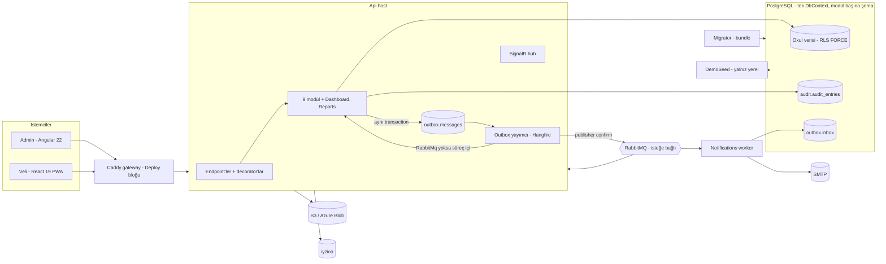

# v1.0.0 mimari incelemesi ve retrospektif (P5-07)

Bu belge, `v1.0.0` etiketinden önce mimarinin kod ve dokümanlara bakılarak yapılmış son incelemesidir. Sayıların kaynağı depodur
(`git log`, `gh pr list`, `grep`); ölçülemeyen yerde "ölçülmedi" yazılmıştır. Karar numaraları [karar günlüğü](karar-gunlugu-v2.md),
mimari ayrıntı [proje dokümanı](proje-dokumani.md) bölüm 5 ve [ADR'ler](adr/) içindedir. Yeni öneriler DEC-660 – DEC-663
(`Proposed`). Bu belge etiket atmaz ve faz geçişini işaretlemez; o sahibin işidir (P5-R2).

Özet sonuç:
- Modüler monolit bu ölçekte doğru seçimdi. Sınırlar **Application katmanında** testle korunuyor; **Domain ve Infrastructure
  katmanında** sınırı koruyan test yok ve oradaki sızıntılar kasıtlı ama yazıya dökülmemişti (bölüm 2).
- Gerçek veriden önceki asıl risk kod değil **karar ve operasyon**: veri konumu (ADR-0014), bütçe, hukuki inceleme, Deploy bloğu.
  Kod tarafında kalan en önemli işler küçük ve adı belli (bölüm 5).
- Süreç dersi: paylaşılan dokümanlar paralel PR'larda sürekli çakıştı; bunun yapısal bir çözümü önerildi (DEC-661).

## 1. v1.0.0'da neredeyiz

13 günde (2026-11-06 – 2026-11-18) `main`'de 107 commit ve 106 birleşmiş PR; dört etiket (`v0.1.0` – `v0.4.0`), beşinci faz
`v1.0.0` için hazırlanıyor. Bütün birleştirmeler squash.

### Bileşenler

| Katman | Ne var |
| --- | --- |
| Modüller | Domain modülleri dokuz: Tenancy, Identity, Organization, Groups, Students, Enrollments, Attendance, Billing, Announcements. Bunlara iki salt okunur modül (Dashboard, Reports) ve ortak parçalar (Audit, Realtime, Outbox, Messaging, Notifications, Storage, Caching, Jobs) eklenir. |
| Host'lar | `SporAkademi.Api` (HTTP, SignalR, Hangfire, outbox yayımı); bildirim worker'ı `SporAkademi.Notifications` (küçük web host: `/health/live`, `/health/ready`; yalnız `notifications` tüketici grubunu RabbitMQ'dan tüketir, `InfrastructureProfile.Worker` ile MFA anahtarı istemez, kendi imajı; P5-04, ADR-0017); migrator (EF migration bundle, ayrı imaj); `SporAkademi.DemoSeed` (yalnız yerel ve Production dışı). |
| Veri ve izolasyon | PostgreSQL 18, tek `DbContext`, modül başına şema, 26 migration. EF global filtre + yazma koruması, bileşik yabancı anahtarlar, tenant'lı unique index, **RLS (FORCE, her `tenant_id`'li tablo)**, kişisel veri audit log'u (`audit.audit_entries`, 2 yıl). Üç veritabanı rolü + ayrı salt okunur yedek rolleri. |
| Mesajlaşma | Transactional outbox (varsayılan: süreç içi teslim); `ConnectionStrings:RabbitMq` varsa RabbitMQ topic exchange, handler başına quorum kuyruğu, TTL'li yeniden deneme, dead-letter, `outbox.inbox` ile idempotent tüketici (ADR-0016). |
| İstemciler | Admin: Angular 22 (Okul Admini, antrenör, Platform Admin). Veli: React 19 + Vite PWA (ADR-0012). İkisi de commit'li OpenAPI belgesinden üretilmiş tipli istemci kullanır; TR/EN. |
| Altyapı | `infra/` OpenTofu (ADR-0015): Container Apps, PostgreSQL Flexible Server, Key Vault, Blob, Log Analytics; staging ve production. Henüz hiçbir kaynak oluşturulmadı. Belge deposu: S3 uyumlu (varsayılan) ya da Azure Blob. |
| CI kapıları | `backend`, `frontend`, `parent`, `e2e`, `a11y`, `repo-checks` (gitleaks, Trivy config, tema/i18n/kontrast, OpenTofu `fmt`/`validate`), `images` (api, migrator, admin, parent ve notifications imajları: smoke test, başlık denetimi, Trivy), `publish` (GHCR). Zorunlu check'ler: `backend`, `frontend`, `repo-checks`, `images`, `e2e`; `parent` ruleset'e eklenmeyi bekliyor. Zorunlu olmayan: `load-smoke`, haftalık `restore-drill`. |

Diyagramın iki notu: (1) RabbitMQ ve worker isteğe bağlıdır; ikisi de yokken sistem bugünkü gibi tek süreçte çalışır (DEC-620,
DEC-628). (2) Gateway, Azure'daki yerleşim `infra/` kodunda tanımlı, canlıda yok.

## 2. Modül sınırları incelemesi

**Soru: dokuz modül gerçekten bağımsız mı?** Kısa cevap: *derleme ve Application katmanında evet, veri katmanında bilerek hayır.*

### Sınırı koruyanlar (kanıt)

- `ModuleRulesTests.Application_modules_only_use_other_modules_through_contracts`: 11 modül için, bir modülün
  `SporAkademi.Application.<Modül>` tipleri başka modülün `Contracts` dışındaki hiçbir tipine bağımlı olamaz. Contracts altında
  28 dosya var (okuma arayüzleri `IStudentDirectory`, `IGroupDirectory`, `IBillingSummary`...; mesajlar `*Messages.cs`).
- Tek senkron komut: `Tenancy → IIdentityModule.CreateSchoolAdminAsync` (US-01 atomik; DEC-122). Başka modül komutu çağırmıyor.
- `LayerDependencyTests`: Domain hiçbir şeye, Application Infrastructure/Api'ye, Infrastructure Api'ye bağımlı değil.
- `Aggregates_of_school_modules_are_tenant_scoped`, `Handlers_are_internal_and_sealed`, `OutboxRulesTests` (mesajlar sürümlü,
  yalnız ilkel değer taşır), `NotificationRulesTests` (e-posta ve push yalnız outbox handler'larından).
- `NotificationsWorkerRulesTests`: worker host'u API'ye ve DemoSeed'e bağlanamaz, yalnız `notifications` grubunu tüketir, kendi telemetri süzgeci yoktur (DEC-634).
- `IgnoreQueryFilters` kodda **hiç kullanılmıyor** (sıfır yer; kural testte duruyor). RLS geldikten sonra ödeme webhook'unun
  okulu bulması `SECURITY DEFINER` fonksiyonla yapılıyor (DEC-523).
- Domain'de modüller birbirinin entity'sini tutmaz, yalnız **tipli ID** (`StudentId`, `GroupId`) taşır. Billing'in ödemesi
  `Enrollment` yerine küçük bir `PaidEnrollment` kaydı (ID'ler + tarihler) alır; ödeme domain'i kayıt aggregate'ına bağlı değil.

### Sınırın sızdığı yerler

| # | Sızıntı | Kanıt | Değerlendirme |
| --- | --- | --- | --- |
| 1 | **Test yalnız Application katmanına bakıyor.** `Modules` listesi 11 modül; `Audit` ve `Realtime` listede yok. Domain ve Infrastructure'daki modül sınırı için test yok. | `ModuleRulesTests.cs` (yalnız `Assemblies.Application`) | Gerçek boşluk. Aşağıdaki 2–4 hiçbir testi kırmıyor, çünkü bakılmıyor. DEC-660. |
| 2 | **Tek şema/tek DbContext ve modüller arası yabancı anahtar.** Billing, Attendance, Announcements ve Enrollments tabloları `students`/`groups`/`enrollments` tablolarına bileşik FK ile bağlı (`HasOne<Student>()`, `HasOne<Group>()`, `HasOne<Enrollment>()`). | `BillingPersistence.cs`, `AttendancePersistence.cs`, `AnnouncementsPersistence.cs`, `BillingRulesPersistence.cs` | **Kasıtlı.** Tek veritabanının tek büyük kazancı bu: okullar arası ve yetim referans veritabanında imkânsız (ADR-0003). Bedel: bir modülü ayrı veritabanına çıkarmak FK'leri kırar. Servis bölme planı şu an yok; bildirimler FK'sizdi. |
| 3 | **Infrastructure'da modüller arası doğrudan tablo okuma.** `Dashboard`, `Reports` (okuma modelleri), `StudentDataExportReadModel` (öğrenci verisi dışa aktarma; Attendance, Billing, Enrollments, Groups tablolarını okur), `Audit` (Identity ve Students) başka modüllerin entity'lerini `AppDbContext` üzerinden sorgular. | `Infrastructure/Dashboard`, `Reports`, `Students/StudentDataExportReadModel.cs`, `Audit` | Okuma modelleri için makul (CQRS'in okuma tarafı sınırı aşar); ama Contracts üzerinden değil. Dışa aktarma ve silme (KVKK) çok modülü kapsadığı için kaçınılmaz bir "çapraz kesen" modül. Bir modül şeması değişince bu dosyalar da kırılır; testi yok. |
| 4 | **Application'da başkalarının Domain tipleri.** Billing Application'ı 18, Students 14 dosyada başka modülün `Domain` namespace'ini kullanıyor (çoğu ID). | `grep Domain.<Modül> src/SporAkademi.Application` | ID'ler için kabul edilebilir "yayımlanmış dil"; ama kuralı koruyan test yok: yarın bir Billing handler'ı `Student` entity'sini kullanabilir. |
| 5 | **Domain event'leri aynı transaction'da, başka modülün consumer'ına.** Örnek: `UserDeactivated` Groups'ta antrenörü boşaltır (DEC-147), `StudentLeft` Enrollments'ta kaydı bitirir. | `IDomainEventConsumer<T>` uygulamaları | Tasarım gereği (ADR-0009): bu **bağlaşık** (coupled) bir modül iletişimidir, asenkron değil. Tutarlılık için doğru, ama bir modül çıkarılırsa bu çağrılar outbox'a çevrilmeli. |
| 6 | **Dokuz modülün tamamı aynı süreçte; paylaşılan veritabanı rolü.** Şema bazında yetki ayrımı yok (`spor_akademi_app` hepsine yazar). | ADR-0011 | Kabul edilmiş. Modül başına rol gerekirse RLS politikalarıyla birlikte yeniden düşünülür; şimdilik ihtiyaç yok. |
| 7 | **`Tenancy` herkesin bağımlılığı.** Hemen her modül `Domain.Tenancy` (`SchoolId`, `ITenantScoped`) kullanır. | Domain `using` sayımı | Fiilen paylaşılan çekirdek (shared kernel). Doğal, ama "dokuz bağımsız modül" ifadesi bunu gizliyor. |

Sonuç: **sınır disiplinli ama büyük ölçüde gelenek ve Application testiyle korunuyor.** Bağımsız dağıtılabilir dokuz servis
değil, dokuz klasörlü bir monolit; ve bu bilinçli. İlk (ve tek) çıkarılan parça bildirimler oldu, çünkü FK'si ve domain
bağımlılığı yoktu, yalnız outbox mesajı tüketiyordu. Sonraki aday varsa (ör. Reports) önce 3. satırdaki okuma modeli sızıntısı
çözülmelidir.

## 3. Kararlar geriye bakınca

| # | Karar | Ne olmuştu | Tutar mıyız? |
| --- | --- | --- | --- |
| 1 | **Modüler monolit, tek DB (ADR-0001, ADR-0003).** | Üç faz boyunca tek deploy işi basit tuttu; bileşik FK izolasyonu güçlendirdi; yük testi (300 eşzamanlı kullanıcı) okuma p95 12,9 ms, yazma p95 72,5 ms; iki API örneği arkasında da aynı. Bölmeyi gerektiren tek yük bildirimlerdi. | **Tutarız.** Servis bölme sıfırdan iyi gerekçelendirilmeli; tek örnekte kalma sınırı henüz görülmedi (`docs/performans.md`). |
| 2 | **MediatR, AutoMapper, dispatcher yok (ADR-0004; DEC-027 → DEC-046).** | Endpoint handler'ı doğrudan alır, decorator sırası Logging → Validation → Transaction. İki paket de ticari lisansa kayma riski taşıyordu; MassTransit v9 bunu RabbitMQ'da kanıtladı (ADR-0016). Bedel: elle mapping ve her handler için DI kaydı (Scrutor, `ValidateOnBuild`). | **Tutarız.** Dispatcher olmaması hata ayıklamayı kolaylaştırdı. Elle mapping tekrarı dayanılır; kod üretimi gerekmedi. |
| 3 | **`Result`/`Error` + sabit hata kodu (ADR-0007).** | Beklenen hata dönüş değeri, beklenmeyen exception; API sabit kod döner, çeviri istemcide. Çok dilli API hata metni (DEC-426) kolay eklendi. `IKeepChangesOnFailure` (DEC-113) gibi istisnalar gerekti (hatalı şifre sayacı). | **Tutarız.** Ek E'deki hata kodu sözleşmesi iki istemciyi bağımsız tuttu. |
| 4 | **RLS ikinci katman olarak, Faz 4'te (ADR-0003'ün uzantısı; DEC-520 – DEC-528).** | Filtre atlansa bile veritabanı korudu; ama sonradan eklemek pahalıydı: migration'lar `maintenance` anahtarı gerektirdi, anonim kimlik uçları için `UsesPlatformData` işareti, `SECURITY DEFINER` fonksiyonlar, yedek için `BYPASSRLS`'li ayrı rol. İnceleme bir hata yakaladı (DEC-526: başka okulun token'ı girişi bozuyordu). | **Tutarız, ama başından yapardık** (bölüm 4). Performans maliyeti pgbench'te var (öğrenci sayfası sorgusu 16 128 → 9 677 işlem/sn, her sorgu öncesi `set_config`); uçtan uca yük testinde bütçenin çok altında kaldı. |
| 5 | **Transactional outbox (DEC-300 – DEC-304), Faz 2.** | E-posta, belge silme, bildirimler commit sonrası, kayıpsız. Sonradan RabbitMQ taşıyıcı olarak outbox'ın altına girdi; sözleşme değişmedi. | **Tutarız.** Bu projenin en iyi yatırımlarından biri: P5-03 ve P5-04 ona dokunmadan eklendi. |
| 6 | **RabbitMQ yalnız isteğe bağlı (ADR-0016; DEC-620 – DEC-629).** | Broker yoksa süreç içi teslim aynen çalışır; testler gerçek broker ile (Testcontainers). Bedel: ~700 satır kendi yayımcı/tüketici kodu, MassTransit yok; at-least-once ve sıra garantisi yok. Azure'da barındırma sorulu (DEC-645). | **Tutarız, kararı ertelenmiş hâliyle.** Gerçek bir ihtiyaç doğana kadar broker zorunlu olmamalı. Production'da hangi taşıyıcı olacağı hâlâ açık (bölüm 5). |
| 7 | **Yalnız bildirimleri ayrı servise çıkarmak (P5-04, ADR-0017).** | E-posta tüketicileri worker'a gitti; SignalR push'ları API'de kaldı (hub bağlantısı API belleğinde). Worker brokersiz başlamaz. Yol boyunca `ConsumerCatalog`'un belge deposu ayarsız worker'ı düşürmesi gibi P5-03 hatası bulundu (DEC-636). | **Tutarız.** "Neden yalnız bu modül" cevabı net: FK'si yok, tek yönlü, dış sisteme bağlı. Ayrı süreç operasyon maliyeti getirdi (yeni imaj, yeni sağlık kontrolü, `InfrastructureProfile` ayrımı, telemetri gizlilik kodunun paylaşılması; bölüm 4, madde 5 ve 9); bildirim hacmi küçükken getirisi esas olarak **öğrenmek**; ölçüsüz büyütülmemeli. |
| 8 | **OpenTofu (ADR-0015, DEC-642).** | Terraform BSL-1.1, OpenTofu MPL-2.0; aynı HCL. CI'da sabit sürüm + SHA-256, sağlayıcı kilit dosyası. `apply` yok. | **Tutarız.** Sahip Terraform CLI isterse kod değişmez. Dikkat: `tofu validate` yerelde koşturulamadı; ilk gerçek doğrulama staging `plan` olacak. |
| 9 | **TOTP'yi kendimiz yazmak (DEC-600 – DEC-609).** | `HMACSHA1` üzerinde ~30 satır, paket yok; anahtar AES-256-GCM, kurtarma kodları hash'li; gerekçe: tedarik zinciri küçük kalır, RFC 6238 küçük, kriptografik primitif .NET'te hazır. Eksikleri: anahtar döndürme, kurtarma kodu yenileme, antrenör MFA'sı yok. | **Tutarız, "kendi kriptografimizi yazma" kuralına istisna olmadığını yazarak:** primitif yazılmadı, protokol yazıldı. Eksikler borç olarak listelendi (bölüm 5). |
| 10 | **Veli uygulaması React, admin Angular (DEC-024, ADR-0012).** | İki yığın, iki OpenAPI istemcisi, iki i18n sözlüğü, iki a11y/e2e takımı, tema token'larının elle kopyası (`check-theme-tokens.sh`), iki CI işi. Karşılığında mobil öncelikli, küçük PWA ve öğrenme hedefi. | **Öğrenme için tuttuk; ürün için tek yığın daha ucuz olurdu.** Sahip ürün sürdürülebilirliğini seçerse Faz 6'da veli uygulaması için yeniden değerlendirilir; şu an dokunulmaz. |
| 11 | **Bellekte access token + HttpOnly refresh, reuse detection (ADR-0006).** | Kaybolan yanıt için 30 sn tolerans (DEC-446) ve sekmeler arası `navigator.locks` gerekti; ortak bilgisayarda yanlış kullanıcıya token sızıntısı bulundu ve kapatıldı (DEC-447). Rol bazlı oturum süresi (P5-02) sonradan eklendi. | **Tutarız.** Karmaşıklığı ürettiği güvenceye değdi; ama oturum yönetimi projede en çok inceleme düzeltmesi çıkaran alandı (DEC-446, DEC-447, DEC-593, DEC-594). |
| 12 | **Elle migration disiplini: bundle, `Down` yok, expand–contract (ADR-0011).** | 26 migration; hiçbiri düzenlenmedi. Migrator imajının `ConnectionStrings__Migrator` desteklememesi ancak P5-06'da fark edildi (DEC-653). | **Tutarız.** Eksik: migration'ın bulutta çalıştığı bir kanıt henüz yok. |

Bir karar geri alınmadı, ama iki tanesi yeniden yazıldı: DEC-374 (kardeş indirimi geçmişi; inceleme sonrası), DEC-027 → DEC-046
(dispatcher). `Superseded` işaretli kararlar yalnız DEC-027, DEC-028 ve DEC-063; yani geri dönüş az oldu.

## 4. Neyi farklı yapardık

1. **RLS'i baştan.** Faz 4'te eklemek her tabloya `FORCE` politika, her migration'a bakım anahtarı, her anonim kimlik ucuna
   işaret, yedek için ayrı rol demekti ve inceleme bir okullar arası giriş hatası buldu (DEC-526). `tenant_id`'li ilk tablodan
   itibaren politika olsaydı `IgnoreQueryFilters` ve ham SQL tartışmaları hiç açılmazdı. Ders: izolasyon katmanı sonradan eklenen
   bir özellik değil, şemanın parçasıdır.
2. **Audit'i ilk gün.** Kişisel veri erişim kaydı Faz 4'te (P4-05) geldi; "okuma" kayıtları uç noktada elle beyan ediliyor.
   İlk günden ortak bir okuma beyanı (bugünkü `AuditedReads` yardımcısı) olsaydı, sonradan öğrenci, antrenör ve belge uç noktalarını tek tek gezmek gerekmezdi. Hâlâ yeni bir okuma uç noktası
   eklendiğinde audit unutulabilir; bunu yakalayan bir mimari test yok (bölüm 5, madde 10).
3. **Paylaşılan dokümanlarda çakışma.** `main`'in ilk 104 commit'inde `docs/roadmap.md` 62, `docs/karar-gunlugu-v2.md` 60,
   `CHANGELOG.md` 39, `docs/pazartesi-onay-listesi.md` 36 kez değişti; her PR bu dosyalara ekliyor. Faz 5'te yedi PR
   paralel gitti: DEC numaraları önceden bölündüğü için **numara** çakışmadı (iyi), ama **metin** çakışması her merge'de çıktı
   ve `git diff --name-only --diff-filter=U` kuralıyla elle çözüldü. Yapısal çözüm: dosya başına tek yazar yok, **PR başına
   küçük parça dosya** (ör. `docs/ekler/<PR>.md`: DEC satırları, CHANGELOG maddesi, onay listesi maddesi) ve sürüm
   hazırlığında tek PR ile birleştirmek. Öneri DEC-661'de.
4. **gitleaks'in `--all` sürprizi.** Her branch'i tarayan gitleaks, bir PR'ın test sabitinin (parola gibi görünen sentetik değer)
   main'i ve herkesin PR'ını kırmasına yol açtı (#139, #145; DEC-250 sonrası da). Çözüm brief'e girdi ("ilk push'tan önce
   allowlist ya da çalışma anında birleştir"), ama kural yazılıydı, ihlali ancak CI buldu. Ders: kuralı yalnız yazmak yetmez;
   `scripts/` altında bir yerel ön kontrol (push öncesi `gitleaks --all` benzeri) daha ucuzdu.
5. **Aynı kodun zayıf bir kopyası: telemetri temizleyicisi (P5-04, DEC-634).** Bildirim worker'ının ilk sürümünde API'nin
   telemetri temizleyicisinin daha zayıf, ayrı bir kopyası vardı: istisna olaylı span'ları, URL ve başlık temizliğini ve
   `RedactText`'i atlıyordu; Npgsql span'ları PostgreSQL hata metnini (değer ya da e-posta alıntılayabilen metin) OTLP'ye
   çıkarabilirdi. Kodu yazmayan bağımsız inceleme yakaladı. Düzeltme: `TelemetryScrubber`, `AccessTokenRedaction` ve Sentry
   gizlilik ayarları `SporAkademi.Infrastructure/Observability`'e taşındı, hem API hem worker aynı sınıfları kullanır ve
   mimari test (`The_worker_has_no_scrubbing_of_its_own`) worker'ın kendi süzgeci olmasını yasaklar. Ders: gizlilik gibi
   güvenlik kodunu "host'a özel" kopyalamak sessizce zayıflar; paylaş ve **kopyalanmasını testle yasakla**. Yeni host
   eklenirken API'den "neleri devralıyor" kontrol listesi gerekir.
6. **Faz sınırlarını erken netleştirmek.** Faz 0'ın "sunucu yokken deploy hazırlığı" yüzünden uzaması (proje dokümanı bölüm 14)
   Deploy bloğunu zamanlanmamış bıraktı (DEC-094); Faz 5'te de bulut hesabı yok. Sonuç: altyapı kodu ve runbook hazır ama
   hiçbiri gerçek bir ortamda koşmadı. Kod doğrulanmamış varsayımlar içeriyor (`ForwardLimit=2`, Flexible Server'da
   `pg_restore`, Azure Files üstünde RabbitMQ). Bir sonraki sefer, sunucu/hesap kararı verilmeden altyapı koduna bu kadar
   yatırım yapmazdık ya da en azından tek bir canlı "hello" ortamı isterdik.
7. **Dokümanlar kodla birlikte eskidi.** Proje dokümanı 5.10 hâlâ "tek VPS + Caddy" yapısını planlanan olarak anlatıyor,
   Azure kodu varken; ADR dizini (bölüm 7) 0010'u "Yazılacak" gösteriyor (dosya Accepted), 0014 ve 0015'i hiç içermiyordu;
   5.4 "faz 4'te RLS" diyordu. Çakışma kaçınmak için dokunulmayan bölümler eskidi. Bu PR bunların küçüklerini düzeltiyor;
   gerisi sürüm hazırlığına.
8. **Test piramidi dengeli ama e2e ince.** 18 e2e akışı (+ a11y); P5-02 (oturum süresi) ve MFA için e2e eklenmedi. Güvenlik
   özellikleri entegrasyon testiyle kanıtlı; gerçek tarayıcıda "30 dk sonra yenilemede ne görünür" kanıtsız (DEC-613).

9. **Bir host için doğrulama, hepsine gitti: MFA anahtarı ve worker smoke testi.** MFA birleşince `AddInfrastructure` MFA anahtarını
   her host'ta doğruluyordu; anahtarı bilmeyen (ve kimseyi oturum açtırmayan) bildirim worker'ının imaj smoke testi
   kırıldı. Çözüm `InfrastructureProfile` ayrımı oldu (`Full`: API ve DemoSeed; `Worker`: MFA anahtarı ve politikası yok,
   `IAccessTokenIssuer` fırlatır). Ders: ortak DI, "bütün host'lar aynı şeyi ister" varsayar; ikinci host eklenir eklenmez
   bu varsayım sınanır. Paylaşılan kayıt yöntemi baştan hangi host'a ait olduğunu söylemeli ve her host için ayrı bir
   smoke test CI'da koşmalı (artık koşuyor).
10. **Düzeltmesi olmayan bir güvenlik uyarısı bütün PR'ları kırdı: npm audit.** Yamalı sürümü olmayan yeni bir advisory
    (picomatch ReDoS, GHSA-fc5q-39xc-vjpf) `frontend` ve `parent` audit adımlarını bir gecede kırmızı yaptı. Politikayı
    gevşetmek yerine süreli ve katı bir istisna listesi eklendi (bitiş 2026-12-17; DEC-670, DEC-671, #177). Ders: "high
    ve üstü kırar" kuralı dış dünyaya karşı tek başına kırılgan; baştan süreli istisna mekanizması olsaydı bir gün
    kaybedilmezdi.

## 5. Açık teknik borç ve riskler

Öncelik: **K** = gerçek veriden önce kapanmalı, **O** = Deploy bloğunda/ilk ayda, **D** = sonraya bırakılabilir.
Boyut: **S** < 1 gün, **M** 1–3 gün, **L** > 3 gün ya da dış bağımlılık. Kaynak: [onay listesi](pazartesi-onay-listesi.md).

| # | Öncelik | Madde | Sahip | Boyut |
| --- | --- | --- | --- | --- |
| 1 | K | **Veri konumu kararı (ADR-0014) ve Azure bölgesi.** Azure'da Türkiye bölgesi yok (DEC-649); Azure demek ADR-0014'te seçenek B (AB'de barındırma, standart sözleşme, Kurul bildirimi, aydınlatmada aktarım). Karar verilmeden gerçek veri girilemez. | Sahip (+ hukuk) | S (karar) / L (süreç) |
| 2 | K | **Hukuki inceleme.** Aydınlatma metni taslağı (DEC-543), saklama süresi 24 ay/10 yıl (DEC-360), silme/anonimleştirme, çocuk ve sağlık verisi için veri işleme sözleşmeleri. | Sahip (+ hukuk) | L |
| 3 | K | **Deploy bloğu.** Sunucu/abonelik, alan adı, uzak `tofu` state, Key Vault sırları (`conn-app`, `conn-migrator`, `mfa-encryption-key`, `jwt-signing-key`), SMTP/SPF/DKIM, Caddy'de `/hubs` ve `access_token` log temizliği, canlı iyzico, günlük yedek zamanlayıcısı. Hiçbir faz geçişi buna bağlı değil (DEC-094) ve hiçbiri gerçek ortamda denenmedi. | Sahip | L |
| 4 | K | **`ForwardedHeaders:ForwardLimit` doğrulaması staging'de (DEC-651, runbook bölüm 8).** `2` bir varsayım: iki ağdan deneme yapılmazsa rate limit ve hesap kilidi tek kova olur ya da IP taklit edilebilir. Yanlışsa yalnız ayar değişir. | Yazılımcı + sahip | S |
| 5 | K | **MFA anahtar yönetimi (DEC-602).** `Mfa:EncryptionKey` production'da ayrı verilmeli (yoksa JWT anahtarından türer: JWT anahtarını döndürmek bütün MFA sırlarını geçersiz kılar). `infra/` uygulama sırlarında `Mfa__EncryptionKey` tanımlı. **Anahtar döndürme** (eskiyle çöz, yeniyle şifrele) yok. | Yazılımcı | M |
| 6 | K | **Bütçe.** Tahmin ~89 USD/ay (staging ~27 + production ~62), NFR-CST-01 hedefi 20 USD; RabbitMQ/Redis açılınca ~114, Container Apps "ortam yönetimi" kalemi doğrulanamadı (+146 olabilir). Sahip kabul etmez ya da tek VPS'e dönerse `infra/` bırakılır. | Sahip | S (karar) |
| 7 | O | **`BYPASSRLS`'li yedek rolü (DEC-571, DEC-522'ye istisna).** Yönetilen PostgreSQL'de böyle bir rol verilebilir mi, doğrulanmadı; verilemezse yedek stratejisi (Azure yerleşik yedek, `pg_dump` ayrı) yeniden tasarlanır. | Yazılımcı + sahip | M |
| 8 | O | **Kurtarma kodu yenileme yok (P5-01).** Kodlar bitince MFA kapatılıp açılır ya da Platform Admin sıfırlar. Antrenör MFA'sı ve "güvenilir cihaz" yok (DEC-604). Platform Admin için sıfırlama düğmesi listede yok (API var), hedef başka Platform Admin ise audit girdisi yok (DEC-605). | Yazılımcı | M |
| 9 | O | **RabbitMQ'nun production'daki yeri (DEC-645, ADR-0016).** Azure Files'lı tek kopya (kırılgan olabilir) / kendi VM'i / yönetilen servis. Bildirim worker'ı brokersiz başlamaz; yani mesajlaşmayı açmak e-postayı açmaktır. Çift e-posta (at-least-once) ve ölü mektup kuyruğunun elle işlenmesi kabul edildi mi, sahipten teyit. | Sahip + yazılımcı | M |
| 10 | O | **Mimari test boşlukları.** (a) ~~Modül sınırı testi Domain/Infrastructure'ı ve `Audit`, `Realtime`'ı kapsamıyor~~ **yapıldı (V1-02, `ModuleBoundaryRulesTests`, DEC-682, DEC-684)**; (b) yeni bir okuma uç noktasının audit beyanını yoklayan test yok. (RLS politikasını unutmayı `RowLevelSecurityTests.Every_table_forces_row_level_security...` yakalıyor.) DEC-660. | Yazılımcı | M |
| 11 | O | **Mesajlaşma izi ve sıra (DEC-625, DEC-629).** İz, mesajı üreten istekten değil teslim işinden başlıyor (outbox satırına trace context yazmak migration ister); sıra garantisi yok (bugünkü handler'lar yalnız ID taşıdığı için sorun değil). | Yazılımcı | M |
| 12 | O | **Oturum süresi eksikleri (P5-02, DEC-611, DEC-613).** Politika `SessionPolicy`: yönetici ve antrenör oturumu 12 saat mutlak, 30 dk hareketsizlik, erişim token'ı `min(15 dk, oturum sonu - şimdi)` ile kesilir (DEC-610); veli 7/30 gün. Hareketsizlik yenilemeden ölçülür (`issued_at`; fiilen 15–30 dk); 30 dk sonra çerez düştüğü için yenilemede iletisiz giriş sayfası; e2e yok. | Yazılımcı | S |
| 13 | O | **iyzico gerçek sandbox koşusu** ve detay yanıtı imzası doğrulaması (DEC-345): adaptör yalnız sahte HTTP ile test edildi. | Sahip + yazılımcı | S |
| 14 | O | **E2E'de MFA ve oturum süresi akışı** (bölüm 4, madde 8). | Yazılımcı | M |
| 15 | O | **Gerçek ekran okuyucuyla elle WCAG turu** (`erisilebilirlik-denetimi.md`): otomatik tarama var, insan turu yok. | Sahip | S |
| 16 | D | **Çözüldü (#200).** ~~`npm audit` istisnası: picomatch ReDoS (GHSA-fc5q-39xc-vjpf), bitiş 2026-12-17.~~ `npm audit` artık bulguyu raporlamadığı için PR #200 `.github/npm-audit-allowlist.json` kaydını kaldırdı. Eski açıklama: `.github/npm-audit-allowlist.json`'daki tek kayıt (#177); yamalı sürüm yoksa kayıt süresi dolunca CI kırılır. O gün yamalı sürüme geçilmeli ya da süre bilinçli uzatılmalı. | Yazılımcı (takvim: sahip) | S |
| 17 | D | **Tek kod tabanı, iki istemci yığını** (bölüm 3, madde 10) ve tema token kopyası. | Sahip (karar) | L |
| 18 | D | **Okul başına alt alan adı (ADR-0013) ertelendi;** çok okul büyürse tenant'ın token'dan çözülmesi sınırlayıcı olabilir. | Sahip | M |
| 19 | D | **Özel uç nokta (private endpoint)** Key Vault ve belge deposu için (DEC-641, ~7 USD/ay); şimdilik RBAC + kısa ömürlü SAS ile kabul. | Sahip + yazılımcı | M |
| 20 | D | **Yapıldı (V1-01, #201).** Proje dokümanı üst satır, 5.1, 5.10, 8, 12, Ek F ve Ek G güncellendi; `bulut-altyapisi.md` ve Pazartesi onay listesindeki sayılar düzeltildi. Eski açıklama: **Proje dokümanı 5.10 ve 8 güncel değil** (bölüm 4, madde 7); sürüm hazırlığında topluca (5.12 #174 ile geldi; ADR dizinine 0017 bu PR'da eklendi). | Yazılımcı | S |

Gerçek veri için **asgari yol** (K'lerin hepsi): 1 → 2 → 3 (staging dahil) → 4 → 5 → 6. O'lar ilk production ayında,
D'ler isteğe göre. Hiçbir madde yeni özellik gerektirmiyor; en büyük belirsizlik kod değil, 1–3 numaralı kararlar.

## 6. Metrikler

Kaynak: depo, 2026-11-18 (`main`, #174, #175 ve #177 sonrası, bu PR öncesi). `[Fact]` ve `[Theory]` satır sayısıdır; bir `[Theory]` birden çok veri satırı
çalıştırır, yani gerçek test sayısı bunun üstündedir. Çalıştırılmış toplam burada ölçülmedi.

| Proje | `[Fact]` | `[Theory]` |
| --- | --- | --- |
| Domain.UnitTests | 261 | 49 |
| Application.UnitTests | 60 | 23 |
| ArchitectureTests | 31 | 3 |
| IntegrationTests (Testcontainers, gerçek PostgreSQL) | 790 | 76 |
| **Backend toplamı** | **1142** | **151** |

| Alan | Değer |
| --- | --- |
| İstemci birim testleri | admin 60 spec dosyası, parent 15 test dosyası; ikisinde toplam ~640 `it(`/`test(` |
| E2E (Playwright, `web/admin/e2e`) | 18 akış testi + a11y paketi (38 ekran, TR/EN, açık/koyu, masaüstü/360 px) |
| Kod (satır, `src/`, migration hariç) | ~36 bin; test ~31 bin |
| Migration | 26 |
| Karar günlüğü | 96 (proje dokümanı) + 353 (`karar-gunlugu-v2.md`) = 449 DEC; v2'de 210 Accepted, 143 Proposed; `Superseded` işaretli üç karar proje dokümanında (DEC-027, DEC-028, DEC-063) |
| ADR | 0001 – 0009 proje dokümanı Ek F'de; dosya olarak 0010, 0012 – 0017; Proposed: 0014, 0015, 0016, 0017 |
| Tarih | ilk commit 2026-11-06; `v0.1.0` 2026-11-07 (etiket geriye dönük 11-13), `v0.2.0` 2026-11-11, `v0.3.0` 2026-11-13, `v0.4.0` 2026-11-16; Faz 5 2026-11-17 – 2026-11-18 |
| Git | 107 commit, 106 birleşmiş PR (`main`, bu PR hariç) |
| CI işleri | 8 (`backend`, `frontend`, `parent`, `e2e`, `a11y`, `repo-checks`, `images`, `publish`) + 2 zorunlu olmayan workflow |
| Performans (yerel, sentetik; `docs/performans.md`) | 300 eşzamanlı kullanıcı: okuma p95 12,9 ms, yazma p95 72,5 ms, hata %0 |
| Geri yükleme (yerel, 393 MB) | tam yedek 19,6 sn, PITR 19,5 sn (production süresi değil) |

Faz başına öğe sayısı roadmap'tedir; yük ve süre ölçümleri sentetik veri ve tek makinedir, production'a taşınmamalıdır.

## 7. Sahibin v1.0.0 için vereceği kararlar

Ayrıntı ve gerekçe: [onay listesi bölüm 12, P5-07](pazartesi-onay-listesi.md). Kısaca: veri konumu (madde 1), hukuki inceleme
(2), bütçe (6), Deploy bloğu ve staging doğrulamaları (3, 4), `v1.0.0` etiketinin neyi *kapsadığı* (DEC-662), paylaşılan
doküman akışı (DEC-661) ve mimari test boşluklarının kapatılması (DEC-660).
